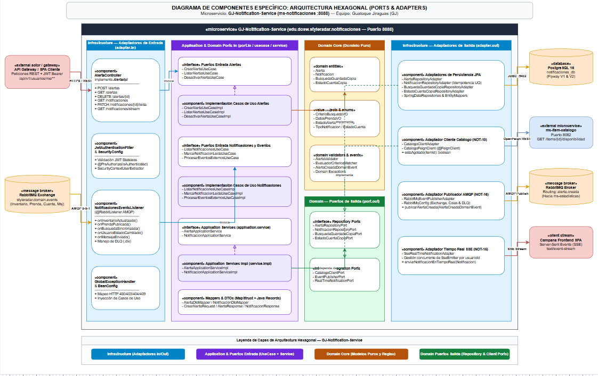
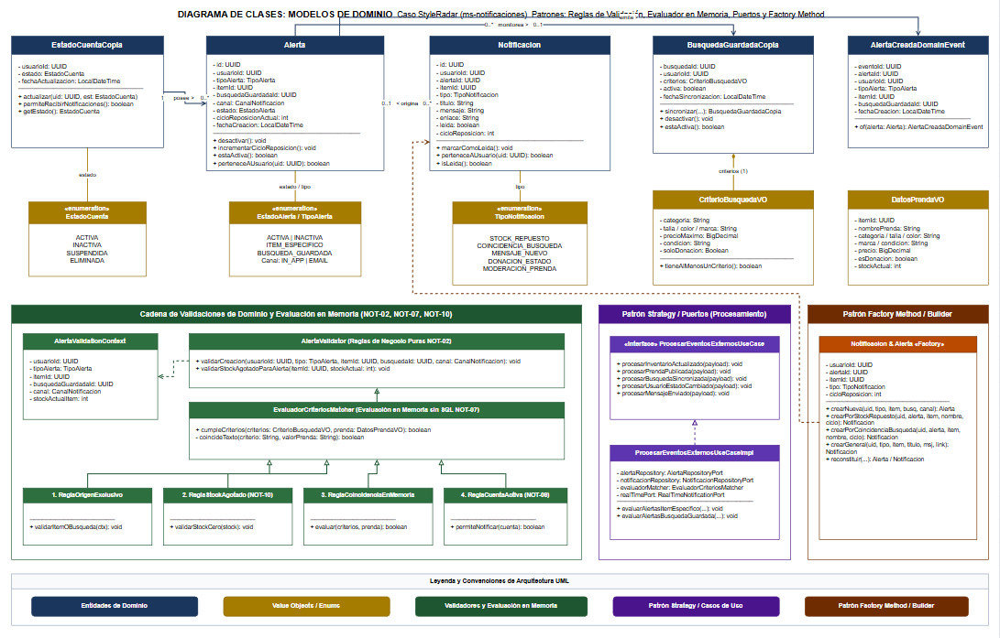
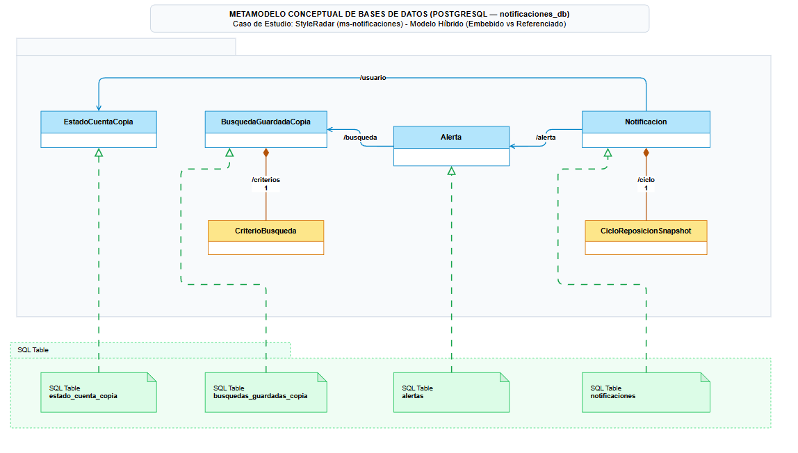
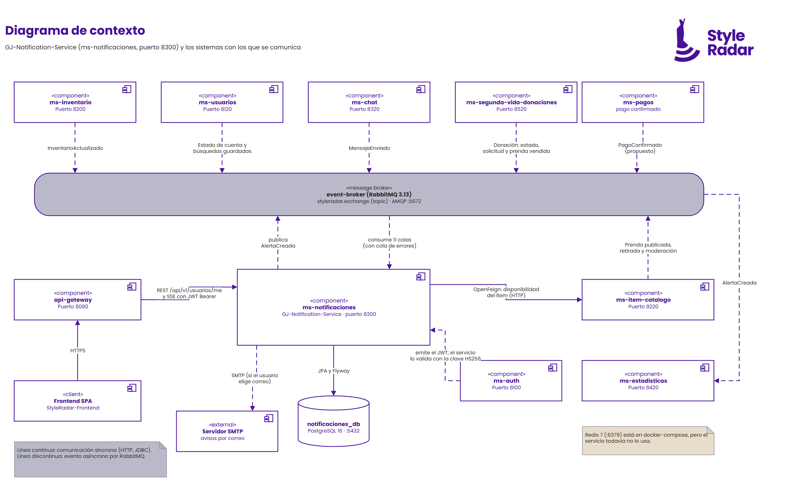
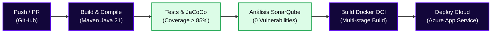

<div align="center">

  <a href="https://github.com/StyleRadar1">
    
  </a>

  <h1>STYLE<font color="#5600EF">RADAR</font> &nbsp;·&nbsp; <code>GJ-Notification-Service</code></h1>

  <p align="center">
    
    
  </p>

  <p align="center">
    
    
    
  </p>

  <p align="center">
    <strong><font color="#5600EF">Descubre tu estilo. En tu ciudad.</font></strong><br />
    <em>Plataforma de moda local con inventario multi-sede geolocalizado en tiempo real y probador virtual para Bogotá.</em>
  </p>

  <p align="center">
    <a href="https://github.com/StyleRadar1/GJ-Notification-Service/actions/workflows/ci-qa.yml">
      
    </a>
    <a href="https://styleradar-backend-prod.azurewebsites.net/swagger-ui/index.html">
      
    </a>
    <a href="https://styleradar-backend-qa.azurewebsites.net/swagger-ui/index.html">
      
    </a>
    <a href="https://sonarcloud.io/organizations/styleradar">
      
    </a>
    <a href="target/site/jacoco/index.html">
      
    </a>
    <a href="#6-tecnologías-y-dependencias">
      
    </a>
    <a href="#6-tecnologías-y-dependencias">
      
    </a>
    <a href="#7-cómo-ejecutar-local-y-con-docker">
      
    </a>
  </p>

</div>


---

##  ÍNDICE DE CONTENIDOS

1. [Nombre del servicio y su bounded context](#1-nombre-del-servicio-y-su-bounded-context)
2. [Equipo y responsables](#2-equipo-y-responsables)
3. [Arquitectura hexagonal con su diagrama](#3-arquitectura-hexagonal-con-su-diagrama)
4. [Endpoints y enlace a Swagger](#4-endpoints-y-enlace-a-swagger)
5. [Eventos que publica y consume](#5-eventos-que-publica-y-consume)
6. [Tecnologías y dependencias](#6-tecnologías-y-dependencias)
7. [Cómo ejecutar local y con Docker](#7-cómo-ejecutar-local-y-con-docker)
8. [Variables de entorno](#8-variables-de-entorno)
9. [Pruebas y cobertura](#9-pruebas-y-cobertura)
10. [CI/CD con el badge del pipeline](#10-cicd-con-el-badge-del-pipeline)
11. [Ramas y cómo contribuir](#11-ramas-y-cómo-contribuir)
12. [Enlace a la épica en Jira](#12-enlace-a-la-épica-en-jira)

---

<a id="1-nombre-del-servicio-y-su-bounded-context"></a>

##  1. NOMBRE DEL SERVICIO Y SU BOUNDED CONTEXT

* **Identificador de Servicio:** `ms-notificaciones` (`GJ-Notification-Service`)
* **Paquete Arquitectónico:** `Paquete 3: Notificaciones y Chat`
* **Puerto de Escucha Oficial:** `8300` (definido en la matriz de puertos sin colisión)
* **Base de Datos Asignada:** `PostgreSQL 16` (`notificaciones_db`), aislada bajo el patrón *Database-per-Service*.
* **Bounded Context:** `Notificaciones, Alertas de Disponibilidad y Tiempo Real`

### Responsabilidades del Dominio

Este microservicio encapsula exclusivamente la lógica de negocio correspondiente a `Notificaciones, Alertas de Disponibilidad y Tiempo Real`.

| Qué HACE este Microservicio (Alcance)                             | Qué NO HACE este Microservicio (Límites)                                          |
| :----------------------------------------------------------------- | :---------------------------------------------------------------------------------- |
| • Gestiona alertas de prendas agotadas (`ITEM_AGOTADO`) y búsquedas guardadas (`BUSQUEDA_GUARDADA`) validando stock contra `ms-item-catalogo`. | • NO autentica credenciales ni emite tokens iniciales (delegado a `ms-auth` en `:8100`). |
| • Evalúa en memoria coincidencias entre eventos (`InventarioActualizado`, `PrendaPublicada`) y copias locales de búsquedas guardadas sin hacer SQL cruzado. | • NO gestiona transacciones monetarias ni pasarelas (delegado a `ms-pagos-suscripciones` en `:8400`). |
| • Sincroniza copias locales de búsquedas guardadas y estados de cuenta (`ACTIVO`, `INACTIVO`, `BLOQUEADO`) mediante eventos asíncronos. | • NO persiste conversaciones ni historial de mensajes STOMP (delegado a `ms-chat` en `:8320`). |
| • Entrega notificaciones generalizadas (stock, mensajes, donaciones, moderación) y emite actualizaciones en tiempo real mediante Server-Sent Events (SSE). | • NO accede directamente a tablas ni bases de datos de otros microservicios (cero llaves foráneas externas). |
| • Garantiza persistencia ACID e idempotencia mediante la restricción única `(alerta_id, item_id, ciclo_reposicion)` y desvío de fallos a Dead Letter Queue (`SR-RNF-15`). | • NO modifica el inventario ni el catálogo maestro de prendas. |

### Arquetipos de Moda y Personajes de StyleRadar (Pendiente actualizaciones de front)

> *(Pendiente actualizaciones de front — El equipo de frontend se encuentra modificando los arquetipos y componentes visuales)*

<div align="center">

| Antonia (Sastre) | Mateo (Calle) | Aura (Futuro) | Nora (Rebelde) | Tomás (Esencial) |
| :---: | :---: | :---: | :---: | :---: |
| <br>**Sastre**<br><sub>Tiendas & Descubrimiento</sub> | <br>**Calle**<br><sub>Playlists & Cultura Urbana</sub> | <br>**Futuro**<br><sub>Probador Virtual AI</sub> | <br>**Rebelde**<br><sub>Segunda Vida & Vintage</sub> | <br>**Esencial**<br><sub>Fundaciones & Donaciones</sub> |

</div>

---

<a id="2-equipo-y-responsables"></a>

##  2. EQUIPO Y RESPONSABLES

Desarrollado y mantenido por el **Squad `Paquete 3 · Notificaciones y Chat`** para la asignatura DOSW 2026.

<div align="center">

| Rol | Nombre Completo |
| :---: | :---: |
| **Líder de Squad** | `Paula Diaz` |
| **Líder de Backend** | `Jose Martinez` |
| **Desarrollo Microservicio Notificaciones** | `Oscar Lasso` |

</div>

---

<a id="3-arquitectura-hexagonal-con-su-diagrama"></a>

##  3. ARQUITECTURA HEXAGONAL CON SU DIAGRAMA

El microservicio implementa **Arquitectura Hexagonal (Puertos y Adaptadores)** combinada con **Domain-Driven Design (DDD)**. El núcleo de negocio permanece 100% puro y aislado de frameworks, bases de datos o brokers de mensajería.

### Diagrama Interactivo de Capas (Mermaid)

```mermaid
flowchart LR
    %% Clientes y Actores Externos
    subgraph EXT_IN["Entrada Externa"]
        CLIENT["Cliente / SPA<br>REST + JWT"]
        BROKER_IN["RabbitMQ Broker<br>Eventos Externos"]
    end

    %% Capa de Infraestructura - Adaptadores de Entrada
    subgraph ADAPTERS_IN["Infraestructura: Entrada"]
        REST_CTRL["AlertaController<br>& AlertaApi"]
        AMQP_LISTENER["NotificacionesEventsListener<br>(Consumer + DLQ)"]
    end

    %% Capa de Aplicacion
    subgraph APPLICATION["Capa de Aplicación"]
        USE_CASES["Casos de Uso (Puertos In)<br>• CrearAlertaUseCase<br>• ListarAlertasUseCase<br>• DesactivarAlertaUseCase<br>• ListarNotificacionesUseCase<br>• MarcarNotificacionLeidaUseCase<br>• ProcesarEventosExternosUseCase"]
        APP_SERVICES["Servicios de Aplicación<br>• AlertaApplicationService<br>• NotificacionApplicationService"]
    end

    %% Núcleo de Dominio Puro
    subgraph DOMAIN["Núcleo de Dominio (Puro)"]
        ENTITIES["Entidades de Dominio<br>• Alerta<br>• Notificacion<br>• BusquedaGuardadaCopia<br>• EstadoCuentaCopia"]
        RULES["Reglas y Matcher en Memoria<br>• AlertaValidator<br>• EvaluadorCriteriosMatcher<br>• AlertaCreadaDomainEvent"]
    end

    %% Puertos de Salida
    subgraph PORTS_OUT["Puertos de Salida (SPI)"]
        P_REPOS["Repository Ports<br>• AlertaRepositoryPort<br>• NotificacionRepositoryPort<br>• BusquedaGuardadaPort<br>• EstadoCuentaPort"]
        P_EXT["Integration Ports<br>• CatalogoClientPort<br>• EventPublisherPort<br>• RealTimeNotificationPort"]
    end

    %% Adaptadores de Salida
    subgraph ADAPTERS_OUT["Infraestructura: Salida"]
        JPA_ADAPTER["Adaptadores JPA<br>PostgreSQL 16 (Flyway)"]
        FEIGN_ADAPTER["CatalogoClientAdapter<br>OpenFeign (:8220)"]
        AMQP_ADAPTER["RabbitMqEventPublisher<br>(Exchange Topic)"]
        SSE_ADAPTER["SseNotificationAdapter<br>(Campana Tiempo Real)"]
    end

    %% Destinos Externos
    subgraph EXT_OUT["Destinos Externos"]
        DB[(PostgreSQL 16<br>notificaciones_db)]
        CATALOGO["ms-item-catalogo<br>(Validación Stock)"]
        ESTADISTICAS["ms-estadisticas<br>(AlertaCreada)"]
        SSE_CLIENT["Campana Frontend<br>(text/event-stream)"]
    end

    %% Flujo de Invocación
    CLIENT --> REST_CTRL
    BROKER_IN --> AMQP_LISTENER

    REST_CTRL --> USE_CASES
    AMQP_LISTENER --> USE_CASES

    USE_CASES --> APP_SERVICES
    APP_SERVICES --> DOMAIN
    APP_SERVICES --> P_REPOS
    APP_SERVICES --> P_EXT

    P_REPOS -.-> JPA_ADAPTER
    P_EXT -.-> FEIGN_ADAPTER
    P_EXT -.-> AMQP_ADAPTER
    P_EXT -.-> SSE_ADAPTER

    JPA_ADAPTER --> DB
    FEIGN_ADAPTER --> CATALOGO
    AMQP_ADAPTER --> ESTADISTICAS
    SSE_ADAPTER --> SSE_CLIENT

    %% Estilos de Alta Claridad y Contraste
    classDef ext fill:#F1F5F9,stroke:#64748B,stroke-width:1.5px,color:#0F172A;
    classDef infra fill:#E0F2FE,stroke:#0284C7,stroke-width:2px,color:#0369A1;
    classDef app fill:#F3E8FF,stroke:#7C3AED,stroke-width:2px,color:#5B21B6;
    classDef dom fill:#FEF3C7,stroke:#D97706,stroke-width:2px,color:#92400E;

    class EXT_IN,EXT_OUT,CLIENT,BROKER_IN,DB,CATALOGO,ESTADISTICAS,SSE_CLIENT ext;
    class ADAPTERS_IN,ADAPTERS_OUT,REST_CTRL,AMQP_LISTENER,JPA_ADAPTER,FEIGN_ADAPTER,AMQP_ADAPTER,SSE_ADAPTER infra;
    class APPLICATION,PORTS_OUT,USE_CASES,APP_SERVICES,P_REPOS,P_EXT app;
    class DOMAIN,ENTITIES,RULES dom;
```



### Diagramas Oficiales del Microservicio (Draw.io & UML)

> **Regla de Oro de Ingenieria StyleRadar:** Todo diagrama arquitectonico esta respaldado por su archivo fuente editable `.drawio`, su imagen y su justificacion tecnica documentada en [docs/DIAGRAMAS_NOT20.md](docs/DIAGRAMAS_NOT20.md).

#### 1. Diagrama de Componentes con Arquitectura Hexagonal (Especifico)
* **Archivo Editable Draw.io:** [`docs/uml/diagrama-componentes-especifico.drawio`](docs/uml/diagrama-componentes-especifico.drawio)
* **Documentacion y Justificacion Tecnica:** [docs/DIAGRAMAS_NOT20.md (Seccion 2)](docs/DIAGRAMAS_NOT20.md#2-diagrama-de-componentes-específico-arquitectura-hexagonal)
* **Descripcion:** Modela adaptadores de entrada (Driving: REST Controller, RabbitMQ Listener), la capa de aplicacion (Input Ports, Use Cases, Application Services, DTOs, Mappers), el nucleo de dominio puro (Modelos, Value Objects, Domain Events, Validadores) y adaptadores de salida (Driven: JPA Repositories, Feign Client, Event Publisher, SSE Adapter).

<p align="center">
  <a href="docs/images/diagrama-componentes-especifico.png" target="_blank">
    
  </a>
</p>

---

#### 2. Diagrama de Clases (Modelo de Dominio y Patrones de Diseno)
* **Archivo Editable Draw.io:** [`docs/uml/diagrama-clases.drawio`](docs/uml/diagrama-clases.drawio)
* **Documentacion y Justificacion Tecnica:** [docs/DIAGRAMAS_NOT20.md (Seccion 3)](docs/DIAGRAMAS_NOT20.md#3-diagrama-de-clases-modelo-de-dominio)
* **Descripcion:** Modela las entidades de dominio (`Alerta`, `Notificacion`, `BusquedaGuardadaCopia`, `EstadoCuentaCopia`), Value Objects (`CriterioBusquedaVO`, `DatosPrendaVO`), Enumeraciones (`TipoAlerta`, `TipoNotificacion`, `CanalNotificacion`, `EstadoAlerta`, `EstadoNotificacion`) y los 3 patrones de diseno implementados (Cadena de Responsabilidad para validaciones, Strategy para matching de criterios y Factory para creacion de notificaciones).

<p align="center">
  <a href="docs/images/diagrama-clases.png" target="_blank">
    
  </a>
</p>

---

#### 3. Diagrama de Base de Datos (Modelo Relacional / ER - PostgreSQL 16)
* **Archivo Editable Draw.io:** [`docs/uml/diagrama-base-datos.drawio`](docs/uml/diagrama-base-datos.drawio)
* **Documentacion y Justificacion Tecnica:** [docs/DIAGRAMAS_NOT20.md (Seccion 4)](docs/DIAGRAMAS_NOT20.md#4-diagrama-de-base-de-datos-metamodelo-conceptual-y-físico)
* **Descripcion:** Modela el metamodelo conceptual hibrido (entidades de dominio frente a Value Objects embebidos vs referenciados por UUID) y el esquema relacional fisico de PostgreSQL 16 gestionado por Flyway (`alertas`, `notificaciones`, `busquedas_guardadas_copia`, `estados_cuenta_copia`, indices B-Tree y restricciones FK/Unique).

<p align="center">
  <a href="docs/images/diagrama-base-datos.png" target="_blank">
    
  </a>
</p>

---

#### 4. Diagrama de Contexto del Sistema (C4 L1)
* **Archivo Editable Draw.io:** [`docs/uml/diagrama-contexto.drawio`](docs/uml/diagrama-contexto.drawio)
* **Documentacion y Justificacion Tecnica:** [docs/DIAGRAMAS_NOT20.md (Seccion 1)](docs/DIAGRAMAS_NOT20.md#1-diagrama-de-contexto-del-sistema-nivel-c4---l1)
* **Descripcion:** Delimita la frontera del microservicio y sus interacciones con API Gateway, frontend SPA, broker RabbitMQ (`styleradar.domain.events`), microservicio de catalogo (via OpenFeign), microservicio de identidad, donaciones, mensajes y microservicio de estadisticas.

<p align="center">
  <a href="docs/images/diagrama-contexto.png" target="_blank">
    
  </a>
</p>

---

#### 5. Diagrama de Despliegue (Topologia Azure & Docker Hub)
* **Archivo Editable Draw.io:** [`docs/uml/diagrama-despliegue.drawio`](docs/uml/diagrama-despliegue.drawio)
* **Documentacion y Justificacion Tecnica:** [docs/DIAGRAMAS_NOT20.md (Seccion 5)](docs/DIAGRAMAS_NOT20.md#5-diagrama-de-despliegue)
* **Descripcion:** Modela la topologia de ejecucion y despliegue continuo: estacion de desarrollo, pipeline de CI/CD en GitHub Actions, repositorio de imagenes en Docker Hub (`styleradar/ms-notificaciones`), y ambientes de ejecucion en Azure App Service (QA en Linux B1ms y Produccion en cluster P1v3 con autoscaling y replicas PostgreSQL).

### Estructura Oficial de Paquetes en `src/main/java/`

```text
src/main/java/edu/dosw/styleradar/notificaciones/
├── NotificacionesApplication.java           <-- Punto de entrada Spring Boot + @EnableFeignClients
├── domain/                                  <-- NÚCLEO DE DOMINIO (Cero dependencias de Spring/JPA)
│   ├── model/                               <-- Alerta, Notificacion, BusquedaGuardadaCopia, EstadoCuentaCopia, VO y Enums
│   ├── validator/                           <-- AlertaValidator y EvaluadorCriteriosMatcher (matching en memoria)
│   ├── event/                               <-- AlertaCreadaDomainEvent
│   ├── exception/                           <-- Excepciones semánticas de negocio
│   └── port/
│       ├── in/                              <-- Interfaces de Casos de Uso (CrearAlerta, Listar, Desactivar, ProcesarEventos)
│       └── out/                             <-- Interfaces SPI (Repositorios, CatalogoClientPort, EventPublisherPort, SSE)
├── application/                             <-- CAPA DE APLICACIÓN (Casos de Uso y Mappers)
│   ├── usecase/                             <-- Implementaciones puras de casos de uso (*UseCaseImpl)
│   ├── dto/
│   │   ├── request/                         <-- CrearAlertaRequest (Java Record)
│   │   ├── response/                        <-- AlertaResponse, NotificacionResponse, ContadorNoLeidasResponse
│   │   └── event/                           <-- Payloads de eventos RabbitMQ (Inventario, Prenda, Usuario, Chat, Donación)
│   └── mapper/
│       ├── in/                              <-- MapStruct DTO <-> Domain (AlertaDtoMapper, NotificacionDtoMapper)
│       └── out/                             <-- MapStruct Domain <-> JPA Entity (*EntityMapper)
└── infrastructure/                          <-- CAPA DE INFRAESTRUCTURA (Adaptadores y Configuración)
    ├── adapter/
    │   ├── in/
    │   │   ├── rest/                        <-- AlertaController y contrato OpenAPI segregado en doc/AlertaApi
    │   │   └── amqp/                        <-- NotificacionesEventsListener (@RabbitListener + manejo hacia DLQ)
    │   └── out/
    │       ├── persistence/                 <-- Entidades JPA, SpringDataRepositories y Adapters transaccionales
    │       ├── external/                    <-- CatalogoFeignClient y CatalogoClientAdapter
    │       ├── messaging/                   <-- RabbitMqEventPublisherAdapter
    │       ├── security/                    <-- JwtTokenService, JwtAuthenticationFilter y SecurityContextUserExtractor
    │       └── sse/                         <-- SseRealTimeNotificationAdapter (Server-Sent Events)
    └── config/                              <-- BeanConfig, SecurityConfig, RabbitMqConfig, OpenApiConfig, GlobalExceptionHandler
```

---

<a id="4-endpoints-y-enlace-a-swagger"></a>

##  4. ENDPOINTS Y ENLACE A SWAGGER

La documentación interactiva OpenAPI 3.0 y los contratos de ejecución se encuentran desplegados y clasificados por entorno:

### Matriz Oficial de Enlaces por Entorno (PROD, QA, LOCAL)

| Entorno | Estado | Propósito | URL Base del Servicio | Swagger OpenAPI UI | Health Check |
| :--- | :---: | :--- | :--- | :--- | :--- |
| **Producción (PROD)** | Active | Despliegue productivo de StyleRadar | `https://styleradar-backend-prod.azurewebsites.net` | [Swagger UI PROD](https://styleradar-backend-prod.azurewebsites.net/swagger-ui/index.html) | [`/actuator/health`](https://styleradar-backend-prod.azurewebsites.net/actuator/health) |
| **Calidad / Pruebas (QA)** | Active | Pruebas integradas de Sprint y QA | `https://styleradar-backend-qa.azurewebsites.net` | [Swagger UI QA](https://styleradar-backend-qa.azurewebsites.net/swagger-ui/index.html) | [`/actuator/health`](https://styleradar-backend-qa.azurewebsites.net/actuator/health) |
| **Desarrollo Local (DEV)** | Local | Entorno de desarrollo local en máquina | `http://localhost:8300` | [Swagger UI Local](http://localhost:8300/swagger-ui/index.html) | [`/actuator/health`](http://localhost:8300/actuator/health) |

* **Especificación OpenAPI (Contrato JSON Schema):** `http://localhost:8300/v3/api-docs` (o `/v3/api-docs` en los dominios de PROD y QA).


<div align="center">
  <table width="100%" style="margin: 18px 0; border: 2px dashed #5600EF; border-radius: 8px; background-color: #FBFBFE;">
    <tr>
      <td align="center" style="padding: 22px;">
        <p>
          <br />
          <strong><font color="#5600EF" size="3">DOCUMENTACIÓN SWAGGER OPENAPI UI ACTIVA</font></strong>
        </p>
        <p>
          <sub>Pega aquí la captura de pantalla de la interfaz interactiva corriendo en <code>http://localhost:8300/swagger-ui/index.html</code> mostrando los endpoints del controlador.</sub>
        </p>
        <p>
<!-- Al generar tu captura, descomenta la siguiente línea y guarda la imagen en la ruta indicada: -->
<!-- <br /> -->
          <code>[ Pegar captura de Swagger UI aquí · docs/evidencias/swagger-ui.png ]</code>
        </p>
      </td>
    </tr>
  </table>
</div>

### Tabla de Endpoints Expuestos

|  Método  | Endpoint | Descripción | Rol Requerido | Códigos HTTP |
| :--------: | :---------------------------- | :----------------------------------------- | :-------------------- | :-----------------------: |
|  `GET`  | `/actuator/health` | Health Check y estado del microservicio | Público | `200` |
|  `POST`  | `/api/v1/usuarios/me/alertas` | Crea una alerta sobre prenda agotada o búsqueda guardada (NOT-05 / NOT-10) | Autenticado (`JWT`) | `201`, `400`, `409`, `422` |
|  `GET`  | `/api/v1/usuarios/me/alertas` | Lista todas las alertas configuradas por el usuario autenticado (NOT-05) | Autenticado (`JWT`) | `200`, `401` |
| `DELETE` | `/api/v1/usuarios/me/alertas/{alertaId}` | Desactiva una alerta perteneciente al usuario autenticado (NOT-05) | Propietario (`JWT`) | `200`, `403`, `404` |
| `PATCH` | `/api/v1/usuarios/me/alertas/{alertaId}/desactivar` | Ruta alternativa PATCH para desactivar alerta (NOT-05) | Propietario (`JWT`) | `200`, `403`, `404` |
|  `GET`  | `/api/v1/usuarios/me/notificaciones` | Lista las notificaciones del usuario (`?soloNoLeidas=true/false`) (NOT-05 / NOT-12) | Autenticado (`JWT`) | `200`, `401` |
| `PATCH` | `/api/v1/usuarios/me/notificaciones/{notificacionId}/leer` | Marca una notificación específica como leída (NOT-13) | Propietario (`JWT`) | `200`, `403`, `404` |
| `PATCH` | `/api/v1/usuarios/me/notificaciones/leer-todas` | Marca todas las notificaciones del usuario como leídas (NOT-13) | Autenticado (`JWT`) | `200`, `401` |
|  `GET`  | `/api/v1/usuarios/me/notificaciones/no-leidas/contador` | Obtiene el contador de notificaciones sin leer para la campana (NOT-13) | Autenticado (`JWT`) | `200`, `401` |
|  `GET`  | `/api/v1/usuarios/me/notificaciones/stream` | Suscripción Server-Sent Events (`text/event-stream`) para campana en tiempo real (NOT-15) | Autenticado (`JWT`) | `200`, `401` |

<details>
<summary><b>Click para ver Ejemplos Interactivos de Request y Response JSON (Payloads)</b></summary>

<br>

#### Ejemplo Request (`POST /api/v1/usuarios/me/alertas`)

```bash
curl -X POST "http://localhost:8300/api/v1/usuarios/me/alertas" \
  -H "Content-Type: application/json" \
  -H "Authorization: Bearer <JWT_TOKEN>" \
  -d '{
    "tipoAlerta": "ITEM_AGOTADO",
    "itemId": 1045,
    "tallaObjetivo": "M",
    "canal": "IN_APP"
  }'
```

#### Ejemplo Response Exitoso (`201 Created`)

```json
{
  "id": 1,
  "usuarioId": 501,
  "tipoAlerta": "ITEM_AGOTADO",
  "itemId": 1045,
  "tallaObjetivo": "M",
  "busquedaGuardadaId": null,
  "canal": "IN_APP",
  "estado": "ACTIVA",
  "fechaCreacion": "2026-11-02T12:00:00",
  "fechaActualizacion": "2026-11-02T12:00:00"
}
```

</details>

---

<a id="5-eventos-que-publica-y-consume"></a>

##  5. EVENTOS QUE PUBLICA Y CONSUME

La comunicación asíncrona entre microservicios se orquesta a través de **RabbitMQ 3.13** utilizando Topic Exchanges durables y enrutamiento de fallos hacia una cola de errores (Dead Letter Queue) conforme a `SR-RNF-15`.

* **Exchange Principal de Dominio:** `styleradar.exchange` (`topic`, durable)
* **Dead Letter Exchange (DLX):** `styleradar.dlx` (`direct`, durable)
* **Dead Letter Queue (DLQ):** `styleradar.notificaciones.dlq`

### Matriz de Eventos AMQP

| Tipo | Routing Key | Cola (Queue) | Microservicio Emisor / Receptor | Cuándo se Dispara / Acción |
| :---: | :--- | :--- | :--- | :--- |
| **PUBLICA** | `styleradar.notificaciones.alerta.creada` | N/A (Exchange) | `ms-notificaciones` &rarr; `ms-estadisticas` | Publica `AlertaCreadaDomainEvent` al persistir una alerta activa (NOT-16). |
| **CONSUME** | `styleradar.inventario.actualizado` | `styleradar.notificaciones.inventario-actualizado.q` | `ms-inventario` &rarr; `ms-notificaciones` | Evalúa reposición de stock y criterios en memoria; genera notificación idempotente por ciclo (NOT-06, NOT-07, NOT-11). |
| **CONSUME** | `styleradar.catalogo.prenda.publicada` | `styleradar.notificaciones.prenda-publicada.q` | `ms-item-catalogo` &rarr; `ms-notificaciones` | Evalúa en memoria si la prenda nueva coincide con búsquedas guardadas activas (NOT-06, NOT-07). |
| **CONSUME** | `styleradar.usuarios.busqueda.sincronizada` | `styleradar.notificaciones.busqueda-guardada.q` | `ms-usuarios` &rarr; `ms-notificaciones` | Mantiene copia local de búsquedas guardadas y desactiva alertas si se elimina (NOT-08). |
| **CONSUME** | `styleradar.usuarios.estado.cambiado` | `styleradar.notificaciones.usuario-estado.q` | `ms-usuarios` &rarr; `ms-notificaciones` | Actualiza copia local del estado de cuenta para no enviar notificaciones a cuentas inactivas (NOT-09). |
| **CONSUME** | `styleradar.chat.mensaje.enviado` | `styleradar.notificaciones.mensaje-enviado.q` | `ms-chat` &rarr; `ms-notificaciones` | Genera notificación `MENSAJE_NUEVO` con enlace a `/chat/conversaciones/{id}` y push SSE (NOT-14). |
| **CONSUME** | `styleradar.donaciones.estado.cambiado` | `styleradar.notificaciones.donacion-cambiada.q` | `ms-segunda-vida-donaciones` &rarr; `ms-notificaciones` | Genera notificación `CAMBIO_DONACION` con enlace a `/donaciones/{id}` (NOT-14). |
| **CONSUME** | `styleradar.catalogo.moderacion.cambiada` | `styleradar.notificaciones.moderacion-cambiada.q` | `ms-item-catalogo` &rarr; `ms-notificaciones` | Genera notificación `MODERACION_PRENDA` y desactiva alertas si la prenda fue retirada (NOT-08, NOT-14). |

<details>
<summary><b>Click para ver Esquema JSON del Evento Publicado (AlertaCreada - NOT-16)</b></summary>

<br>

```json
{
  "eventoId": "evt-alr-1001",
  "alertaId": 75,
  "usuarioId": 501,
  "tipoAlerta": "ITEM_AGOTADO",
  "itemId": 1045,
  "busquedaGuardadaId": null,
  "canal": "IN_APP",
  "fechaCreacion": "2026-11-02T12:30:00"
}
```

</details>

---

<a id="6-tecnologías-y-dependencias"></a>

##  6. TECNOLOGÍAS Y DEPENDENCIAS

El stack del microservicio cumple con el estándar unificado de arquitectura de StyleRadar:

| Capa / Componente | Tecnología | Versión | Justificación Técnica |
| :--- | :--- | :--- | :--- |
| **Lenguaje Core** | Java LTS | `21` | Records inmutables, Pattern Matching y alto rendimiento en procesamiento de eventos. |
| **Framework Empresarial** | Spring Boot | `3.2.5` | Gestión declarativa de configuración, ecosistema nativo Spring Web, Security, Data JPA y AMQP. |
| **Cliente HTTP Declarativo** | Spring Cloud OpenFeign | `2023.0.1` | Validación síncrona de prenda agotada contra `ms-item-catalogo` (NOT-10). |
| **Base de Datos** | PostgreSQL | `16` | Integridad transaccional ACID y restricción única `(alerta_id, item_id, ciclo_reposicion)`. |
| **Migraciones de BD** | Flyway | `9.22.x` | Control de versiones reproducible de scripts SQL (`V1__init_schema.sql`, `V2__add_indexes.sql`). |
| **Broker de Mensajería** | RabbitMQ | `3.13` | Desacoplamiento temporal de microservicios mediante Topic Exchanges y Dead Letter Queues. |
| **Caché en Memoria** | Redis | `7.x` | Soporte de caché y deduplicación rápida de alertas. |
| **Mapeo de DTOs** | MapStruct | `1.5.5.Final` | Generación de mappers (`in` y `out`) en tiempo de compilación sin sobrecarga de reflexión. |
| **Testing Core & Web** | JUnit 5 + Mockito + MockMvc | `5.10.x` | Pruebas unitarias de dominio/casos de uso y pruebas de integración REST/AMQP/JPA con H2 PostgreSQL mode. |
| **Métricas de Cobertura** | JaCoCo Plugin | `0.8.11` | Verificación estricta de cobertura mínima (`>= 85%`) como regla obligatoria en `mvn verify`. |

---

<a id="7-cómo-ejecutar-local-y-con-docker"></a>

##  7. CÓMO EJECUTAR LOCAL Y CON DOCKER

### Prerrequisitos de Entorno

* **Java Development Kit (JDK):** Versión 21 LTS instalada (`java -version`).
* **Apache Maven:** Versión 3.9+ instalada (`mvn -version`).
* **Docker Engine & Docker Compose:** Versión 24+ en ejecución (`docker --version`).

### Ejecución Local con Maven (Perfil Dev)

```bash
# 1. Clonar el repositorio
git clone https://github.com/StyleRadar1/GJ-Notification-Service.git
cd GJ-Notification-Service

# 2. Levantar servicios de infraestructura en Docker (PostgreSQL, Redis, RabbitMQ)
docker compose up -d notificaciones-db notificaciones-redis event-broker

# 3. Ejecutar el microservicio localmente en el puerto 8300
mvn clean spring-boot:run -Dspring-boot.run.profiles=dev
```

### Ejecución Contenerizada Completa con Docker

<details>
<summary><b>Click para ver Instrucciones de Docker y docker-compose.yml</b></summary>

<br>

```bash
# Compilar y empaquetar el JAR ejecutable omitiendo tests
mvn clean package -DskipTests

# Construir la imagen OCI local
docker build -t styleradar/ms-notificaciones:v1.0 .

# Levantar toda la pila (base de datos + redis + rabbitmq + microservicio)
docker compose up --build -d
```

</details>

### Comprobación de Salud (Health Check)

```bash
curl -s http://localhost:8300/actuator/health
# Esperado: {"status":"UP"}
```

<div align="center">
  <table width="100%" style="margin: 18px 0; border: 2px dashed #5600EF; border-radius: 8px; background-color: #FBFBFE;">
    <tr>
      <td align="center" style="padding: 22px;">
        <p>
          <br />
          <strong><font color="#5600EF" size="3">CONTENEDOR OCI DOCKER EN EJECUCIÓN (docker compose ps)</font></strong>
        </p>
        <p>
          <sub>Pega aquí la captura de terminal ejecutando <code>docker compose ps</code> mostrando el contenedor del microservicio y sus servicios de persistencia y broker en estado healthy.</sub>
        </p>
        <p>
<!-- Al generar tu captura, descomenta la siguiente línea y guarda la imagen en la ruta indicada: -->
<!-- <br /> -->
          <code>[ Pegar captura de Docker compose ps aquí · docs/evidencias/docker-compose-ps.png ]</code>
        </p>
      </td>
    </tr>
  </table>
</div>


---

<a id="8-variables-de-entorno"></a>

##  8. VARIABLES DE ENTORNO

Todas las configuraciones sensibles y dependientes de entorno se externalizan mediante variables de sistema conformes al estándar **Twelve-Factor App**.

| Variable | Descripción | Valor por Defecto (`dev`) | Requerido en Prod |
| :--- | :--- | :--- | :---: |
| `PORT` | Puerto de escucha HTTP del microservicio | `8300` | Sí |
| `SPRING_PROFILES_ACTIVE` | Perfil de configuración Spring Boot activo | `dev` | Sí |
| `DB_HOST` | Hostname o IP del servidor PostgreSQL | `localhost` | Sí |
| `DB_PORT` | Puerto de conexión a PostgreSQL | `5432` | Sí |
| `DB_NAME` | Nombre de la base de datos aislada | `notificaciones_db` | Sí |
| `DB_USER` | Usuario de conexión a la base de datos | `styleradar_user` | Sí |
| `DB_PASSWORD` | Contraseña del usuario de base de datos | `styleradar_secret` | Sí |
| `RABBITMQ_HOST` | Hostname del broker de mensajería | `localhost` | Sí |
| `RABBITMQ_PORT` | Puerto AMQP de RabbitMQ | `5672` | Sí |
| `RABBITMQ_USER` | Usuario de conexión a RabbitMQ | `guest` | Sí |
| `RABBITMQ_PASSWORD` | Contraseña de conexión a RabbitMQ | `guest` | Sí |
| `REDIS_HOST` | Hostname del servidor de caché Redis | `localhost` | No |
| `CATALOG_SERVICE_URL` | URL base de `ms-item-catalogo` para OpenFeign | `http://localhost:8220` | Sí |
| `JWT_SECRET` | Clave secreta HMAC-SHA256 (mínimo 256 bits) para validar JWT | `clave_secreta_minimo_256_bits...` | Sí |

<details>
<summary><b>Click para copiar la Plantilla de Archivo .env.example</b></summary>

<br>

```dotenv
# ==============================================================================
# STYLERADAR · VARIABLES DE ENTORNO LOCALES (.env) - ms-notificaciones
# ==============================================================================
PORT=8300
SPRING_PROFILES_ACTIVE=dev

# Persistencia PostgreSQL
DB_HOST=localhost
DB_PORT=5432
DB_NAME=notificaciones_db
DB_USER=styleradar_user
DB_PASSWORD=styleradar_secret

# Event Broker RabbitMQ
RABBITMQ_HOST=localhost
RABBITMQ_PORT=5672
RABBITMQ_USER=guest
RABBITMQ_PASSWORD=guest
RABBITMQ_EXCHANGE=styleradar.exchange
RABBITMQ_DLX=styleradar.dlx

# Caché Redis
REDIS_HOST=localhost
REDIS_PORT=6379

# Cliente Feign Catálogo
CATALOG_SERVICE_URL=http://localhost:8220

# Seguridad JWT
JWT_SECRET=clave_secreta_minimo_256_bits_para_firmado_seguro_hs256_styleradar_2026
JWT_EXPIRATION_MS=86400000
```

</details>

---

<a id="9-pruebas-y-cobertura"></a>

##  9. PRUEBAS Y COBERTURA (≥ 85%)

El proyecto exige una cobertura de código mínima del **85%** verificada automáticamente mediante el plugin de **JaCoCo** durante la fase de compilación.

### Comandos de Ejecución de Pruebas

```bash
# Ejecutar todas las pruebas unitarias y de integración con verificación JaCoCo >= 85%
mvn clean verify

# Generar únicamente el reporte HTML de JaCoCo
mvn jacoco:report
```

* **Ruta del Reporte HTML:** `target/site/jacoco/index.html`

<div align="center">
  <table width="100%" style="margin: 18px 0; border: 2px dashed #5600EF; border-radius: 8px; background-color: #FBFBFE;">
    <tr>
      <td align="center" style="padding: 22px;">
        <p>
          <br />
          <strong><font color="#5600EF" size="3">REPORTE CONSOLIDADO DE COBERTURA JACOCO (≥ 85%)</font></strong>
        </p>
        <p>
          <sub>Pega aquí la captura del reporte HTML (<code>target/site/jacoco/index.html</code>) evidenciando el cumplimiento de la cobertura mínima obligatoria (≥ 85%).</sub>
        </p>
        <p>
<!-- Al generar tu captura, descomenta la siguiente línea y guarda la imagen en la ruta indicada: -->
<!-- <br /> -->
          <code>[ Pegar captura de JaCoCo ≥ 85% aquí · docs/evidencias/cobertura-jacoco.png ]</code>
        </p>
      </td>
    </tr>
  </table>
</div>


### Pirámide de Pruebas Implementada

| Nivel de Prueba | Alcance | Tecnologías Utilizadas | Ubicación en el Código | Cobertura Meta |
| :--- | :--- | :--- | :--- | :---: |
| **Pruebas Unitarias de Dominio** | `AlertaValidator`, `EvaluadorCriteriosMatcher` y modelos puros | JUnit 5, AssertJ | `src/test/java/.../unit/domain/` | ≥ 90% |
| **Pruebas Unitarias de Aplicación** | Casos de uso aislados (`CrearAlerta`, `Listar`, `Desactivar`, `ProcesarEventos`) | JUnit 5, Mockito, AssertJ | `src/test/java/.../unit/application/` | ≥ 90% |
| **Pruebas de Integración y Contrato** | Controladores REST, Seguridad JWT, Flyway, Repositorios JPA, Consumidores AMQP y SSE | Spring Boot Test, MockMvc, H2 PostgreSQL Mode | `src/test/java/.../integration/adapter/in/rest/` | ≥ 85% |

> [!IMPORTANT]
> **Criterio de Fallo en CI:** El archivo `pom.xml` contiene la regla `<limit><minimum>0.85</minimum></limit>`. Si la cobertura total consolidada es inferior al 85%, el comando `mvn verify` fallará con error y el pipeline bloqueará el Pull Request.

---

<a id="10-cicd-con-el-badge-del-pipeline"></a>

##  10. CI/CD CON EL BADGE DEL PIPELINE

El ciclo de vida del software implementa integración continua y entrega continua automatizada mediante **GitHub Actions**:

### Matriz de Pipelines por Entorno (PROD y QA)

| Pipeline | Entorno Destino | Desencadenador (Trigger) | Quality Gate Exigido | Badge de Estado |
| :--- | :--- | :--- | :--- | :---: |
| **CI - Staging / QA** | Calidad (`QA`) | Pull Request o Push a rama `develop` | Build OK + Tests Unitarios/Integración + JaCoCo ≥ 85% + Docker Build | [](https://github.com/StyleRadar1/GJ-Notification-Service/actions/workflows/ci-qa.yml) |
| **CD - Producción (PROD)** | Producción (`PROD`) | Merge a rama `main` tras validación QA | Verificación completa + Imagen OCI lista para despliegue | [](https://github.com/StyleRadar1/GJ-Notification-Service/actions/workflows/cd-prod.yml) |
| **Quality Gate SonarQube** | Transversal | Ejecutado en cada build de CI | 0 Vulnerabilidades, 0 Bugs, Deuda Técnica &lt; 5% | [](https://sonarcloud.io/organizations/styleradar) |

### Diagrama del Flujo Automatizado (Pipeline Stages)



### Reglas de Calidad en SonarQube (*Quality Gate Passed*)

* **Bugs:** 0
* **Vulnerabilidades:** 0
* **Hotspots de Seguridad:** 0 revisados al 100%
* **Code Smells Críticos:** 0
* **Deuda Técnica:** < 5%

<div align="center">
  <table width="100%" style="margin: 18px 0; border: 2px dashed #5600EF; border-radius: 8px; background-color: #FBFBFE;">
    <tr>
      <td align="center" style="padding: 22px;">
        <p>
          <br />
          <strong><font color="#5600EF" size="3">EJECUCIÓN DEL PIPELINE CI/CD EN VERDE (BUILD & QUALITY GATE PASSED)</font></strong>
        </p>
        <p>
          <sub>Pega aquí la captura del pipeline de integración continua (Azure DevOps / GitHub Actions) finalizado con éxito en todas sus fases.</sub>
        </p>
        <p>
<!-- Al generar tu captura, descomenta la siguiente línea y guarda la imagen en la ruta indicada: -->
<!-- <br /> -->
          <code>[ Pegar captura del Pipeline CI/CD en verde aquí · docs/evidencias/pipeline-ci-cd.png ]</code>
        </p>
      </td>
    </tr>
  </table>
</div>

---

<a id="11-ramas-y-cómo-contribuir"></a>

##  11. RAMAS Y CÓMO CONTRIBUIR

El equipo sigue el modelo de trabajo **GitFlow adaptado para microservicios**. La rama `main` se encuentra protegida y solo recibe cambios mediante Pull Requests aprobados.

### Estructura de Ramas Oficial

```text
main (default / protegida)    <-- Código validado en producción
└── develop                   <-- Rama de integración para QA / Staging
    └── Scaffolding           <-- Rama de trabajo que concentra el desarrollo del microservicio
        (feature/scaffolding y features integrados con commits atómicos)
```

### Convención de Commits (*Conventional Commits*)

Todo mensaje de commit debe seguir el estándar en minúsculas y modo imperativo:

```text
<tipo>(<alcance>): <descripción imperativa en español>

Ejemplos válidos:
feat(domain): migrar modelos alerta, notificacion, enums y validadores de dominio
feat(rest): migrar endpoints de alertas, notificaciones y sse bajo /api/v1/usuarios/me
test(notificaciones): agregar pruebas unitarias y de integracion superando 85% en jacoco
docs(readme): actualizar estructura oficial del readme en develop
```

### Checklist Obligatorio para Pull Requests

- [ ] La rama parte de la versión más reciente de `develop`.
- [ ] El código compila limpiamente con `mvn clean compile`.
- [ ] Todas las pruebas unitarias e integración pasan (`mvn verify`).
- [ ] La cobertura JaCoCo es mayor o igual al 85%.
- [ ] No se introducen credenciales, contraseñas ni tokens en el código fuente.
- [ ] El PR tiene asignado al menos 1 revisor del squad antes del merge.

---

<a id="12-enlace-a-la-épica-en-jira"></a>

##  12. ENLACE A LA ÉPICA EN JIRA

El seguimiento de requerimientos, evidencias y artefactos de entrega se centraliza en los siguientes enlaces oficiales:

### Enlaces de Gestión, Repositorios y Evidencias

* **Épica Oficial del Microservicio (Jira):** [https://styleradar.atlassian.net/browse/NOT](https://styleradar.atlassian.net/browse/NOT)
* **Tablero Scrum del Squad (Jira):** [https://styleradar.atlassian.net/jira/software/projects/SR/boards/1](https://styleradar.atlassian.net/jira/software/projects/SR/boards/1)
* **API Swagger en Producción (PROD):** [https://styleradar-backend-prod.azurewebsites.net/swagger-ui/index.html](https://styleradar-backend-prod.azurewebsites.net/swagger-ui/index.html)
* **API Swagger en Calidad (QA):** [https://styleradar-backend-qa.azurewebsites.net/swagger-ui/index.html](https://styleradar-backend-qa.azurewebsites.net/swagger-ui/index.html)
* **Colección de Pruebas Postman:** [postman/styleradar-notificaciones.postman_collection.json](postman/styleradar-notificaciones.postman_collection.json)
* **Contratos de Eventos Asíncronos (NOT-21):** [docs/CONTRATOS_EVENTOS_NOT21.md](docs/CONTRATOS_EVENTOS_NOT21.md)
* **Diagramas UML Oficiales en Draw.io:** [docs/uml/](docs/uml/)
* **Documentación Arquitectónica y Justificaciones (NOT-20):** [docs/DIAGRAMAS_NOT20.md](docs/DIAGRAMAS_NOT20.md)


<div align="center">
  <table width="100%" style="margin: 18px 0; border: 2px dashed #5600EF; border-radius: 8px; background-color: #FBFBFE;">
    <tr>
      <td align="center" style="padding: 22px;">
        <p>
          <br />
          <strong><font color="#5600EF" size="3">TABLERO SCRUM Y SEGUIMIENTO DE LA ÉPICA EN JIRA</font></strong>
        </p>
        <p>
          <sub>Pega aquí la captura del tablero de Jira mostrando la Épica, User Stories y tareas asignadas al microservicio para el sprint.</sub>
        </p>
        <p>
<!-- Al generar tu captura, descomenta la siguiente línea y guarda la imagen en la ruta indicada: -->
<!-- <br /> -->
          <code>[ Pegar captura del Tablero de Jira aquí · docs/evidencias/jira-tablero-epica.png ]</code>
        </p>
      </td>
    </tr>
  </table>
</div>

### Requerimientos Funcionales y No Funcionales Asignados

| Código RF / RNF | Nombre del Requerimiento | Actor Principal | Criterio de Aceptación Clave |
| :---: | :--- | :--- | :--- |
| `SR-RF-28` | Configuración de alertas sobre prendas agotadas | Comprador | Valida mediante OpenFeign que la prenda esté sin stock en `ms-item-catalogo` antes de activar la alerta (NOT-10). |
| `SR-RF-29` | Alertas sobre búsquedas guardadas | Comprador | Permite activar y desactivar alertas vinculadas a copias locales de búsquedas guardadas (NOT-03, NOT-08). |
| `SR-RF-30` | Detección reactiva de reposición y nuevas prendas | Sistema / Eventos | Evalúa criterios en memoria al recibir `InventarioActualizado` y `PrendaPublicada` respetando idempotencia por ciclo (NOT-06, NOT-07, NOT-11). |
| `SR-RF-31` | Notificaciones de mensajes, donaciones y moderación | Comprador / Donante / Tienda | Genera notificaciones con enlaces específicos al recibir eventos de `ms-chat`, `ms-segunda-vida-donaciones` y `ms-item-catalogo` (NOT-12, NOT-14). |
| `SR-RF-32` | Bandeja de notificaciones, contador y campana SSE | Usuario Autenticado | Permite listar, contar no leídas, marcar como leída (individual/todas) y recibir eventos en tiempo real por SSE (NOT-13, NOT-15). |
| `SR-RNF-15` | Resiliencia e idempotencia en consumidores de eventos | Sistema / Broker | Descarta eventos duplicados con la restricción única `(alerta_id, item_id, ciclo_reposicion)` y envía fallos a la Dead Letter Queue `styleradar.notificaciones.dlq` (NOT-11). |
