<div align="center">

  <a href="https://github.com/StyleRadar1">
    
  </a>

  <h1>STYLE<font color="#5600EF">RADAR</font> &nbsp;·&nbsp; <code>GJ-Notification-Service</code></h1>

  <p align="center">
    
    
  </p>

  <p align="center">
    
    
    
  </p>

  <p align="center">
    <strong><font color="#5600EF">Descubre tu estilo. En tu ciudad.</font></strong><br />
    <em>Plataforma de moda local con inventario multi-sede geolocalizado en tiempo real y probador virtual para Bogotá.</em>
  </p>

  <p align="center">
    <a href="https://github.com/StyleRadar1/GJ-Notification-Service/actions/workflows/ci-qa.yml">
      
    </a>
    <a href="#4-endpoints-y-enlace-a-swagger">
      
    </a>
    <a href="#4-endpoints-y-enlace-a-swagger">
      
    </a>
    <a href="target/site/jacoco/index.html">
      
    </a>
    <a href="#6-tecnologías-y-dependencias">
      
    </a>
    <a href="#6-tecnologías-y-dependencias">
      
    </a>
    <a href="#7-cómo-ejecutar-local-y-con-docker">
      
    </a>
  </p>

</div>


---

##  ÍNDICE DE CONTENIDOS

1. [Nombre del servicio y su bounded context](#1-nombre-del-servicio-y-su-bounded-context)
2. [Equipo y responsables](#2-equipo-y-responsables)
3. [Arquitectura hexagonal con su diagrama](#3-arquitectura-hexagonal-con-su-diagrama)
4. [Endpoints y enlace a Swagger](#4-endpoints-y-enlace-a-swagger)
5. [Eventos que publica y consume](#5-eventos-que-publica-y-consume)
6. [Tecnologías y dependencias](#6-tecnologías-y-dependencias)
7. [Cómo ejecutar local y con Docker](#7-cómo-ejecutar-local-y-con-docker)
8. [Variables de entorno](#8-variables-de-entorno)
9. [Pruebas y cobertura](#9-pruebas-y-cobertura)
10. [CI/CD con el badge del pipeline](#10-cicd-con-el-badge-del-pipeline)
11. [Ramas y cómo contribuir](#11-ramas-y-cómo-contribuir)
12. [Enlace a la épica en Jira](#12-enlace-a-la-épica-en-jira)

---

<a id="1-nombre-del-servicio-y-su-bounded-context"></a>

##  1. NOMBRE DEL SERVICIO Y SU BOUNDED CONTEXT

* **Identificador de Servicio:** `ms-notificaciones` (`GJ-Notification-Service`)
* **Paquete Arquitectónico:** `Paquete 3: Notificaciones y Chat`
* **Puerto de Escucha Oficial:** `8300` (definido en la matriz de puertos sin colisión)
* **Base de Datos Asignada:** `PostgreSQL 16` (`notificaciones_db`), aislada bajo el patrón *Database-per-Service*.
* **Bounded Context:** `Notificaciones, Alertas de Disponibilidad y Tiempo Real`

### Responsabilidades del Dominio

Este microservicio encapsula exclusivamente la lógica de negocio correspondiente a `Notificaciones, Alertas de Disponibilidad y Tiempo Real`.

| Qué HACE este Microservicio (Alcance)                             | Qué NO HACE este Microservicio (Límites)                                          |
| :----------------------------------------------------------------- | :---------------------------------------------------------------------------------- |
| • Gestiona alertas de prendas agotadas (`ITEM_AGOTADO`) y búsquedas guardadas (`BUSQUEDA_GUARDADA`) validando stock contra `ms-item-catalogo`. | • NO autentica credenciales ni emite tokens iniciales (delegado a `ms-auth` en `:8100`). |
| • Evalúa en memoria coincidencias entre eventos (`InventarioActualizado`, `PrendaPublicada`) y copias locales de búsquedas guardadas sin hacer SQL cruzado. | • NO gestiona transacciones monetarias ni pasarelas (delegado a `ms-pagos-suscripciones` en `:8400`). |
| • Sincroniza copias locales de búsquedas guardadas y estados de cuenta (`ACTIVO`, `INACTIVO`, `BLOQUEADO`, `SUSPENDIDO`) mediante eventos asíncronos. | • NO persiste conversaciones ni historial de mensajes STOMP (delegado a `ms-chat` en `:8320`). |
| • Entrega notificaciones generalizadas (stock, mensajes, donaciones, moderación, solicitudes de donación, prendas vendidas, pagos confirmados y fundaciones desactivadas), las empuja en tiempo real por Server-Sent Events (SSE) con ticket de 60 s y reconexión (`Last-Event-ID`), y las envía además por correo si el usuario lo eligió por tipo de aviso o si la alerta se configuró con canal `EMAIL` o `AMBOS`. | • NO accede directamente a tablas ni bases de datos de otros microservicios (cero llaves foráneas externas). |
| • Garantiza persistencia ACID e idempotencia mediante las restricciones únicas `(alerta_id, item_id, ciclo_reposicion)` y `(evento_id, usuario_id)`, y desvío de fallos a Dead Letter Queue (`SR-RNF-15`). | • NO modifica el inventario ni el catálogo maestro de prendas. |

---

<a id="2-equipo-y-responsables"></a>

##  2. EQUIPO Y RESPONSABLES

Desarrollado y mantenido por el **Squad `Paquete 3 · Notificaciones y Chat`** para la asignatura DOSW 2026.

<div align="center">

| Rol | Nombre Completo |
| :---: | :---: |
| **Líder de Squad** | `Paula Diaz` |
| **Líder de Backend** | `Jose Martinez` |
| **Desarrollo Microservicio Notificaciones** | `Oscar Lasso` |

</div>

---

<a id="3-arquitectura-hexagonal-con-su-diagrama"></a>

##  3. ARQUITECTURA HEXAGONAL CON SU DIAGRAMA

El microservicio implementa **Arquitectura Hexagonal (Puertos y Adaptadores)** combinada con **Domain-Driven Design (DDD)**. El núcleo de negocio permanece 100% puro y aislado de frameworks, bases de datos o brokers de mensajería.

### Diagrama Interactivo de Capas (Mermaid)

```mermaid
flowchart LR
    %% Clientes y Actores Externos
    subgraph EXT_IN["Entrada Externa"]
        CLIENT["Cliente / SPA<br>REST + JWT"]
        BROKER_IN["RabbitMQ Broker<br>Eventos Externos"]
    end

    %% Capa de Infraestructura - Adaptadores de Entrada
    subgraph ADAPTERS_IN["Infraestructura: Entrada"]
        REST_CTRL["AlertaController<br>& AlertaApi"]
        AMQP_LISTENER["NotificacionesEventsListener<br>(Consumer + DLQ)"]
        SCHEDULER["CorreoPendienteRecuperador<br>(al arrancar y cada 60 s)"]
    end

    %% Capa de Aplicacion
    subgraph APPLICATION["Capa de Aplicación"]
        USE_CASES["Casos de Uso (Puertos In)<br>• CrearAlertaUseCase<br>• ListarAlertasUseCase<br>• DesactivarAlertaUseCase<br>• ListarNotificacionesUseCase<br>• MarcarNotificacionLeidaUseCase<br>• ProcesarEventosExternosUseCase<br>• PreferenciasAvisosUseCase<br>• EnviarAvisoPorCorreoUseCase<br>• ReenviarCorreosPendientesUseCase"]
        APP_SERVICES["Servicios de Aplicación<br>• AlertaApplicationService<br>• NotificacionApplicationService"]
    end

    %% Núcleo de Dominio Puro
    subgraph DOMAIN["Núcleo de Dominio (Puro)"]
        ENTITIES["Entidades de Dominio<br>• Alerta<br>• Notificacion<br>• PreferenciaAviso<br>• BusquedaGuardadaCopia<br>• EstadoCuentaCopia<br>• CorreoPendiente"]
        RULES["Reglas y Matcher en Memoria<br>• AlertaValidator<br>• EvaluadorCriteriosMatcher<br>• AlertaCreadaDomainEvent"]
    end

    %% Puertos de Salida
    subgraph PORTS_OUT["Puertos de Salida (SPI)"]
        P_REPOS["Repository Ports<br>• AlertaRepositoryPort<br>• NotificacionRepositoryPort<br>• BusquedaGuardadaPort<br>• EstadoCuentaPort<br>• PreferenciaAvisoRepositoryPort<br>• CorreoPendienteRepositoryPort"]
        P_EXT["Integration Ports<br>• CatalogoClientPort<br>• EventPublisherPort<br>• RealTimeNotificationPort<br>• CorreoPort<br>• EnvioCorreoPort"]
    end

    %% Adaptadores de Salida
    subgraph ADAPTERS_OUT["Infraestructura: Salida"]
        JPA_ADAPTER["Adaptadores JPA<br>PostgreSQL 16 (Flyway)"]
        FEIGN_ADAPTER["CatalogoClientAdapter<br>OpenFeign (:8220)"]
        AMQP_ADAPTER["RabbitMqEventPublisher<br>(Exchange Topic)"]
        SSE_ADAPTER["SseNotificationAdapter<br>(Campana Tiempo Real)"]
        SMTP_ADAPTER["CorreoSmtpAdapter<br>(JavaMailSender)"]
    end

    %% Destinos Externos
    subgraph EXT_OUT["Destinos Externos"]
        DB[(PostgreSQL 16<br>notificaciones_db)]
        CATALOGO["ms-item-catalogo<br>(Validación Stock)"]
        ESTADISTICAS["ms-estadisticas<br>(AlertaCreada)"]
        SSE_CLIENT["Campana Frontend<br>(text/event-stream)"]
        SMTP["Servidor SMTP<br>(opcional)"]
    end

    %% Flujo de Invocación
    CLIENT --> REST_CTRL
    BROKER_IN --> AMQP_LISTENER

    REST_CTRL --> USE_CASES
    AMQP_LISTENER --> USE_CASES
    SCHEDULER --> USE_CASES

    USE_CASES --> APP_SERVICES
    APP_SERVICES --> DOMAIN
    APP_SERVICES --> P_REPOS
    APP_SERVICES --> P_EXT

    P_REPOS -.-> JPA_ADAPTER
    P_EXT -.-> FEIGN_ADAPTER
    P_EXT -.-> AMQP_ADAPTER
    P_EXT -.-> SSE_ADAPTER
    P_EXT -.-> SMTP_ADAPTER

    JPA_ADAPTER --> DB
    FEIGN_ADAPTER --> CATALOGO
    AMQP_ADAPTER --> ESTADISTICAS
    SSE_ADAPTER --> SSE_CLIENT
    SMTP_ADAPTER --> SMTP

    %% Estilos de Alta Claridad y Contraste
    classDef ext fill:#F1F5F9,stroke:#64748B,stroke-width:1.5px,color:#0F172A;
    classDef infra fill:#E0F2FE,stroke:#0284C7,stroke-width:2px,color:#0369A1;
    classDef app fill:#F3E8FF,stroke:#7C3AED,stroke-width:2px,color:#5B21B6;
    classDef dom fill:#FEF3C7,stroke:#D97706,stroke-width:2px,color:#92400E;

    class EXT_IN,EXT_OUT,CLIENT,BROKER_IN,DB,CATALOGO,ESTADISTICAS,SSE_CLIENT,SMTP ext;
    class ADAPTERS_IN,ADAPTERS_OUT,REST_CTRL,AMQP_LISTENER,SCHEDULER,JPA_ADAPTER,FEIGN_ADAPTER,AMQP_ADAPTER,SSE_ADAPTER,SMTP_ADAPTER infra;
    class APPLICATION,PORTS_OUT,USE_CASES,APP_SERVICES,P_REPOS,P_EXT app;
    class DOMAIN,ENTITIES,RULES dom;
```

### Diagramas Oficiales del Microservicio (Draw.io & UML)

> **Regla de Oro de Ingenieria StyleRadar:** Todo diagrama arquitectonico esta respaldado por su archivo fuente editable `.drawio`, su imagen y su justificacion tecnica documentada en [docs/DIAGRAMAS_NOT20.md](docs/DIAGRAMAS_NOT20.md).
>
> **Idioma:** los ocho diagramas (`.drawio` e imagenes) estan en ingles. Los nombres de clases, metodos, tablas, columnas y colas se dejan tal como estan en el codigo.
>
> **Actualizacion del 17/11/2026:** los diagramas reflejan el codigo de `develop`: `itemId` como texto (UUID), migracion V6, `Alerta.activar()`, `ActivarAlertaUseCaseImpl`, `RateLimitFilter` y `MetricasConfig`.

#### 1. Diagrama de Componentes con Arquitectura Hexagonal (Especifico)
* **Archivo Editable Draw.io:** [`docs/uml/diagrama-componentes-especifico.drawio`](docs/uml/diagrama-componentes-especifico.drawio)
* **Documentacion y Justificacion Tecnica:** [docs/DIAGRAMAS_NOT20.md (Seccion 2)](docs/DIAGRAMAS_NOT20.md#2-diagrama-de-componentes-específico-arquitectura-hexagonal)
* **Descripcion:** Modela adaptadores de entrada (Driving: REST Controller, RabbitMQ Listener), la capa de aplicacion (Input Ports, Use Cases, Application Services, DTOs, Mappers), el nucleo de dominio puro (Modelos, Value Objects, Domain Events, Validadores) y adaptadores de salida (Driven: JPA Repositories, Feign Client, Event Publisher, SSE Adapter, SMTP Adapter). Incluye los controladores de alertas y de preferencias de avisos, los 12 consumidores de eventos, el recuperador de correos pendientes (GJ-119), el caso de uso para reactivar alertas (`ActivarAlertaUseCaseImpl`), el filtro de limite de solicitudes (`RateLimitFilter`) y las metricas (`MetricasConfig`). Cada caja muestra solo su estereotipo y su nombre real.

<p align="center">
  <a href="docs/images/diagrama-componentes-especifico.png" target="_blank">
    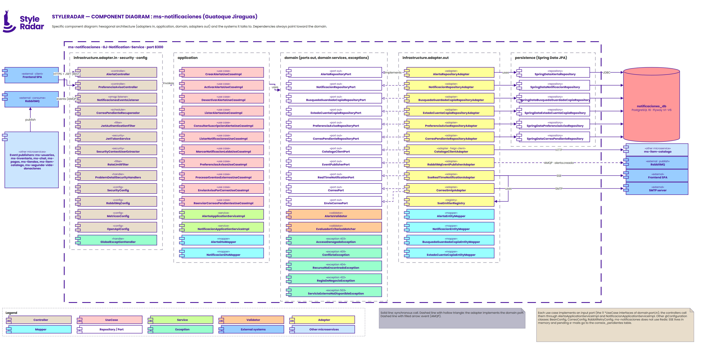
  </a>
</p>

---

#### 2. Diagrama de Clases (Modelo de Dominio y Patrones de Diseno)
* **Archivo Editable Draw.io:** [`docs/uml/diagrama-clases.drawio`](docs/uml/diagrama-clases.drawio)
* **Documentacion y Justificacion Tecnica:** [docs/DIAGRAMAS_NOT20.md (Seccion 3)](docs/DIAGRAMAS_NOT20.md#3-diagrama-de-clases-modelo-de-dominio)
* **Descripcion:** Modela las entidades de dominio (`Alerta`, `Notificacion`, `PreferenciaAviso`, `BusquedaGuardadaCopia`, `EstadoCuentaCopia`), Value Objects (`CriterioBusquedaVO`, `DatosPrendaVO`), Enumeraciones (`TipoAlerta`, `TipoNotificacion`, `CanalNotificacion`, `CanalAviso`, `EstadoAlerta`, `EstadoCuenta`) y las reglas del dominio (`AlertaValidator` para las validaciones y `EvaluadorCriteriosMatcher` para el matching en memoria) y la pagina de resultados (`Pagina`), el correo pendiente de reintento (`CorreoPendiente` y `EstadoCorreo`) y las cinco excepciones de dominio (`AccesoDenegadoException`, `ConflictoException`, `RecursoNoEncontradoException`, `ReglaDeNegocioException` y `ServicioExternoNoDisponibleException`, todas hijas de `RuntimeException`), cada una con el codigo HTTP al que se traduce. El dominio no depende de Spring ni de JPA.

<p align="center">
  <a href="docs/images/diagrama-clases.png" target="_blank">
    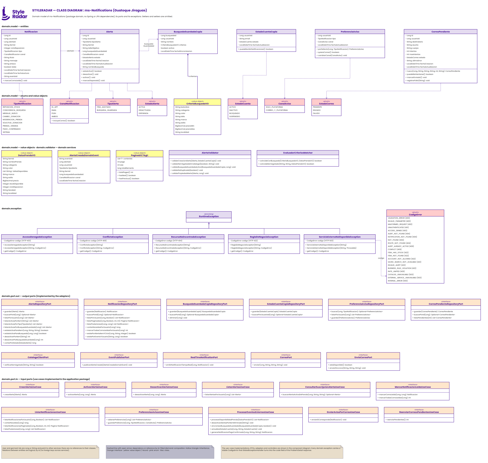
  </a>
</p>

---

#### 3. Diagrama de Base de Datos (Modelo Relacional / ER - PostgreSQL 16)
* **Archivo Editable Draw.io:** [`docs/uml/diagrama-base-datos.drawio`](docs/uml/diagrama-base-datos.drawio)
* **Documentacion y Justificacion Tecnica:** [docs/DIAGRAMAS_NOT20.md (Seccion 4)](docs/DIAGRAMAS_NOT20.md#4-diagrama-de-base-de-datos-metamodelo-conceptual-y-físico)
* **Descripcion:** Modela el esquema relacional fisico de PostgreSQL 16 gestionado por Flyway (migraciones V1 a V6; en V6 `item_id` pasa a `VARCHAR(100)` para aceptar UUID): `alertas`, `notificaciones`, `preferencias_avisos`, `busquedas_guardadas_copia`, `estados_cuenta_copia` y `correos_pendientes`, con sus indices y las restricciones unicas que dan la idempotencia. No hay llaves foraneas: los usuarios e items viven en otros servicios (Database-per-Service).

<p align="center">
  <a href="docs/images/diagrama-base-datos.png" target="_blank">
    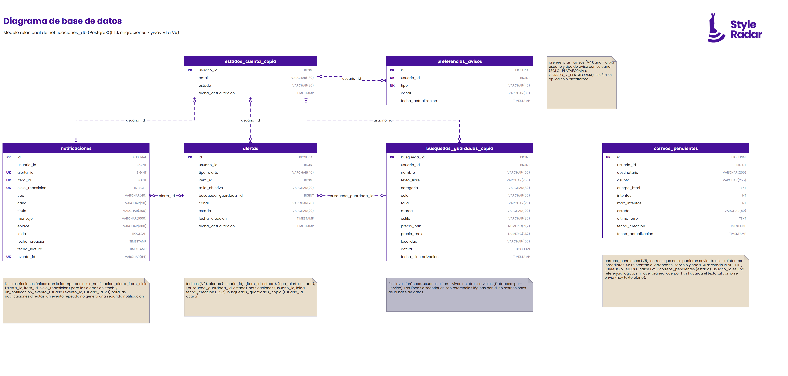
  </a>
</p>

---

#### 4. Diagrama de Contexto del Sistema (C4 L1)
* **Archivo Editable Draw.io:** [`docs/uml/diagrama-contexto.drawio`](docs/uml/diagrama-contexto.drawio)
* **Documentacion y Justificacion Tecnica:** [docs/DIAGRAMAS_NOT20.md (Seccion 1)](docs/DIAGRAMAS_NOT20.md#1-diagrama-de-contexto-del-sistema-nivel-c4---l1)
* **Descripcion:** Delimita la frontera del microservicio y sus interacciones con API Gateway, frontend SPA, broker RabbitMQ (exchange `styleradar.exchange`), microservicio de catalogo (via OpenFeign), identidad, donaciones, chat, pagos, tiendas, estadisticas y el servidor SMTP de los avisos por correo.

<p align="center">
  <a href="docs/images/diagrama-contexto.png" target="_blank">
    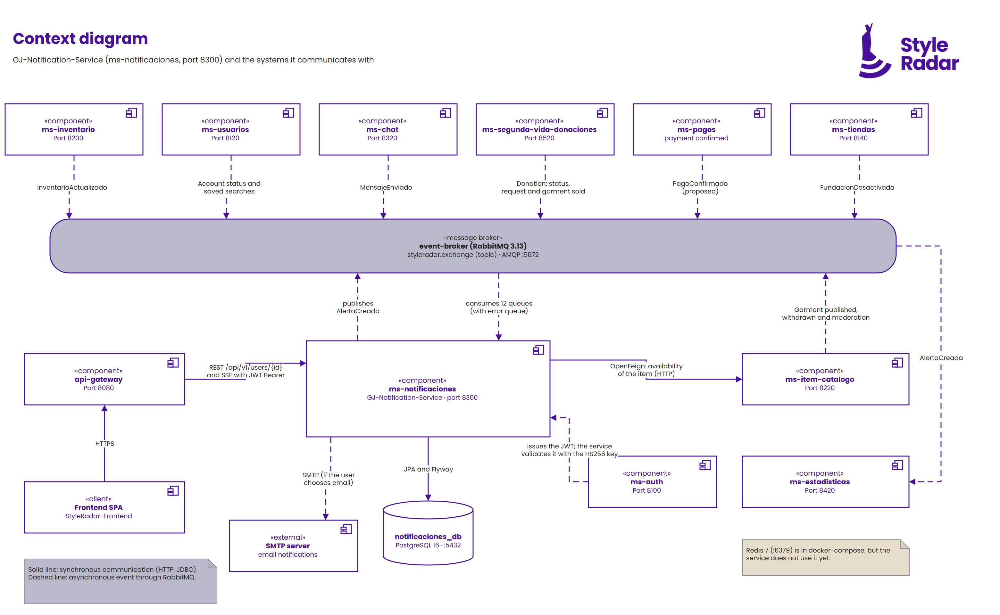
  </a>
</p>

---

#### 5. Diagrama de Despliegue (Topologia Azure & Docker Hub)
* **Archivo Editable Draw.io:** [`docs/uml/diagrama-despliegue.drawio`](docs/uml/diagrama-despliegue.drawio)
* **Documentacion y Justificacion Tecnica:** [docs/DIAGRAMAS_NOT20.md (Seccion 5)](docs/DIAGRAMAS_NOT20.md#5-diagrama-de-despliegue)
* **Descripcion:** Modela la topologia de ejecucion y despliegue continuo: estacion de desarrollo, pipeline de CI/CD en GitHub Actions, repositorio de imagenes en Azure Container Registry, y los ambientes de QA y PROD en Azure App Service (cada uno con su base de datos y su vhost del broker).

---

#### 6. Diagrama de Componentes General (Ecosistema StyleRadar)
* **Archivo Editable Draw.io:** [`docs/uml/diagrama-componentes-general.drawio`](docs/uml/diagrama-componentes-general.drawio)
* **Documentacion y Justificacion Tecnica:** [docs/DIAGRAMAS_NOT20.md (Seccion 7)](docs/DIAGRAMAS_NOT20.md#7-diagrama-de-componentes-general-ecosistema-styleradar)
* **Descripcion:** Vista de todo el backend de StyleRadar, compartida por los equipos: el cliente web, el API Gateway, los 13 microservicios con su base de datos propia, las colas de RabbitMQ (Notificaciones, Pagos y Estadisticas), Redis y los sistemas externos (Google OAuth, MercadoPago, Azure Blob Storage y FASHN AI). `ms-notificaciones` aparece con su base `notificaciones_db` y su cola de RabbitMQ. El diagrama lo elaboro el equipo de arquitectura; este servicio solo lo conserva como referencia.

<p align="center">
  <a href="docs/images/diagrama-componentes-general.png" target="_blank">
    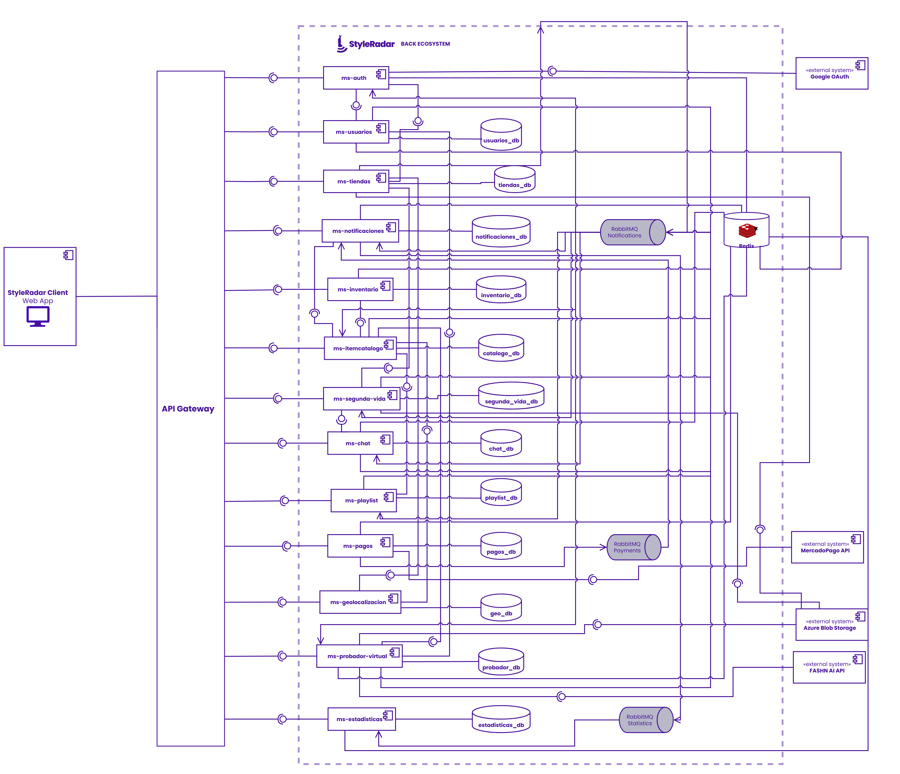
  </a>
</p>

---

#### 7. Diagrama de Despliegue General (Ecosistema StyleRadar)
* **Archivo Editable Draw.io:** [`docs/uml/diagrama-despliegue-general.drawio`](docs/uml/diagrama-despliegue-general.drawio)
* **Documentacion y Justificacion Tecnica:** [docs/DIAGRAMAS_NOT20.md (Seccion 8)](docs/DIAGRAMAS_NOT20.md#8-diagrama-de-despliegue-general-ecosistema-styleradar)
* **Descripcion:** Topologia de ejecucion de todo el ecosistema: la aplicacion web entra por el API Gateway (`8080`) y cada microservicio corre como contenedor en su puerto, con su base en el servidor de PostgreSQL, su espacio en Redis cuando lo usa y su conexion al broker RabbitMQ. `ms-notificaciones` corre en el puerto `8300`. El de este servicio en detalle es el diagrama 5.

<p align="center">
  <a href="docs/images/diagrama-despliegue-general.png" target="_blank">
    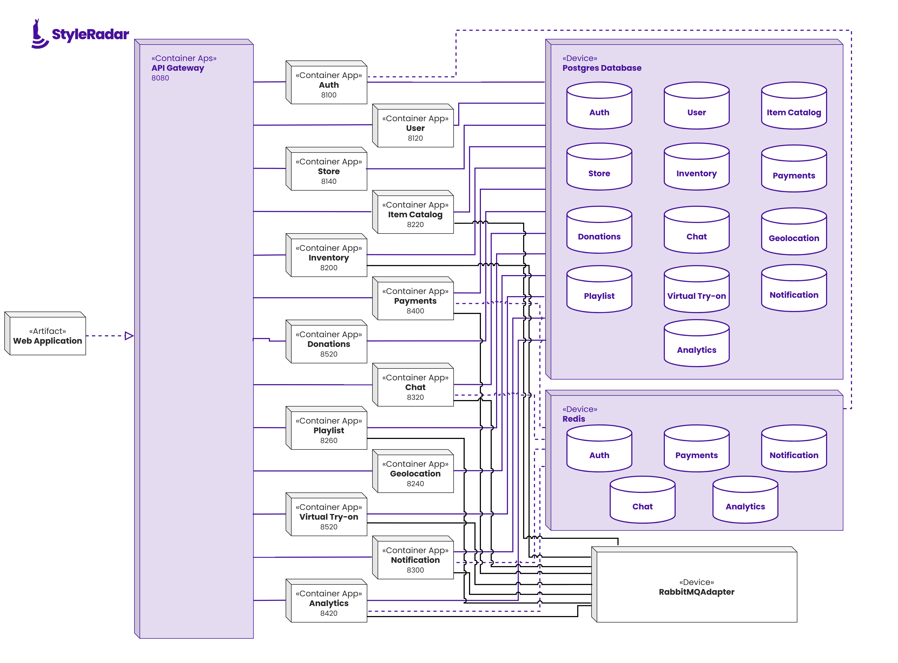
  </a>
</p>

### Estructura Oficial de Paquetes en `src/main/java/`

```text
src/main/java/edu/dosw/styleradar/notificaciones/
├── NotificacionesApplication.java           <-- Punto de entrada Spring Boot + @EnableFeignClients
├── domain/                                  <-- NÚCLEO DE DOMINIO (Cero dependencias de Spring/JPA)
│   ├── model/                               <-- Alerta, Notificacion, PreferenciaAviso, BusquedaGuardadaCopia, EstadoCuentaCopia, VO y Enums
│   ├── validator/                           <-- AlertaValidator y EvaluadorCriteriosMatcher (matching en memoria)
│   ├── event/                               <-- AlertaCreadaDomainEvent
│   ├── exception/                           <-- Excepciones semánticas de negocio
│   └── port/
│       ├── in/                              <-- Interfaces de Casos de Uso (CrearAlerta, Listar, Desactivar, MarcarLeida, ProcesarEventos, PreferenciasAvisos, EnviarAvisoPorCorreo)
│       └── out/                             <-- Interfaces SPI (Repositorios, CatalogoClientPort, EventPublisherPort, RealTimeNotificationPort, CorreoPort)
├── application/                             <-- CAPA DE APLICACIÓN (Casos de Uso y Mappers)
│   ├── usecase/                             <-- Implementaciones puras de casos de uso (*UseCaseImpl)
│   ├── dto/
│   │   ├── request/                         <-- CrearAlertaRequest y PreferenciaAvisoRequest (Java Record)
│   │   ├── response/                        <-- AlertaResponse, NotificacionResponse, ContadorNoLeidasResponse, PreferenciaAvisoResponse
│   │   └── event/                           <-- Payloads de eventos RabbitMQ (Inventario, Prenda, Usuario, Chat, Donación, Pago)
│   └── mapper/
│       └── in/                              <-- MapStruct DTO <-> Domain (AlertaDtoMapper, NotificacionDtoMapper)
└── infrastructure/                          <-- CAPA DE INFRAESTRUCTURA (Adaptadores y Configuración)
    ├── adapter/
    │   ├── in/
    │   │   ├── rest/                        <-- AlertaController, PreferenciaAvisoController y contratos OpenAPI segregados en doc/
    │   │   └── amqp/                        <-- NotificacionesEventsListener (@RabbitListener + manejo hacia DLQ)
    │   └── out/
    │       ├── persistence/                 <-- Entidades JPA, SpringDataRepositories, Adapters transaccionales y mapper/ (MapStruct dominio-entidad)
    │       ├── external/                    <-- CatalogoFeignClient y CatalogoClientAdapter
    │       ├── messaging/                   <-- RabbitMqEventPublisherAdapter
│       ├── mail/                        <-- CorreoSmtpAdapter (JavaMailSender, hilo aparte, 3 intentos con espera creciente)
    │       └── sse/                         <-- SseRealTimeNotificationAdapter (empuja cada notificación por SSE)
    ├── security/                            <-- JwtTokenService, JwtAuthenticationFilter y SecurityContextUserExtractor
    ├── sse/                                 <-- SseEmitterRegistry (conexiones SSE abiertas por usuario)
    └── config/                              <-- BeanConfig, SecurityConfig, RabbitMqConfig, RabbitRetryConfig, CorreoConfig, OpenApiConfig, GlobalExceptionHandler
```

---

<a id="4-endpoints-y-enlace-a-swagger"></a>

##  4. ENDPOINTS Y ENLACE A SWAGGER

La documentación interactiva OpenAPI 3.0 y los contratos de ejecución se encuentran desplegados y clasificados por entorno:

> [!IMPORTANT]
> **Alcance Exclusivo del Microservicio:** Esta documentación Swagger y especificación OpenAPI 3.0 pertenece **única y exclusivamente al Microservicio de Notificaciones y Alertas (`ms-notificaciones` / Puerto 8300)** del equipo **Guatoque Jiraguas (GJ)**. No contiene ni mezcla endpoints de otros microservicios del ecosistema (como autenticación, usuarios, tiendas o catálogo), garantizando el desacoplamiento estricto por servicio (Database-per-Service & API Isolation).

### Matriz Oficial de Enlaces de Swagger para `ms-notificaciones`

| Entorno | Estado | Propósito | URL Base del Servicio | Swagger OpenAPI UI | Health Check |
| :--- | :---: | :--- | :--- | :--- | :--- |
| **Desarrollo Local / Docker (DEV)** | Local | Entorno de desarrollo local en máquina | `http://localhost:8300` | [Swagger UI Local](http://localhost:8300/swagger-ui/index.html) | [`/actuator/health`](http://localhost:8300/actuator/health) |
| **Producción (PROD)** | Desplegado | Despliegue productivo de StyleRadar (Azure App Service `styleradar-notificaciones-prod`) | `https://styleradar-notificaciones-prod.azurewebsites.net` | Apagado en PROD (`SWAGGER_ENABLED=true` lo enciende) | [`/actuator/health`](https://styleradar-notificaciones-prod.azurewebsites.net/actuator/health) |
| **Calidad / Pruebas (QA)** | Desplegado | Pruebas integradas de Sprint y QA (Azure App Service `styleradar-notificaciones-qa`) | `https://styleradar-notificaciones-qa.azurewebsites.net` | [Swagger UI QA](https://styleradar-notificaciones-qa.azurewebsites.net/swagger-ui/index.html) | [`/actuator/health`](https://styleradar-notificaciones-qa.azurewebsites.net/actuator/health) |

* **Especificación OpenAPI (Contrato JSON Schema):** `http://localhost:8300/v3/api-docs` (o `/v3/api-docs` en el dominio de QA).


<div align="center">
  <table width="100%" style="margin: 18px 0; border: 2px dashed #5600EF; border-radius: 8px; background-color: #FBFBFE;">
    <tr>
      <td align="center" style="padding: 22px;">
        <p>
          <br />
          <strong><font color="#5600EF" size="3">DOCUMENTACIÓN SWAGGER OPENAPI UI ACTIVA</font></strong>
        </p>
        <p>
          <sub>Pega aquí la captura de pantalla de la interfaz interactiva corriendo en <code>http://localhost:8300/swagger-ui/index.html</code> mostrando los endpoints del controlador.</sub>
        </p>
        <p>
          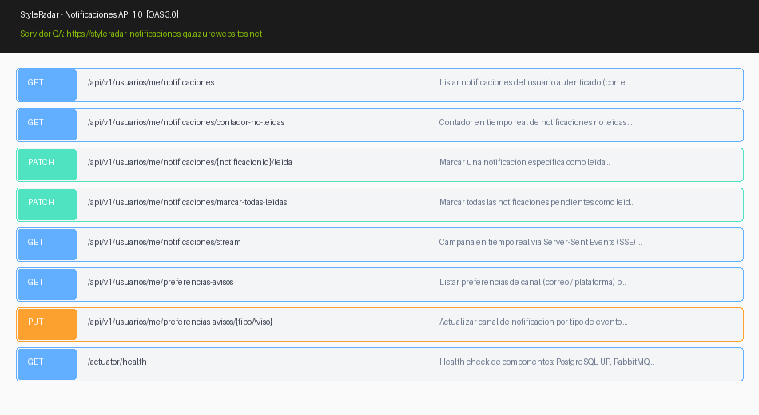<br />
        </p>
      </td>
    </tr>
  </table>
</div>

### Tabla de Endpoints Expuestos

> **Nota de Arquitectura REST y Estandarización de Endpoints en Inglés (/api/v1/users/{id}):**  
> Siguiendo la directriz oficial del proyecto StyleRadar para el API Gateway y consistencia entre microservicios, todos los endpoints canónicos comienzan con **`/api/v1`** y están completamente definidos en inglés bajo la convención REST: **`/api/v1/users/{id}/...`**.
>
> **Seguridad y Validación de Autorización:**  
> La seguridad del backend extrae el usuario autenticado del token JWT (`sub` o `userId`) y valida que coincida exactamente con el `{id}` de la ruta (o que cuente con privilegios de administrador). Si un usuario intenta consultar o manipular los recursos de otro usuario (por ejemplo un token de usuario 101 solicitando `/api/v1/users/202/...`), el backend rechaza la petición inmediatamente retornando **`HTTP 403 Forbidden`** bajo el estándar RFC 7807 (Problem Details).
>
> **Formato de errores:** todos los errores son `application/problem+json` con `type: "about:blank"`, `title`, `status`, `detail`, `instance`, `mensaje`, `timestamp` y un `code` estable (por ejemplo `ALERT_NOT_FOUND`, `ALERT_ALREADY_ACTIVE`, `ITEM_HAS_STOCK`, `SAVED_SEARCH_NOT_AVAILABLE`, `ACCOUNT_NOT_ALLOWED`, `RATE_LIMITED`). El front elige su mensaje a partir de `code`, no del texto de `detail`. En los 400 de validación, `errors` trae un mensaje por campo. La lista completa de códigos está en el Swagger (esquema `ProblemDetail`).
>
> *Nota de compatibilidad:* Por interoperabilidad con las pruebas existentes y clientes previos, el servicio también responde de forma transparente a las rutas alias en español (`/alertas`, `/notificaciones`, `/preferencias-avisos`), sin prefijo `/users/{id}/...` y `/api/v1/usuarios/{id}/...`, y con el alias `/me`.

|  Método  | Endpoint Canónico (Inglés) | Descripción | Rol Requerido | Códigos HTTP |
| :--------: | :---------------------------- | :----------------------------------------- | :-------------------- | :-----------------------: |
|  `GET`  | `/actuator/health` | Health Check y estado del microservicio | Público | `200` |
|  `POST`  | `/api/v1/users/{id}/alerts` | Crea una alerta sobre prenda agotada o búsqueda guardada con canal `IN_APP`, `EMAIL`, `PUSH` o `AMBOS` (SR-RF-29 / NOT-05 / NOT-10) | Autenticado (`JWT`) | `201`, `400`, `401`, `403`, `409`, `422`, `429`, `503` |
|  `GET`  | `/api/v1/users/{id}/alerts/check` | Estado inicial del botón «Avisarme cuando llegue»: con `?itemId=` y `?tallaObjetivo=` responde `suscrita` y el `alertaId` si ya hay una alerta activa para esa prenda y talla (SR-RF-29) | Autenticado (`JWT`) | `200`, `400`, `401`, `403`, `429` |
|  `GET`  | `/api/v1/users/{id}/alerts` | Lista todas las alertas del usuario autenticado, incluyendo `nombreBusqueda` en las de búsqueda guardada (SR-RF-32 / NOT-05) | Autenticado (`JWT`) | `200`, `401`, `403`, `429` |
| `DELETE` | `/api/v1/users/{id}/alerts/{alertId}` | Desactiva una alerta perteneciente al usuario autenticado (SR-RF-32 / NOT-05) | Propietario (`JWT`) | `200`, `401`, `403`, `404`, `429` |
| `PATCH` | `/api/v1/users/{id}/alerts/{alertId}/deactivate` | Ruta alternativa PATCH para desactivar alerta (SR-RF-32 / NOT-05) | Propietario (`JWT`) | `200`, `401`, `403`, `404`, `429` |
| `PATCH` | `/api/v1/users/{id}/alerts/{alertId}/activate` | Reactiva una alerta desactivada con las mismas reglas que al crearla: sin otra alerta activa igual (409), prenda aún agotada o búsqueda activa (422) y catálogo disponible (503). Si ya está activa la devuelve sin cambios (SR-RF-32) | Propietario (`JWT`) | `200`, `401`, `403`, `404`, `409`, `422`, `429`, `503` |
|  `GET`  | `/api/v1/users/{id}/notifications` | Lista las notificaciones del usuario. Sin parámetros devuelve un arreglo; con `?page=0&size=20` o `?read=true/false` (único filtro de lectura: `true` leídas, `false` no leídas) devuelve una página (NOT-05 / NOT-12 / GJ-118) | Autenticado (`JWT`) | `200`, `400`, `401`, `403`, `429` |
| `PATCH` | `/api/v1/users/{id}/notifications/{notificationId}/read` | Marca una notificación específica como leída (NOT-13) | Propietario (`JWT`) | `200`, `401`, `403`, `404`, `429` |
| `PATCH` | `/api/v1/users/{id}/notifications/read-all` | Marca todas las notificaciones del usuario como leídas (NOT-13) | Autenticado (`JWT`) | `200`, `401`, `403`, `429` |
|  `GET`  | `/api/v1/users/{id}/notifications/unread/count` | Obtiene el contador de notificaciones sin leer para la campana (NOT-13) | Autenticado (`JWT`) | `200`, `401`, `403`, `429` |
|  `GET`  | `/api/v1/users/{id}/notifications/stream` | Suscripción Server-Sent Events (`text/event-stream`) para campana en tiempo real con soporte `Last-Event-ID` (NOT-15, GJ-62). El navegador no puede enviar la cabecera con `EventSource`: se abre con `?ticket=<ticket>` (ver la fila siguiente) | Autenticado (`JWT` en la cabecera o ticket en `?ticket=`) | `200`, `401`, `403`, `429` |
|  `POST`  | `/api/v1/users/{id}/notifications/stream-ticket` | Entrega un ticket de vida corta (60 s) que solo sirve para abrir el stream. El JWT de sesión nunca viaja en la URL: un JWT en `?ticket=` o `?access_token=` se rechaza y el ticket no abre ningún otro endpoint | Autenticado (`JWT`) | `200`, `401`, `403`, `429` |
|  `GET`  | `/api/v1/users/{id}/notification-preferences` | Lista los canales configurados por tipo de notificación (GJ-64) | Autenticado (`JWT`) | `200`, `401`, `403`, `429` |
|  `PUT`  | `/api/v1/users/{id}/notification-preferences/{type}` | Configura `SOLO_PLATAFORMA` o `CORREO_Y_PLATAFORMA` por tipo de aviso (GJ-64) | Autenticado (`JWT`) | `200`, `400`, `401`, `403`, `429` |

<details>
<summary><b>Click para ver Ejemplos Interactivos de Request y Response JSON (Payloads)</b></summary>

<br>

#### Ejemplo Request (`POST /api/v1/users/{id}/alerts`)

```bash
curl -X POST "http://localhost:8300/api/v1/users/101/alerts" \
  -H "Content-Type: application/json" \
  -H "Authorization: Bearer <JWT_TOKEN>" \
  -d '{
    "tipoAlerta": "ITEM_AGOTADO",
    "itemId": "3fa85f64-5717-4562-b3fc-2c963f66afa6",
    "tallaObjetivo": "M",
    "canal": "IN_APP"
  }'
```

#### Ejemplo Response Exitoso (`201 Created`)

```json
{
  "id": 1,
  "usuarioId": 501,
  "tipoAlerta": "ITEM_AGOTADO",
  "itemId": "3fa85f64-5717-4562-b3fc-2c963f66afa6",
  "tallaObjetivo": "M",
  "busquedaGuardadaId": null,
  "nombreBusqueda": null,
  "canal": "IN_APP",
  "estado": "ACTIVA",
  "fechaCreacion": "2026-11-02T12:00:00",
  "fechaActualizacion": "2026-11-02T12:00:00"
}
```

</details>

---

<a id="5-eventos-que-publica-y-consume"></a>

##  5. EVENTOS QUE PUBLICA Y CONSUME

La comunicación asíncrona entre microservicios se orquesta a través de **RabbitMQ 3.13** utilizando Topic Exchanges durables y enrutamiento de fallos hacia una cola de errores (Dead Letter Queue) conforme a `SR-RNF-15`.

* **Exchange Principal de Dominio:** `styleradar.exchange` (`topic`, durable)
* **Dead Letter Exchange (DLX):** `styleradar.dlx` (`direct`, durable)
* **Dead Letter Queue (DLQ):** `styleradar.notificaciones.dlq`

### Matriz de Eventos AMQP

| Tipo | Routing Key | Cola (Queue) | Microservicio Emisor / Receptor | Cuándo se Dispara / Acción |
| :---: | :--- | :--- | :--- | :--- |
| **PUBLICA** | `styleradar.notificaciones.alerta.creada` | N/A (Exchange) | `ms-notificaciones` &rarr; `ms-estadisticas` | Publica `AlertaCreadaDomainEvent` al persistir una alerta activa (NOT-16). |
| **CONSUME** | `styleradar.inventario.actualizado` | `styleradar.notificaciones.inventario-actualizado.q` | `ms-inventario` &rarr; `ms-notificaciones` | Evalúa reposición de stock y criterios en memoria; genera notificación idempotente por ciclo (NOT-06, NOT-07, NOT-11). |
| **CONSUME** | `styleradar.catalogo.prenda.publicada` | `styleradar.notificaciones.prenda-publicada.q` | `ms-item-catalogo` &rarr; `ms-notificaciones` | Evalúa en memoria si la prenda nueva coincide con búsquedas guardadas activas (NOT-06, NOT-07). |
| **CONSUME** | `styleradar.usuarios.busqueda.sincronizada` | `styleradar.notificaciones.busqueda-guardada.q` | `ms-usuarios` &rarr; `ms-notificaciones` | Mantiene copia local de búsquedas guardadas y desactiva alertas si se elimina (NOT-08). |
| **CONSUME** | `styleradar.usuarios.estado.cambiado` | `styleradar.notificaciones.usuario-estado.q` | `ms-usuarios` &rarr; `ms-notificaciones` | Actualiza copia local del estado de cuenta para no enviar notificaciones a cuentas inactivas (NOT-09). |
| **CONSUME** | `styleradar.chat.mensaje.enviado` | `styleradar.notificaciones.mensaje-enviado.q` | `ms-chat` &rarr; `ms-notificaciones` | Genera notificación `MENSAJE_NUEVO` con enlace a `/chat/conversaciones/{id}` y push SSE (NOT-14). |
| **CONSUME** | `styleradar.donaciones.estado.cambiado` | `styleradar.notificaciones.donacion-cambiada.q` | `ms-segunda-vida-donaciones` &rarr; `ms-notificaciones` | Genera notificación `CAMBIO_DONACION` con enlace a `/donaciones/{id}` (NOT-14). |
| **CONSUME** | `styleradar.catalogo.moderacion.cambiada` | `styleradar.notificaciones.moderacion-cambiada.q` | `ms-item-catalogo` &rarr; `ms-notificaciones` | Genera notificación `MODERACION_PRENDA` y desactiva alertas si la prenda fue retirada (NOT-08, NOT-14). |
| **CONSUME** | `styleradar.catalogo.prenda.retirada` | `styleradar.notificaciones.prenda-retirada.q` | `ms-item-catalogo` &rarr; `ms-notificaciones` | Desactiva las alertas activas de la prenda retirada (NOT-08). |
| **CONSUME** | `styleradar.donaciones.solicitud.creada` | `styleradar.notificaciones.solicitud-donacion.q` | `ms-segunda-vida-donaciones` &rarr; `ms-notificaciones` | Genera notificación `SOLICITUD_DONACION` para la fundación destinataria (soporta alias `solicitudId` y `representanteId`, SR-RF-106 / GJ-61). |
| **CONSUME** | `styleradar.segundavida.prenda.vendida` / `styleradar.segunda-mano.prenda.vendida` | `styleradar.notificaciones.prenda-vendida.q` | `ms-segunda-vida-donaciones` &rarr; `ms-notificaciones` | Genera notificación `PRENDA_VENDIDA` para cada interesado, excluyendo al comprador y al vendedor (SR-RF-106 / GJ-65). |
| **CONSUME** | `styleradar.pagos.pago.confirmado` | `styleradar.notificaciones.pago-confirmado.q` | `ms-pagos` &rarr; `ms-notificaciones` | Genera notificación `PAGO_CONFIRMADO`; si el usuario no existe en la copia local, el mensaje va a la DLQ (SR-RF-106 / GJ-65). |
| **CONSUME** | `styleradar.tiendas.fundacion.desactivada` | `styleradar.notificaciones.fundacion-desactivada.q` | `ms-tiendas` &rarr; `ms-notificaciones` | Genera notificación `CAMBIO_DONACION` para cada donante afectado cuando una fundación aliada se desactiva (SR-RF-106 / GJ-117). |

> **Nombres propuestos:** las tres últimas routing keys las definió `ms-notificaciones` y están pendientes de confirmar con los equipos emisores; cambiarlas solo requiere editar `application.messaging.routing-keys`. La especificación de cada payload está en [docs/CONTRATOS_EVENTOS_NOT21.md](docs/CONTRATOS_EVENTOS_NOT21.md). Todos los consumidores son idempotentes por `eventoId`.

<details>
<summary><b>Click para ver Esquema JSON del Evento Publicado (AlertaCreada - NOT-16)</b></summary>

<br>

```json
{
  "eventoId": "evt-alr-1001",
  "alertaId": 75,
  "usuarioId": 501,
  "tipoAlerta": "ITEM_AGOTADO",
  "itemId": 1045,
  "busquedaGuardadaId": null,
  "canal": "IN_APP",
  "fechaCreacion": "2026-11-02T12:30:00"
}
```

</details>

---

<a id="6-tecnologías-y-dependencias"></a>

##  6. TECNOLOGÍAS Y DEPENDENCIAS

El stack del microservicio cumple con el estándar unificado de arquitectura de StyleRadar:

| Capa / Componente | Tecnología | Versión | Justificación Técnica |
| :--- | :--- | :--- | :--- |
| **Lenguaje Core** | Java LTS | `21` | Records inmutables, Pattern Matching y alto rendimiento en procesamiento de eventos. |
| **Framework Empresarial** | Spring Boot | `3.2.5` | Gestión declarativa de configuración, ecosistema nativo Spring Web, Security, Data JPA y AMQP. |
| **Cliente HTTP Declarativo** | Spring Cloud OpenFeign | `2023.0.1` | Validación síncrona de prenda agotada contra `ms-item-catalogo` (NOT-10). |
| **Base de Datos** | PostgreSQL | `16` | Integridad transaccional ACID y restricción única `(alerta_id, item_id, ciclo_reposicion)`. |
| **Migraciones de BD** | Flyway | `9.22.x` | Control de versiones reproducible de scripts SQL (`V1` esquema, `V2` índices, `V3` `evento_id` de idempotencia, `V4` `preferencias_avisos`, `V5` `correos_pendientes`). |
| **Broker de Mensajería** | RabbitMQ | `3.13` | Desacoplamiento temporal de microservicios mediante Topic Exchanges y Dead Letter Queues. |
| **Caché en Memoria** | Redis | `7.x` | Declarado en `docker-compose`; el servicio todavía no lo usa. |
| **Correo** | Spring Boot Starter Mail (`JavaMailSender`) | `3.2.5` | Avisos por correo cuando el usuario lo elige. Se activa con `SPRING_MAIL_HOST`; sin él no se envía correo. |
| **Seguridad** | Spring Security + JJWT | `0.11.5` | JWT HS256 sin estado; la clave se comparte con `ms-auth`. |
| **Documentación de API** | springdoc-openapi | `2.5.0` | OpenAPI 3 y Swagger UI. |
| **Mapeo de DTOs** | MapStruct | `1.5.5.Final` | Generación de mappers (DTO en `application`, entidades JPA en `infrastructure`) en tiempo de compilación sin sobrecarga de reflexión. |
| **Testing Core & Web** | JUnit 5 + Mockito + MockMvc | `5.10.x` | Pruebas unitarias de dominio/casos de uso y pruebas de integración REST/AMQP/JPA con H2 PostgreSQL mode. |
| **Pruebas de integración** | Testcontainers · WireMock · GreenMail | `1.21.4` · `3.5.4` · `2.0.1` | RabbitMQ real, Catálogo simulado y servidor SMTP de prueba. |
| **Métricas de Cobertura** | JaCoCo Plugin | `0.8.11` | Verificación estricta de cobertura mínima (`>= 85%`) como regla obligatoria en `mvn verify`. |

---

> [!NOTE]
> **Documento Oficial de Análisis y Justificación Tecnológica:** Para consultar el análisis comparativo formal de alternativas evaluadas y descartadas (PostgreSQL vs NoSQL, RabbitMQ vs Kafka, Java/Spring vs Node/Python, SSE vs WebSockets, JavaMailSender vs SDKs propietarios), visita:
> **[docs/ANALISIS_DECISIONES_TECNOLOGICAS.md](docs/ANALISIS_DECISIONES_TECNOLOGICAS.md)**.

<a id="7-cómo-ejecutar-local-y-con-docker"></a>

##  7. CÓMO EJECUTAR LOCAL Y CON DOCKER

### Prerrequisitos de Entorno

* **Java Development Kit (JDK):** Versión 21 LTS instalada (`java -version`).
* **Apache Maven:** Versión 3.9+ instalada (`mvn -version`).
* **Docker Engine & Docker Compose:** Versión 24+ en ejecución (`docker --version`).

### Ejecución Local con Maven (Perfil Dev)

```bash
# 1. Clonar el repositorio
git clone https://github.com/StyleRadar1/GJ-Notification-Service.git
cd GJ-Notification-Service

# 2. Levantar servicios de infraestructura en Docker (PostgreSQL, Redis, RabbitMQ)
docker compose up -d notificaciones-db notificaciones-redis event-broker

# 3. Ejecutar el microservicio localmente en el puerto 8300
mvn clean spring-boot:run -Dspring-boot.run.profiles=dev
```

### Ejecución Contenerizada Completa con Docker

<details>
<summary><b>Click para ver Instrucciones de Docker y docker-compose.yml</b></summary>

<br>

```bash
# Compilar y empaquetar el JAR ejecutable omitiendo tests
mvn clean package -DskipTests

# Construir la imagen OCI local
docker build -t styleradar/ms-notificaciones:v1.0 .

# Levantar toda la pila (base de datos + redis + rabbitmq + microservicio)
docker compose up --build -d
```

</details>

### Comprobación de Salud (Health Check)

```bash
curl -s http://localhost:8300/actuator/health
# Esperado: {"status":"UP"}
```

<div align="center">
  <table width="100%" style="margin: 18px 0; border: 2px dashed #5600EF; border-radius: 8px; background-color: #FBFBFE;">
    <tr>
      <td align="center" style="padding: 22px;">
        <p>
          <br />
          <strong><font color="#5600EF" size="3">CONTENEDOR OCI DOCKER EN EJECUCIÓN (docker compose ps)</font></strong>
        </p>
        <p>
          <sub>Pega aquí la captura de terminal ejecutando <code>docker compose ps</code> mostrando el contenedor del microservicio y sus servicios de persistencia y broker en estado healthy.</sub>
        </p>
        <p>
          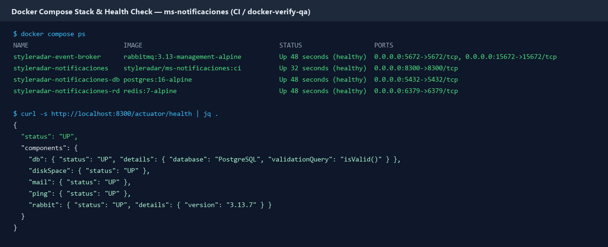<br />
        </p>
      </td>
    </tr>
  </table>
</div>


---

<a id="8-variables-de-entorno"></a>

##  8. VARIABLES DE ENTORNO

Todas las configuraciones sensibles y dependientes de entorno se externalizan mediante variables de sistema conformes al estándar **Twelve-Factor App**.

| Variable | Descripción | Valor por Defecto (`dev`) | Requerido en Prod |
| :--- | :--- | :--- | :---: |
| `PORT` | Puerto de escucha HTTP del microservicio | `8300` | Sí |
| `SPRING_PROFILES_ACTIVE` | Perfil de configuración Spring Boot activo | `dev` | Sí |
| `DB_HOST` | Hostname o IP del servidor PostgreSQL | `localhost` | Sí |
| `DB_PORT` | Puerto de conexión a PostgreSQL | `5432` | Sí |
| `DB_NAME` | Nombre de la base de datos aislada | `notificaciones_db` | Sí |
| `DB_USER` | Usuario de conexión a la base de datos | `styleradar_user` | Sí |
| `DB_PASSWORD` | Contraseña del usuario de base de datos | `styleradar_secret` | Sí |
| `RABBITMQ_HOST` | Hostname del broker de mensajería | `localhost` | Sí |
| `RABBITMQ_PORT` | Puerto AMQP de RabbitMQ | `5672` | Sí |
| `RABBITMQ_USER` | Usuario de conexión a RabbitMQ | `guest` | Sí |
| `RABBITMQ_PASSWORD` | Contraseña de conexión a RabbitMQ | `guest` | Sí |
| `RABBITMQ_VHOST` | Virtual host del broker (solo perfil `prod`) | `/` | No |
| `RABBITMQ_SSL_ENABLED` | Activa TLS hacia el broker; con TLS se usa el puerto `5671` (solo perfil `prod`, donde viene encendido) | `true` en PROD | No |
| `RABBITMQ_SSL_VERIFY_HOSTNAME` | Verifica que el certificado del broker coincida con el host (solo perfil `prod`) | `true` | No |
| `REDIS_HOST` | Hostname del servidor de caché Redis | `localhost` | No |
| `CATALOG_SERVICE_URL` | URL base de `ms-item-catalogo` para OpenFeign | `http://localhost:8220` | Sí |
| `JWT_SECRET` | Clave secreta HMAC-SHA256 (mínimo 256 bits) para validar JWT | `clave_secreta_minimo_256_bits...` | Sí |
| `CORS_ALLOWED_ORIGINS` | Orígenes del frontend permitidos por CORS, separados por comas | `http://localhost:5173` | No |
| `RATE_LIMIT_ENABLED` | Enciende o apaga el límite de solicitudes por usuario (OWASP A06); al pasarse responde `429` con `Retry-After` | `true` | No |
| `RATE_LIMIT_PER_MINUTE` | Solicitudes por minuto y por usuario (por IP si no está autenticado) | `120` | No |
| `SSE_TICKET_TTL_SECONDS` | Vida del ticket con el que se abre el stream de la campana | `60` | No |
| `SWAGGER_ENABLED` | Enciende Swagger UI y `/v3/api-docs` en PROD, donde vienen apagados (OWASP A02) | `false` en PROD | No |
| `SPRING_MAIL_HOST` | Servidor SMTP para los avisos por correo. Sin esta variable no se envían correos (los avisos en plataforma siguen funcionando) | `smtp.ejemplo.co` | No |
| `SPRING_MAIL_PORT` | Puerto del servidor SMTP | `587` | No |
| `SPRING_MAIL_USERNAME` / `SPRING_MAIL_PASSWORD` | Credenciales del SMTP. Se inyectan como variables de entorno o secretos; no se guardan en el repositorio | — | No |
| `MAIL_FROM` | Dirección remitente de los correos | `no-reply@styleradar.co` | No |
| `MAIL_PENDING_MAX_ATTEMPTS` | Cuántas veces se reintenta un correo guardado como pendiente antes de marcarlo `FALLIDO` (GJ-119) | `3` | No |
| `MAIL_RETRY_DELAY_MS` | Cada cuántos milisegundos se reintentan los correos pendientes (además de al arrancar el servicio) | `60000` | No |

<details>
<summary><b>Click para copiar la Plantilla de Archivo .env.example</b></summary>

<br>

```dotenv
# ==============================================================================
# STYLERADAR · VARIABLES DE ENTORNO LOCALES (.env) - ms-notificaciones
# ==============================================================================
PORT=8300
SPRING_PROFILES_ACTIVE=dev

# Persistencia PostgreSQL
DB_HOST=localhost
DB_PORT=5432
DB_NAME=notificaciones_db
DB_USER=styleradar_user
DB_PASSWORD=styleradar_secret

# Event Broker RabbitMQ
RABBITMQ_HOST=localhost
RABBITMQ_PORT=5672
RABBITMQ_USER=guest
RABBITMQ_PASSWORD=guest
RABBITMQ_VHOST=/
RABBITMQ_SSL_ENABLED=false
RABBITMQ_SSL_VERIFY_HOSTNAME=true
RABBITMQ_EXCHANGE=styleradar.exchange
RABBITMQ_DLX=styleradar.dlx

# Caché Redis
REDIS_HOST=localhost
REDIS_PORT=6379

# Cliente Feign Catálogo
CATALOG_SERVICE_URL=http://localhost:8220

# Seguridad JWT
JWT_SECRET=clave_secreta_minimo_256_bits_para_firmado_seguro_hs256_styleradar_2026
JWT_EXPIRATION_MS=86400000
```

</details>

---

<a id="9-pruebas-y-cobertura"></a>

##  9. PRUEBAS Y COBERTURA (≥ 85%)

El proyecto exige una cobertura de código mínima del **85%** verificada automáticamente mediante el plugin de **JaCoCo** durante la fase de compilación.

### Comandos de Ejecución de Pruebas

```bash
# Ejecutar todas las pruebas unitarias y de integración con verificación JaCoCo >= 85%
mvn clean verify

# Generar únicamente el reporte HTML de JaCoCo
mvn jacoco:report
```

* **Ruta del Reporte HTML:** `target/site/jacoco/index.html`

<div align="center">
  <table width="100%" style="margin: 18px 0; border: 2px dashed #5600EF; border-radius: 8px; background-color: #FBFBFE;">
    <tr>
      <td align="center" style="padding: 22px;">
        <p>
          <br />
          <strong><font color="#5600EF" size="3">REPORTE CONSOLIDADO DE COBERTURA JACOCO (≥ 85%)</font></strong>
        </p>
        <p>
          <sub>Pega aquí la captura del reporte HTML (<code>target/site/jacoco/index.html</code>) evidenciando el cumplimiento de la cobertura mínima obligatoria (≥ 85%).</sub>
        </p>
        <p>
          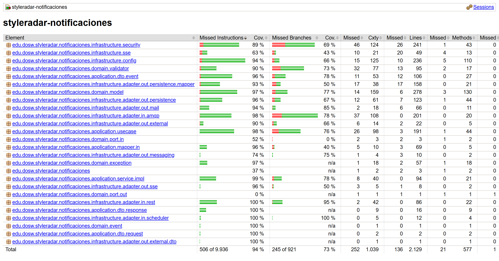<br />
        </p>
      </td>
    </tr>
  </table>
</div>


### Pirámide de Pruebas Implementada

| Nivel de Prueba | Alcance | Tecnologías Utilizadas | Ubicación en el Código | Cobertura Meta |
| :--- | :--- | :--- | :--- | :---: |
| **Pruebas Unitarias de Dominio** | `AlertaValidator`, `EvaluadorCriteriosMatcher` y modelos puros | JUnit 5, AssertJ | `src/test/java/.../unit/domain/` | ≥ 90% |
| **Pruebas Unitarias de Aplicación** | Casos de uso aislados (`CrearAlerta`, `Listar`, `Desactivar`, `ProcesarEventos`, `PreferenciasAvisos`, `EnviarAvisoPorCorreo`) y adaptador de correo con reintentos | JUnit 5, Mockito, AssertJ | `src/test/java/.../unit/application/` | ≥ 90% |
| **Pruebas de Integración y Contrato** | Controladores REST, Seguridad JWT, Flyway, Repositorios JPA, Consumidores AMQP, SSE y correo | Spring Boot Test, MockMvc, H2 PostgreSQL Mode, GreenMail | `src/test/java/.../integration/` | ≥ 85% |
| **Pruebas con RabbitMQ real** | Publicación de `AlertaCreada` y consumo de eventos contra un broker real | Testcontainers (requieren Docker; en un equipo sin Docker se omiten y las corre el CI) | `src/test/java/.../integration/messaging/` | — |

Estado actual: **169 pruebas, 0 fallos, cobertura de líneas 94,0 %** (11 pruebas con Docker omitidas en un equipo sin Docker).

> [!IMPORTANT]
> **Criterio de Fallo en CI:** El archivo `pom.xml` contiene la regla `<limit><minimum>0.85</minimum></limit>`. Si la cobertura total consolidada es inferior al 85%, el comando `mvn verify` fallará con error y el pipeline bloqueará el Pull Request.

---

<a id="10-cicd-con-el-badge-del-pipeline"></a>

##  10. CI/CD CON EL BADGE DEL PIPELINE

El ciclo de vida del software implementa integración continua y entrega continua automatizada mediante **GitHub Actions**:

### Matriz de Pipelines por Entorno (PROD y QA)

| Pipeline | Entorno Destino | Desencadenador (Trigger) | Quality Gate Exigido | Badge de Estado |
| :--- | :--- | :--- | :--- | :---: |
| **CI - Staging / QA** | Calidad (`QA`) | Push a `develop` o a ramas `feature/**` | Build OK + Tests Unitarios/Integración + JaCoCo ≥ 85% + Docker Build | [](https://github.com/StyleRadar1/GJ-Notification-Service/actions/workflows/ci-qa.yml) |
| **CD - Producción (PROD)** | Producción (`PROD`) | Merge a rama `main` tras validación QA | Verificación completa + Imagen OCI lista para despliegue | [](https://github.com/StyleRadar1/GJ-Notification-Service/actions/workflows/cd-prod.yml) |
| **Análisis estático (SonarQube)** | Transversal | Pendiente de configurar en el CI | Meta: 0 Vulnerabilidades, 0 Bugs, Deuda Técnica &lt; 5% | Pendiente |

### Diagrama del Flujo Automatizado (Pipeline Stages)

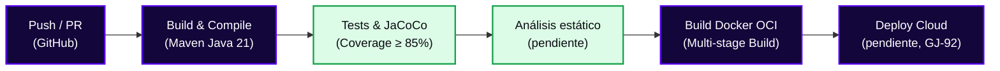

### Metas de calidad en SonarQube (pendiente de configurar)

* **Bugs:** 0
* **Vulnerabilidades:** 0
* **Hotspots de Seguridad:** 0 revisados al 100%
* **Code Smells Críticos:** 0
* **Deuda Técnica:** < 5%

<div align="center">
  <table width="100%" style="margin: 18px 0; border: 2px dashed #5600EF; border-radius: 8px; background-color: #FBFBFE;">
    <tr>
      <td align="center" style="padding: 22px;">
        <p>
          <br />
          <strong><font color="#5600EF" size="3">EJECUCIÓN DEL PIPELINE CI/CD EN VERDE (BUILD & QUALITY GATE PASSED)</font></strong>
        </p>
        <p>
          <sub>Pega aquí la captura del pipeline de integración continua (Azure DevOps / GitHub Actions) finalizado con éxito en todas sus fases.</sub>
        </p>
        <p>
          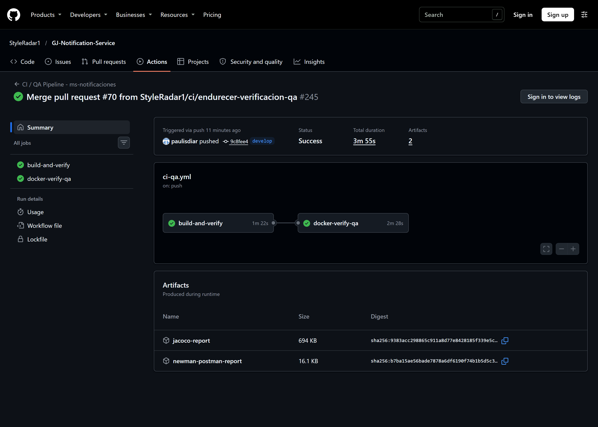<br />
        </p>
      </td>
    </tr>
  </table>
</div>

---

<a id="11-ramas-y-cómo-contribuir"></a>

##  11. RAMAS Y CÓMO CONTRIBUIR

El equipo sigue el modelo de trabajo **GitFlow adaptado para microservicios**. La rama `main` se encuentra protegida y solo recibe cambios mediante Pull Requests aprobados.

### Estructura de Ramas Oficial

```text
main (default / protegida)    <-- Código validado en producción
└── develop                   <-- Rama de integración para QA / Staging
    └── Scaffolding           <-- Rama de trabajo que concentra el desarrollo del microservicio
        (feature/scaffolding y features integrados con commits atómicos)
```

### Convención de Commits (*Conventional Commits*)

Todo mensaje de commit debe seguir el estándar en minúsculas y modo imperativo:

```text
<tipo>(<alcance>): <descripción imperativa en español>

Ejemplos válidos:
feat(domain): migrar modelos alerta, notificacion, enums y validadores de dominio
feat(rest): migrar endpoints de alertas, notificaciones y sse bajo /api/v1/usuarios/me
test(notificaciones): agregar pruebas unitarias y de integracion superando 85% en jacoco
docs(readme): actualizar estructura oficial del readme en develop
```

### Checklist Obligatorio para Pull Requests

- [ ] La rama parte de la versión más reciente de `develop`.
- [ ] El código compila limpiamente con `mvn clean compile`.
- [ ] Todas las pruebas unitarias e integración pasan (`mvn verify`).
- [ ] La cobertura JaCoCo es mayor o igual al 85%.
- [ ] No se introducen credenciales, contraseñas ni tokens en el código fuente.
- [ ] El PR tiene asignado al menos 1 revisor del squad antes del merge.

---

<a id="12-enlace-a-la-épica-en-jira"></a>

##  12. ENLACE A LA ÉPICA EN JIRA

El seguimiento de requerimientos, evidencias y artefactos de entrega se centraliza en los siguientes enlaces oficiales:

### Enlaces de Gestión, Repositorios y Evidencias

* **Épica Oficial del Microservicio (Jira):** [GJ-2 · ms-notificaciones](https://mail-team-nyjtgqcj.atlassian.net/browse/GJ-2)
* **Proyecto en Jira (GJ):** [https://mail-team-nyjtgqcj.atlassian.net/browse/GJ](https://mail-team-nyjtgqcj.atlassian.net/browse/GJ)
* **API Swagger en Producción (PROD):** apagado por seguridad (`SWAGGER_ENABLED=false`); la especificación se consulta en QA o en local. Se enciende con `SWAGGER_ENABLED=true` en el App Service.
* **API Swagger en Calidad (QA):** [https://styleradar-notificaciones-qa.azurewebsites.net/swagger-ui/index.html](https://styleradar-notificaciones-qa.azurewebsites.net/swagger-ui/index.html)
* **Swagger UI Microservicio Notificaciones (:8300):** [http://localhost:8300/swagger-ui/index.html](http://localhost:8300/swagger-ui/index.html)
* **Especificación OpenAPI 3.0 JSON Schema:** [http://localhost:8300/v3/api-docs](http://localhost:8300/v3/api-docs)
* **Documento de Análisis y Justificación de Decisiones Tecnológicas:** [docs/ANALISIS_DECISIONES_TECNOLOGICAS.md](docs/ANALISIS_DECISIONES_TECNOLOGICAS.md)
* **Contratos y Especificación de Eventos Asíncronos (NOT-21):** [docs/CONTRATOS_EVENTOS_NOT21.md](docs/CONTRATOS_EVENTOS_NOT21.md)
* **Contrato de autenticación JWT (GJ-35):** [docs/CONTRATO_JWT_AUTENTICACION.md](docs/CONTRATO_JWT_AUTENTICACION.md)
* **Colección de Pruebas Postman:** [postman/styleradar-notificaciones.postman_collection.json](postman/styleradar-notificaciones.postman_collection.json)
* **Contratos de Eventos Asíncronos (NOT-21):** [docs/CONTRATOS_EVENTOS_NOT21.md](docs/CONTRATOS_EVENTOS_NOT21.md)
* **Diagramas UML Oficiales en Draw.io:** [docs/uml/](docs/uml/)
* **Documentación Arquitectónica y Justificaciones (NOT-20):** [docs/DIAGRAMAS_NOT20.md](docs/DIAGRAMAS_NOT20.md)


<div align="center">
  <table width="100%" style="margin: 18px 0; border: 2px dashed #5600EF; border-radius: 8px; background-color: #FBFBFE;">
    <tr>
      <td align="center" style="padding: 22px;">
        <p>
          <br />
          <strong><font color="#5600EF" size="3">TABLERO SCRUM Y SEGUIMIENTO DE LA ÉPICA EN JIRA</font></strong>
        </p>
        <p>
          <sub>Pega aquí la captura del tablero de Jira mostrando la Épica, User Stories y tareas asignadas al microservicio para el sprint.</sub>
        </p>
        <p>
          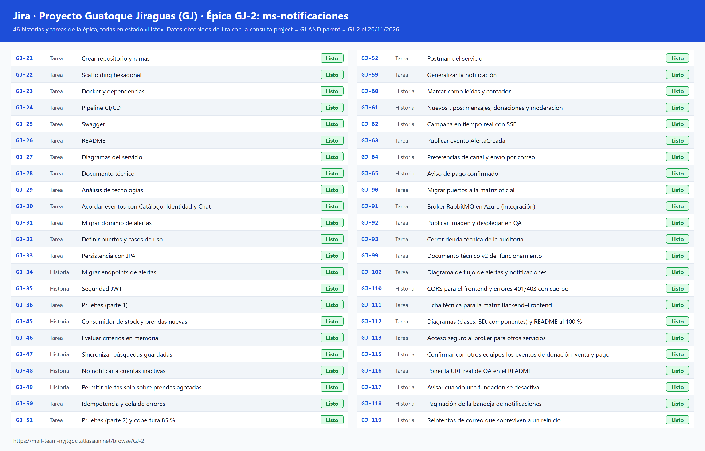<br />
        </p>
      </td>
    </tr>
  </table>
</div>

### Requerimientos Funcionales y No Funcionales Asignados (Numeración Unificada)

| Código RF / RNF | Nombre del Requerimiento | Actor Principal | Criterio de Aceptación Clave |
| :---: | :--- | :--- | :--- |
| `SR-RF-29` | Configurar alerta de disponibilidad | Comprador | Crea alertas sobre prenda agotada (`ITEM_AGOTADO`, `itemId` UUID/texto) o búsqueda guardada (`BUSQUEDA_GUARDADA`) con canal `IN_APP`, `EMAIL`, `PUSH` o `AMBOS`; valida que la prenda esté sin stock en `ms-item-catalogo` (NOT-10), comprueba estado inicial con `GET /alerts/check`, devuelve `nombreBusqueda` y publica `AlertaCreada`. |
| `SR-RF-30` | Detectar prendas que coinciden con una alerta | Sistema / Eventos | Evalúa criterios en memoria al recibir `InventarioActualizado` (tolerante a `stockAnterior` opcional) y `PrendaPublicada`, y desactiva alertas ante `PrendaRetirada` o búsqueda eliminada (NOT-06, NOT-07, NOT-08). |
| `SR-RF-31` | Notificar coincidencia o reposición de una prenda | Comprador / Sistema | Genera una sola notificación por `(alerta_id, item_id, ciclo_reposicion)`, la empuja en tiempo real por SSE y envía correo si la preferencia del tipo es `CORREO_Y_PLATAFORMA` o si el canal de la alerta es `EMAIL` o `AMBOS`, con reintentos persistentes en `correos_pendientes` (NOT-11, GJ-119). |
| `SR-RF-32` | Consultar, desactivar y reactivar alertas | Comprador | Permite listar sus alertas (con `nombreBusqueda`), desactivarlas (`DELETE` o `PATCH /deactivate`) sin borrar la búsqueda guardada y reactivarlas (`PATCH /activate`) validando disponibilidad y ausencia de duplicados (NOT-05). |
| `SR-RF-104` | Consultar la bandeja de notificaciones | Usuario Autenticado | Permite listar con paginación (`page`, `size`) y filtro único `read` (`true` leídas, `false` no leídas), contar no leídas, marcar como leída (individual/todas) y abrir el stream SSE mediante ticket de 60 s (`POST /stream-ticket`) con reconexión `Last-Event-ID` (NOT-12, NOT-13, NOT-15, GJ-62, GJ-118). |
| `SR-RF-105` | Elegir el canal de cada tipo de aviso | Usuario Autenticado | Permite consultar y elegir por cada uno de los 9 valores de `TipoNotificacion` entre `SOLO_PLATAFORMA` (por defecto) y `CORREO_Y_PLATAFORMA` (GJ-64). |
| `SR-RF-106` | Avisar la actividad de otros módulos | Comprador / Donante / Tienda | Genera notificaciones idempotentes por `(evento_id, usuario_id)` al recibir eventos de `ms-chat`, `ms-segunda-vida-donaciones`, `ms-item-catalogo`, `ms-pagos` y `ms-tiendas` (fundación desactivada), excluyendo cuentas en estado `INACTIVO`, `BLOQUEADO` o `SUSPENDIDO` (NOT-09, NOT-14, GJ-61, GJ-65, GJ-117). |
| `SR-RNF-15` | Resiliencia e idempotencia en consumidores de eventos | Sistema / Broker | 3 entregas totales con backoff ante fallos transitorios, rechazo inmediato sin reencolar hacia `styleradar.notificaciones.dlq` ante payloads inválidos, restricciones únicas en PostgreSQL 16 y errores HTTP con campo `code` estable (`CodigoError`). |
