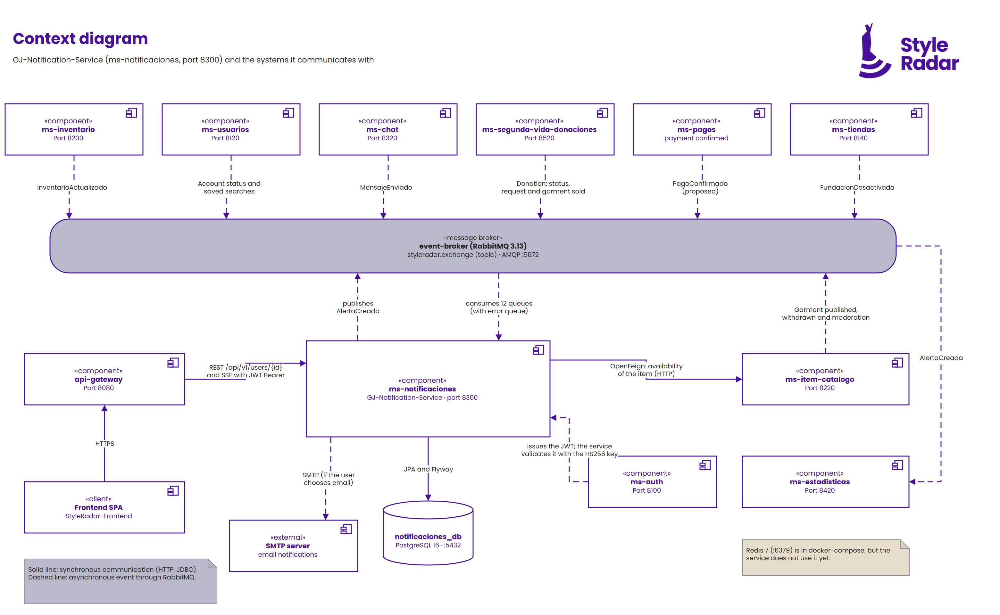
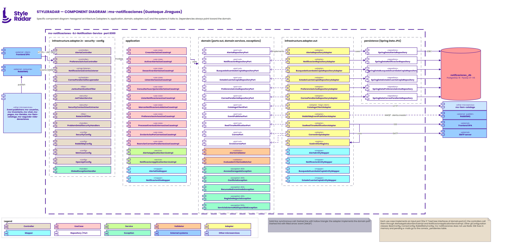
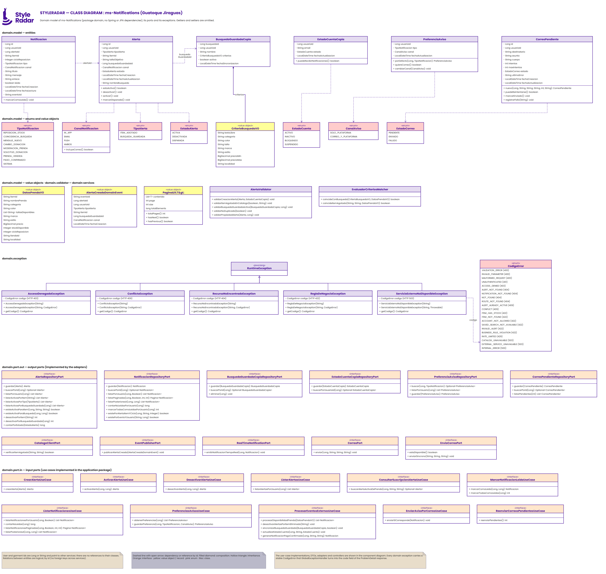
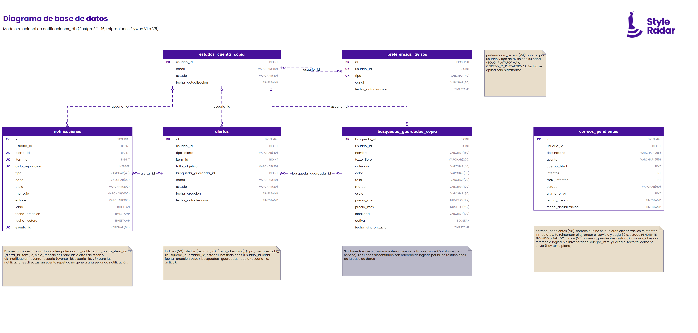
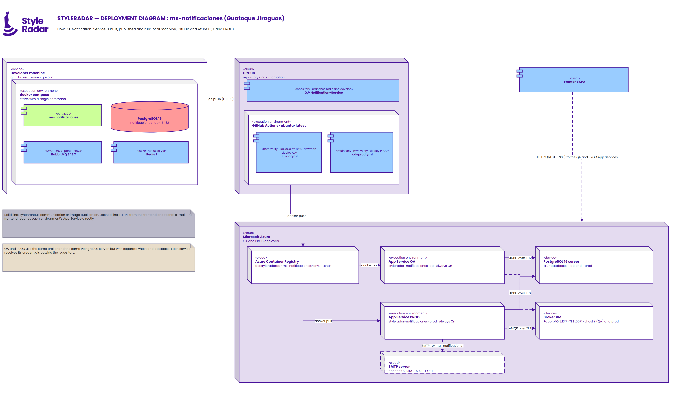
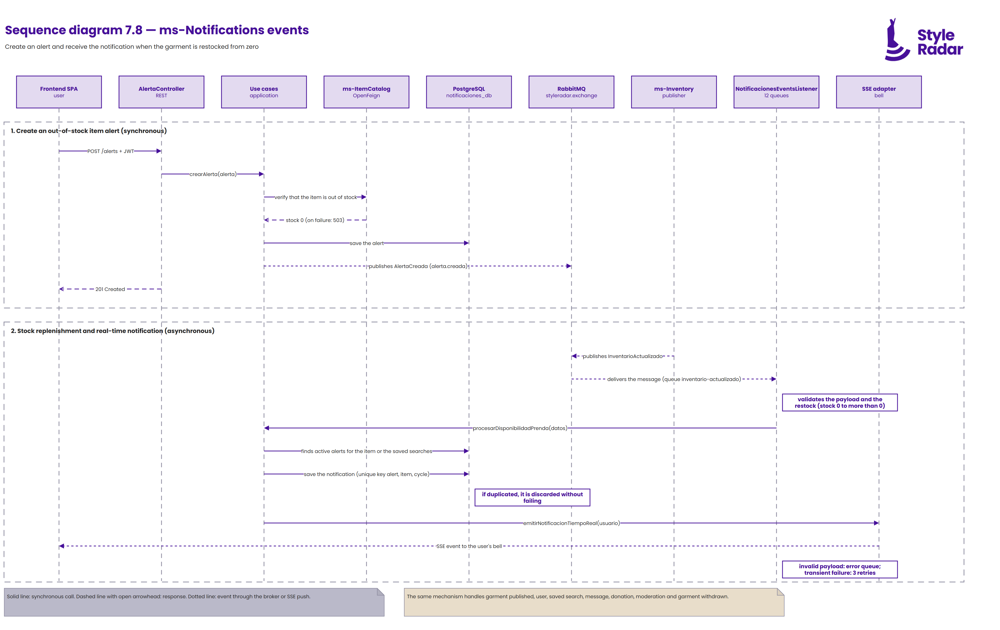
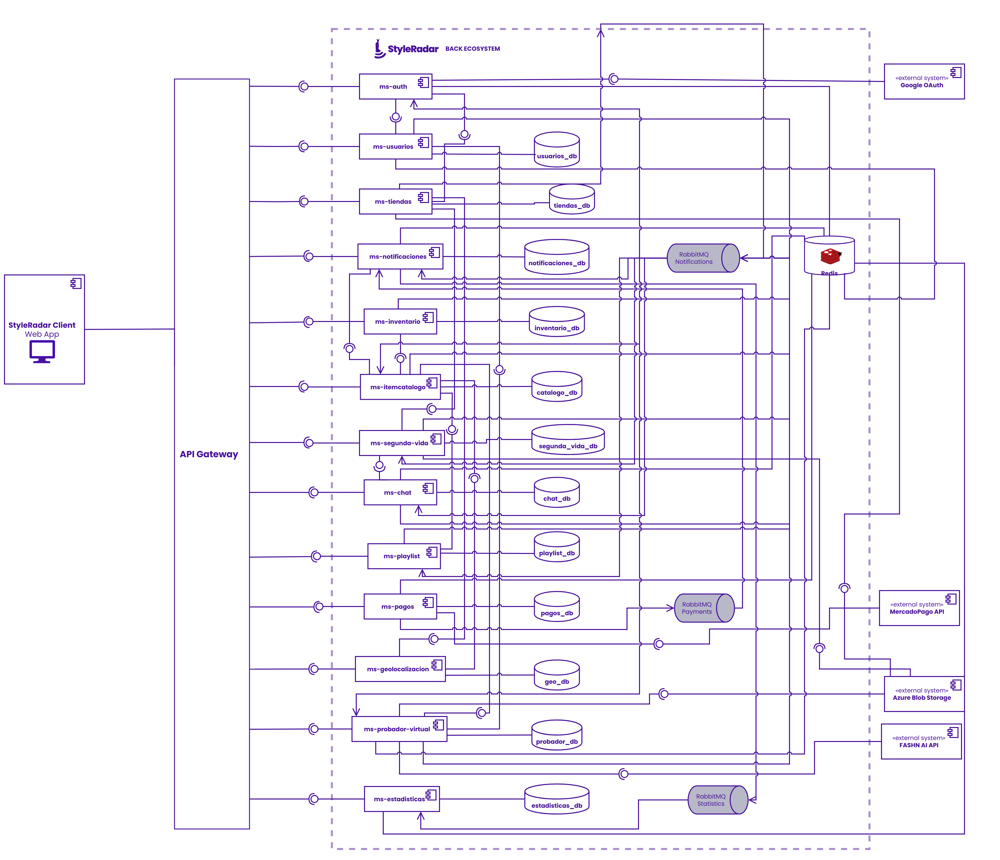
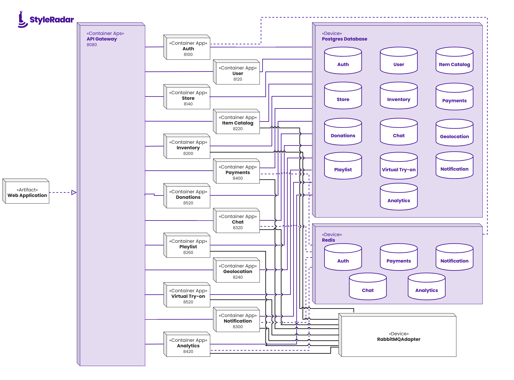

# DOCUMENTACIÓN ARQUITECTÓNICA Y DIAGRAMAS UML — GJ-Notification-Service (NOT-20)

- **Microservicio:** `GJ-Notification-Service` (`ms-notificaciones`, puerto `8300`)
- **Equipo:** Guatoque Jiraguas (`GJ`)
- **Bounded Context:** Notificaciones, alertas de disponibilidad y tiempo real (`SSE`)
- **Archivos fuente editables (Draw.io):** [`docs/uml/`](./uml/)
- **Imágenes exportadas:** [`docs/images/`](./images/)

> **Regla de oro de StyleRadar:** cada diagrama va acompañado de su explicación técnica (qué representa) y de su justificación arquitectónica (por qué se diseñó así). Un diagrama sin texto no se recibe.

> **Idioma:** los diagramas (`.drawio` e imágenes) están en inglés; los nombres de clases, métodos, tablas, columnas y colas se dejan como en el código. Esta explicación sigue en español.
>
> **Actualización del 18/11/2026:** reflejan el código de cierre del Sprint 3 (`itemId` de texto con migración V6, `GET /alerts/check` con `ConsultarSuscripcionAlertaUseCaseImpl` y `SuscripcionAlertaResponse`, filtro único `read` en notificaciones, `Alerta.activar()` con `ActivarAlertaUseCaseImpl`, canal `AMBOS`, estado de cuenta `SUSPENDIDO`, campo `nombreBusqueda` en `AlertaResponse`, `CodigoError` (`code`) en las excepciones de dominio y `ProblemDetail`, `RateLimitFilter`, `MetricasConfig` y Swagger en inglés).

## Plantilla de estilo

Todos los diagramas siguen la plantilla de diagramas de StyleRadar: fondo blanco, tipografía Poppins y la paleta del curso.

| Color | Uso | Valor |
| :--- | :--- | :---: |
| Acento | Bordes, títulos y relaciones | `#47119A` |
| Dominante | Notas y detalles | `#E8DDCA` |
| Secundario | Texto y nodos de despliegue | `#262626` |
| Apoyo | Broker y notas informativas | `#BAB9C9` |
| Base | Fondo | `#FFFFFF` |

Cada diagrama empieza con la cabecera común: logo de StyleRadar y el título `STYLERADAR — <TIPO> DIAGRAM : <microservicio> (<equipo>)`.

**Notación de componentes.** Cada componente se dibuja con el símbolo UML de componente (rectángulo con las dos pestañas a la izquierda) y su color indica el tipo:

| Tipo | Color | Valor |
| :--- | :--- | :---: |
| Controller (controladores, filtros, listeners y configuración) | Beige | `#E8DDCA` |
| UseCase (casos de uso, servicios y reglas de dominio) | Rosa | `#FFCCCC` |
| Adapter | Amarillo | `#FFFF99` |
| Mapper | Cian | `#99FFFF` |
| Repository y puertos | Blanco | `#FFFFFF` |
| Exception | Verde | `#99FFCC` |
| Sistemas externos | Azul | `#99CCFF` |
| Base de datos | Rojo | `#FF9999` |

En el diagrama de clases, la cabecera de cada clase indica su tipo: interfaz (naranja `#FFE6CC`), clase abstracta (azul `#CCE5FF`), objeto de valor (amarillo `#FFFF99`), enumeración (rosa `#FFCCCC`) y clase (lila `#E4DBF0`). En el de base de datos, cada tabla lleva la cabecera lila y una columna de claves (`PK`, `FK`, `UK`).

Los valores se tomaron de la imagen de la propuesta de estilo. Si el curso publica los códigos oficiales, se reemplazan en los cinco archivos `.drawio`.

Los diagramas se editan en [Draw.io](https://app.diagrams.net) abriendo el archivo `.drawio`. Después de editarlos se exporta el PNG con el mismo nombre.

| Diagrama | Fuente editable | Imagen |
| :--- | :--- | :--- |
| Contexto | [`diagrama-contexto.drawio`](./uml/diagrama-contexto.drawio) | [`diagrama-contexto.png`](./images/diagrama-contexto.png) |
| Componentes específico | [`diagrama-componentes-especifico.drawio`](./uml/diagrama-componentes-especifico.drawio) | [`diagrama-componentes-especifico.png`](./images/diagrama-componentes-especifico.png) |
| Clases | [`diagrama-clases.drawio`](./uml/diagrama-clases.drawio) | [`diagrama-clases.png`](./images/diagrama-clases.png) |
| Base de datos | [`diagrama-base-datos.drawio`](./uml/diagrama-base-datos.drawio) | [`diagrama-base-datos.png`](./images/diagrama-base-datos.png) |
| Despliegue | [`diagrama-despliegue.drawio`](./uml/diagrama-despliegue.drawio) | [`diagrama-despliegue.png`](./images/diagrama-despliegue.png) |
| Secuencia 7.8 | [`diagrama-secuencia.drawio`](./uml/diagrama-secuencia.drawio) | [`diagrama-secuencia.png`](./images/diagrama-secuencia.png) |

---

## 1. Diagrama de contexto

  

### 1.1. Explicación técnica

El diagrama muestra la frontera de `ms-notificaciones` (puerto `8300`) y los sistemas con los que se comunica.

1. **Frontend (SPA):** el usuario llega por HTTPS directamente al servicio; el API Gateway ya no se dibuja en los diagramas de ms-notificaciones. Las rutas REST de `/api/v1/users/{id}` y la suscripción SSE de la campana exigen un JWT Bearer (el stream también acepta un ticket de 60 s en `?ticket=`).
2. **Broker de eventos (RabbitMQ, `:5672`):** el servicio consume 12 colas durables sobre el exchange `styleradar.exchange`:
   - `ms-inventario` (`:8200`) publica `InventarioActualizado`.
   - `ms-usuarios` (`:8120`) publica el estado de cuenta y las búsquedas guardadas.
   - `ms-chat` (`:8320`) publica `MensajeEnviado`.
   - `ms-segunda-vida-donaciones` (`:8520`) publica `DonacionEstadoCambiado`.
   - `ms-segunda-vida-donaciones` (`:8520`) publica además `SolicitudDonacionCreada` y `PrendaVendida` (nombres propuestos, por confirmar).
   - `ms-pagos` publica `PagoConfirmado` (nombre propuesto, por confirmar).
   - `ms-item-catalogo` (`:8220`) publica prenda publicada, prenda retirada y cambios de moderación.
   - `ms-tiendas` (`:8140`) publica `FundacionDesactivada` (GJ-117), que avisa a los donantes afectados.
3. **Publicación de `AlertaCreada`:** cada alerta nueva se publica en el broker y la consume `ms-estadisticas` (`:8420`).
4. **Catálogo por OpenFeign:** al crear una alerta sobre una prenda, el servicio consulta la disponibilidad en `ms-item-catalogo`. Si Catálogo no responde, el cliente recibe `503` y no se crea la alerta.
5. **Autenticación (`ms-auth`, `:8100`):** emite el JWT. `ms-notificaciones` no lo consulta: valida la firma HS256 con la clave compartida.
6. **Base de datos propia:** `notificaciones_db` (PostgreSQL 16, `:5432`), sin tablas compartidas con otros servicios.
7. **Redis:** está en `docker-compose`, pero el servicio todavía no lo usa.

### 1.2. Justificación arquitectónica

- **Eventos en vez de consultas a otras bases de datos:** el monolito original detectaba reposiciones consultando tablas de inventario. En microservicios eso viola *Database-per-Service*. Consumir eventos elimina ese acoplamiento y reacciona al cambio en cuanto ocurre.
- **Una sola llamada síncrona:** solo la creación de una alerta necesita una respuesta inmediata sobre el stock, por eso es la única comunicación HTTP hacia otro servicio.
- **Validación local del token:** evita una llamada a `ms-auth` en cada petición y mantiene el servicio disponible aunque autenticación esté caída.

---

## 2. Diagrama de componentes específico (arquitectura hexagonal)

  

### 2.1. Explicación técnica

El servicio se organiza en puertos y adaptadores, con las dependencias apuntando hacia el dominio.

1. **Adaptadores de entrada (`infrastructure/adapter/in`):**
   - `AlertaController` implementa `AlertaApi` (documentación Swagger en inglés) y expone 11 endpoints bajo `/api/v1/users/{id}` (incluidos `GET /alerts/check`, `PATCH /alerts/{alertId}/activate`, `GET /notifications` con filtro único `read`, `POST /notifications/stream-ticket` y la suscripción SSE con reconexión por `Last-Event-ID`). `PreferenciaAvisoController` expone 2 más: listar y elegir el canal de cada tipo de aviso (14 endpoints en total junto a `/actuator/health`).
   - `NotificacionesEventsListener` consume las 12 colas. Un payload inválido va directo a la cola de errores; un fallo transitorio se reintenta 3 veces antes de llegar a ella (`RabbitRetryConfig`).
   - `JwtAuthenticationFilter` y `SecurityConfig` validan el JWT sin estado (y el ticket de 60 s en `?ticket=` únicamente para el stream SSE). Solo `/actuator/health` y la documentación Swagger (en local y QA; apagada en PROD) son públicos.
   - `GlobalExceptionHandler` responde con `ProblemDetail` (RFC 7807) con `type: "about:blank"`, un campo `code` estable (`CodigoError`), `mensaje`, `timestamp` y `errors` por campo en los `400` de validación.
   - `CorreoPendienteRecuperador` (`adapter/in/scheduler`) reintenta los correos pendientes al arrancar el servicio y cada 60 s (GJ-119).
2. **Aplicación (`application`):** los once puertos de entrada (`domain/port/in`) son interfaces de casos de uso (`CrearAlertaUseCase`, `ConsultarSuscripcionAlertaUseCase`, `ListarAlertasUseCase`, `DesactivarAlertaUseCase`, `ActivarAlertaUseCase`, `ListarNotificacionesUseCase`, `MarcarNotificacionLeidaUseCase`, `PreferenciasAvisosUseCase`, `ProcesarEventosExternosUseCase`, `EnviarAvisoPorCorreoUseCase` y `ReenviarCorreosPendientesUseCase`). Cada una tiene su implementación `*UseCaseImpl`, que delega en `AlertaApplicationService` y `NotificacionApplicationService` (también interfaz más implementación). Los DTO son `records` (incluyendo `SuscripcionAlertaResponse`, `TicketStreamResponse` y `AlertaResponse` con `nombreBusqueda`) y el mapeo usa MapStruct.
3. **Dominio (`domain`):** modelos, objetos de valor, reglas (`AlertaValidator`, `EvaluadorCriteriosMatcher`), evento y excepciones, sin Spring, JPA ni Lombok. Los puertos de salida son interfaces del dominio.
4. **Adaptadores de salida (`infrastructure/adapter/out`):** implementan los puertos de salida: JPA sobre PostgreSQL, cliente OpenFeign de Catálogo, publicador de `AlertaCreada`, `SseEmitter` por usuario y `CorreoSmtpAdapter`, que envía los avisos por correo con `JavaMailSender` en un hilo aparte, con 3 intentos y espera creciente; si se agotan, guarda el correo como pendiente (`CorreoPendienteRepositoryAdapter`). El mismo adaptador implementa `EnvioCorreoPort`, el envío inmediato que usa el reintento.

### 2.2. Justificación arquitectónica

- **Dominio aislado:** las reglas críticas se prueban sin levantar Spring ni una base de datos.
- **Tecnologías intercambiables:** cambiar PostgreSQL, RabbitMQ o el cliente de Catálogo implica cambiar solo su adaptador.
- **Interfaz más implementación:** casos de uso y servicios siempre tienen interfaz, como exige la estructura votada por el curso.

### 2.3. Deuda arquitectónica (resuelta en GJ-93)

- Los mapeadores de persistencia ahora viven en `infrastructure/adapter/out/persistence/mapper`. El paquete `application` ya no importa nada de `infrastructure`.
- `AlertaController` solo conoce los casos de uso, los mapeadores de DTO, el extractor de usuario (`infrastructure/security`) y el registro SSE compartido (`infrastructure/sse`). Ya no usa ningún adaptador de salida.
- `SecurityContextUserExtractor` ya no asume el usuario 1 cuando el identificador no es numérico: responde acceso denegado.

---

## 3. Diagrama de clases

  

### 3.1. Explicación técnica

1. **Entidades:** `Notificacion`, `Alerta`, `PreferenciaAviso`, `BusquedaGuardadaCopia` y `EstadoCuentaCopia`. Los identificadores de usuario y búsqueda son `Long` y el del ítem es `String` (UUID); todos apuntan a otros servicios, por lo que no hay referencias a sus clases. `Alerta` tiene `activar()` y `desactivar()`.
2. **Relaciones por id:** `Notificacion` referencia a `Alerta` por `alertaId`, y `Alerta` referencia a `BusquedaGuardadaCopia` por `busquedaGuardadaId`. Son relaciones lógicas, no objetos enlazados.
3. **Objetos de valor:** `CriterioBusquedaVO` (composición de la búsqueda guardada) y `DatosPrendaVO` (datos del evento de prenda).
4. **Enumeraciones:** `TipoNotificacion` (9 tipos), `CanalNotificacion` (`IN_APP`, `EMAIL`, `PUSH`, `AMBOS`), `CanalAviso` (`SOLO_PLATAFORMA` o `CORREO_Y_PLATAFORMA`), `TipoAlerta`, `EstadoAlerta`, `EstadoCuenta` (`ACTIVO`, `INACTIVO`, `BLOQUEADO`, `SUSPENDIDO`) y `CodigoError`.
5. **Reglas:** `AlertaValidator` valida la creación, la propiedad y los duplicados de una alerta (asignando el `CodigoError` correspondiente a cada excepción). `EvaluadorCriteriosMatcher` compara una búsqueda guardada o una alerta contra los datos de un evento, en memoria.
6. **Evento de dominio:** `AlertaCreadaDomainEvent`, que el servicio publica al registrar una alerta.
7. **Excepciones de dominio:** cinco clases hijas de `RuntimeException` que portan su `CodigoError` estable y que `AlertaValidator`, los casos de uso y los adaptadores lanzan: `AccesoDenegadoException` (403, `ACCESS_DENIED`), `RecursoNoEncontradoException` (404, `ALERT_NOT_FOUND` / `NOTIFICATION_NOT_FOUND`), `ConflictoException` (409, `ALERT_ALREADY_ACTIVE`), `ReglaDeNegocioException` (422, `ITEM_HAS_STOCK` / `ITEM_NOT_FOUND` / `ACCOUNT_NOT_ALLOWED` / `SAVED_SEARCH_NOT_AVAILABLE` / `INVALID_ALERT`) y `ServicioExternoNoDisponibleException` (503, `CATALOG_UNAVAILABLE`). `GlobalExceptionHandler` las traduce a respuestas `ProblemDetail` con su `code`.
8. **Puertos (interfaces):** el diagrama muestra los 11 puertos de salida (`domain.port.out`, que implementan los adaptadores) y los 11 de entrada (`domain.port.in`, que implementan los casos de uso), con las firmas de sus métodos.
9. **Reintento de correos y paginación:** `CorreoPendiente` es el correo que no se pudo enviar (con sus intentos y su `EstadoCorreo`: `PENDIENTE`, `ENVIADO` o `FALLIDO`) y `Pagina<T>` es la página de resultados de la bandeja, sin depender de Spring Data.

### 3.2. Justificación arquitectónica

- **Referencias por id:** importar clases de otros servicios acoplaría los modelos de dominio. Con ids y objetos de valor, el contexto de notificaciones es autónomo.
- **Evaluación en memoria:** comparar criterios contra el evento evita consultar el catálogo cada vez que llega un cambio de stock.
- **Cambios de estado en el dominio:** los cambios pasan por métodos como `desactivar()` y `marcarComoLeida()`, no por asignación directa de campos.

---

## 4. Diagrama de base de datos

  

### 4.1. Explicación técnica

El esquema relacional de `notificaciones_db` (PostgreSQL 16) lo gestionan las migraciones Flyway `V1__init_schema.sql`, `V2__add_indexes.sql`, `V3__add_evento_id_notificaciones.sql`, `V4__create_preferencias_avisos.sql`, `V5__create_correos_pendientes.sql` y `V6__alter_item_id_to_varchar.sql` (`item_id` pasa a `VARCHAR(100)` en `alertas` y `notificaciones` para aceptar UUID). Hibernate solo lo valida (`ddl-auto: validate`).

| Tabla | Propósito |
| :--- | :--- |
| `alertas` | Alertas por prenda agotada o por búsqueda guardada, con su estado. |
| `notificaciones` | Bandeja de cada usuario, con estado de lectura, ciclo de reposición y `evento_id` del evento que la originó. |
| `preferencias_avisos` | Canal elegido por usuario y tipo de aviso. Sin fila se aplica solo plataforma. |
| `busquedas_guardadas_copia` | Copia local de las búsquedas guardadas, actualizada por eventos. |
| `estados_cuenta_copia` | Copia local del estado de cuenta (`ACTIVO`, `INACTIVO`, `BLOQUEADO`, `SUSPENDIDO`). |
| `correos_pendientes` | Correos que no se pudieron enviar tras los reintentos inmediatos, con sus intentos y su estado (`PENDIENTE`, `ENVIADO` o `FALLIDO`). Se reintentan al arrancar el servicio y cada 60 s. |

Dos restricciones únicas dan la idempotencia: `uk_notificacion_alerta_item_ciclo` impide más de una notificación por alerta, ítem y ciclo de reposición, y `uk_notificacion_evento_usuario` (`evento_id`, `usuario_id`) impide que un evento repetido genere una segunda notificación directa. `preferencias_avisos` es única por `(usuario_id, tipo)`.

### 4.2. Justificación arquitectónica

- **Sin llaves foráneas:** usuarios e ítems pertenecen a otros servicios y no se pueden referenciar entre bases de datos. Las relaciones del diagrama son lógicas.
- **Copias locales por evento:** evitan llamadas HTTP cada vez que llega un evento y permiten evaluar en memoria.
- **Idempotencia en la base de datos:** RabbitMQ entrega al menos una vez; la restricción única impide el duplicado aunque dos entregas lleguen a la vez. La que pierde se descarta sin generar notificación.
- **Columnas tipadas:** los criterios de búsqueda se guardan en columnas propias, no en JSONB.

### 4.3. Limitaciones conocidas

- `correos_pendientes.cuerpo_html` guarda el texto del correo tal como se envía, que hoy es texto plano.
- Con varias instancias del servicio, el recuperador podría reintentar el mismo correo en dos de ellas; hoy cada entorno corre con una sola instancia.

---

## 5. Diagrama de despliegue

  

### 5.1. Explicación técnica

El diagrama muestra el equipo de desarrollo, GitHub y los dos entornos de Azure.

**Equipo y GitHub**
1. **Equipo del desarrollador:** `docker compose` levanta `ms-notificaciones` (`:8300`), PostgreSQL 16, RabbitMQ 3.13.7 y Redis 7.
2. **GitHub:** repositorio con las ramas `main` y `develop`. Los líderes aprueban los pull requests.
3. **GitHub Actions:** `ci-qa.yml` ejecuta `mvn verify` con JaCoCo de al menos 85 %, comprueba el arranque con `docker compose`, publica la imagen y despliega en QA, y corre Newman contra QA. `cd-prod.yml` ejecuta `mvn verify`, construye la imagen y despliega en PROD.

**Azure**
4. **Azure Container Registry:** guarda la imagen `ms-notificaciones` que publican los pipelines.
5. **App Service QA y App Service PROD:** el contenedor en el puerto `8300`, con Always On. QA comparte plan B1 con otro proyecto; PROD tiene plan propio.
6. **Servidor PostgreSQL 16:** una sola instancia con dos bases separadas (`styleradar_notificaciones_qa` y `styleradar_notificaciones_prod`), por JDBC sobre TLS.
7. **VM del broker:** RabbitMQ 3.13.7 con TLS y persistencia, administrado por Oscar. QA usa el vhost `/` y PROD el vhost `prod`; el servicio se conecta con AMQP sobre TLS.
8. **Servidor SMTP (opcional):** solo se usa si el entorno define `SPRING_MAIL_HOST`.

### 5.2. Justificación arquitectónica

- **Imagen multi-etapa:** compila con Maven en una etapa y copia solo el JAR a una imagen de ejecución mínima, con usuario sin privilegios.
- **Un broker compartido en la nube:** lo definió el profesor como infraestructura compartida, sin repositorio propio.
- **Credenciales fuera del repositorio:** solo se versiona `.env.example`; cada entorno recibe sus secretos por variables.

---

## 6. Diagrama de secuencia 7.8 (eventos)

  

### 6.1. Explicación técnica

El diagrama muestra los dos recorridos principales del servicio.

**Fase 1: crear una alerta (síncrono)**
1. El frontend envía `POST /api/v1/users/{id}/alerts` con el JWT al `AlertaController`.
2. El caso de uso consulta a `ms-item-catalogo` por OpenFeign que el ítem esté agotado. Si Catálogo no responde, la respuesta es `503` y no se crea la alerta.
3. Se guarda la alerta en PostgreSQL, se publica `AlertaCreada` en el broker (la consume `ms-estadisticas`) y el cliente recibe `201 Created`.

**Fase 2: reposición de stock y notificación (asíncrono)**
1. `ms-inventario` publica `InventarioActualizado` en RabbitMQ y el broker lo entrega a `NotificacionesEventsListener`.
2. El listener valida el payload y que sea una reposición (stock de cero a mayor que cero). Un payload inválido va a la cola de errores; un fallo transitorio se reintenta 3 veces.
3. El caso de uso busca las alertas activas, guarda la notificación y, si la restricción única detecta un duplicado, lo descarta sin fallar.
4. Por último empuja la notificación por SSE a la campana del usuario conectado.

El mismo mecanismo atiende los demás eventos: prenda publicada, estado de cuenta, búsqueda guardada, mensaje, donación, moderación y prenda retirada.

### 6.2. Justificación arquitectónica

- **Una llamada síncrona y el resto por eventos:** solo crear la alerta necesita una respuesta inmediata; la reposición se procesa sin acoplar a Inventario con Notificaciones.
- **Reintentos y cola de errores:** un fallo transitorio no pierde el evento y un mensaje inválido no bloquea la cola.
- **Idempotencia:** como el broker puede entregar un evento más de una vez, la restricción única de la base de datos evita notificaciones repetidas.

---

## 7. Diagrama de componentes general (ecosistema StyleRadar)

  

> Este diagrama lo elaboró el equipo de arquitectura y es el mismo para todos los microservicios. Se conserva aquí como referencia; el detalle de `ms-notificaciones` está en las secciones 1 a 6. Fuente editable: [`uml/diagrama-componentes-general.drawio`](./uml/diagrama-componentes-general.drawio).

### 7.1. Explicación técnica

El diagrama muestra el backend completo de StyleRadar dentro de un recuadro punteado («Back Ecosystem»).

1. **Cliente y entrada:** la aplicación web (*StyleRadar Client*) habla solo con el **API Gateway**, que reparte las llamadas a cada microservicio.
2. **Microservicios:** `ms-auth`, `ms-usuarios`, `ms-tiendas`, `ms-notificaciones`, `ms-inventario`, `ms-itemcatalogo`, `ms-segunda-vida`, `ms-chat`, `ms-playlist`, `ms-pagos`, `ms-geolocalizacion`, `ms-probador-virtual` y `ms-estadisticas`. Cada uno tiene su propia base de datos (`usuarios_db`, `notificaciones_db`, `catalogo_db`, etc.).
3. **Mensajería y caché:** hay colas de RabbitMQ para Notificaciones, Pagos y Estadísticas, y una instancia de Redis compartida.
4. **Sistemas externos:** Google OAuth, la API de MercadoPago, Azure Blob Storage y la API de FASHN AI.
5. **Interfaces:** las interfaces proporcionadas y requeridas (círculo y semicírculo) marcan quién ofrece y quién consume cada servicio.

**Lo que corresponde a `ms-notificaciones`:** su base `notificaciones_db`, su cola de RabbitMQ y su entrada por el API Gateway. Los eventos que consume y publica están en [CONTRATOS_EVENTOS_NOT21.md](./CONTRATOS_EVENTOS_NOT21.md).

### 7.2. Justificación arquitectónica

- **Una base por servicio:** ningún servicio lee la base de otro; se comunican por HTTP a través de las interfaces o por eventos de RabbitMQ.
- **Una sola puerta de entrada:** el API Gateway concentra la autenticación y el enrutamiento, así que el cliente no conoce los puertos de los servicios.

---

## 8. Diagrama de despliegue general (ecosistema StyleRadar)

  

> Elaborado por el equipo de arquitectura. Se conserva como referencia; el despliegue propio de `ms-notificaciones` (QA y PROD en Azure) está en la sección 5. Fuente editable: [`uml/diagrama-despliegue-general.drawio`](./uml/diagrama-despliegue-general.drawio). La imagen se generó a partir del archivo `.drawio`.

### 8.1. Explicación técnica

1. **Aplicación web:** el artefacto *Web Application* se despliega contra el **API Gateway** (`8080`).
2. **Contenedores:** cada microservicio es una *Container App* con su puerto: Auth `8100`, User `8120`, Store `8140`, Item Catalog `8220`, Inventory `8200`, Payments `8400`, Donations `8520`, Chat `8320`, Playlist `8260`, Geolocation `8240`, Virtual Try-on `8520`, **Notification `8300`** y Analytics `8420`.
3. **PostgreSQL:** un servidor con una base por servicio (Auth, User, Item Catalog, Store, Inventory, Payments, Donations, Chat, Geolocation, Playlist, Virtual Try-on, Notification y Analytics).
4. **Redis:** espacios para Auth, Payments, Notification, Chat y Analytics.
5. **RabbitMQ:** un dispositivo `RabbitMQAdapter` al que se conectan los servicios que publican o consumen eventos.

> **Por confirmar con el equipo de arquitectura:** en el diagrama, Donations y Virtual Try-on figuran con el mismo puerto `8520`. Dos contenedores no pueden compartir puerto en la misma máquina; conviene confirmar el valor correcto.

### 8.2. Justificación arquitectónica

- **Contenedor por servicio:** cada microservicio se despliega y escala por separado.
- **Bases y caché separadas por servicio:** un fallo o una migración en una base no afecta a los demás servicios.
