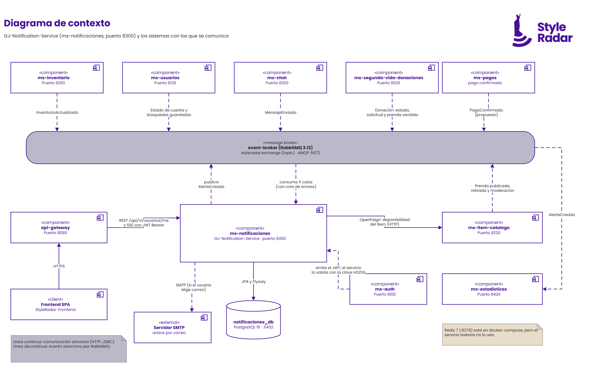
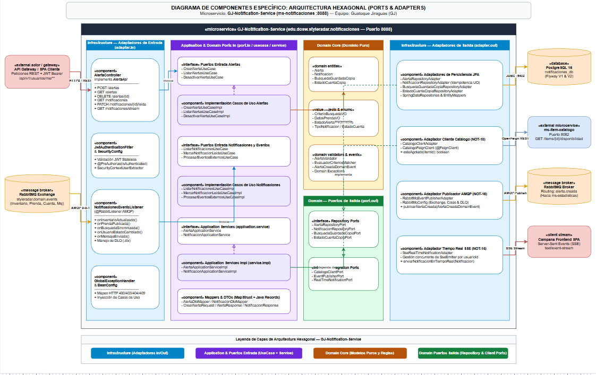
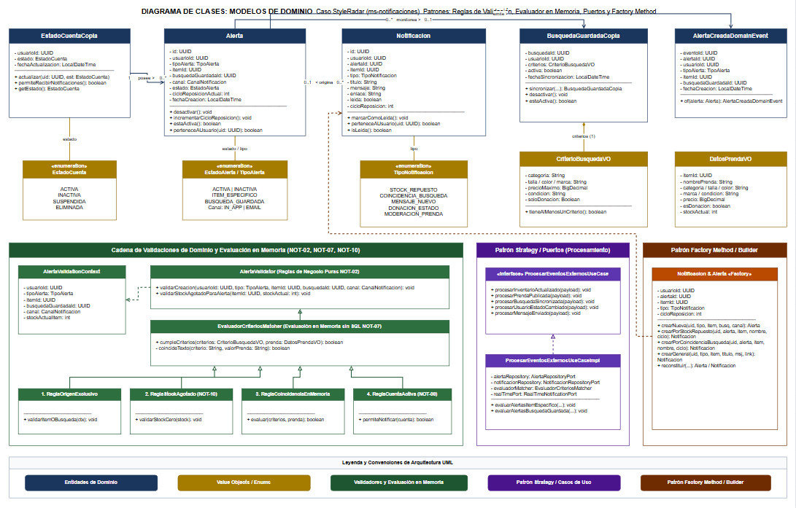
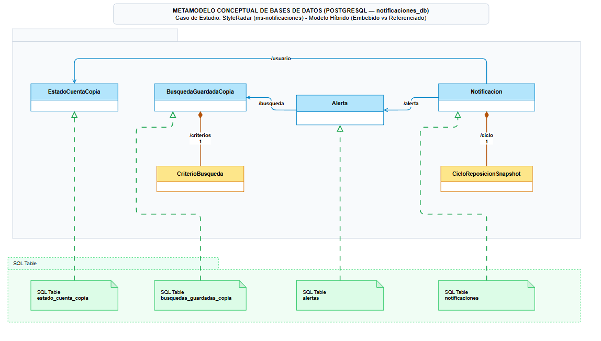
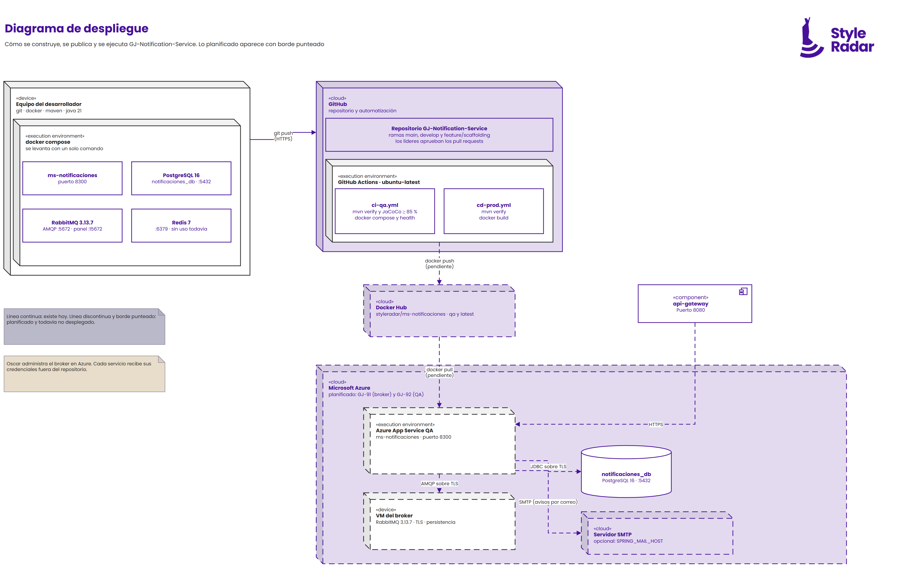
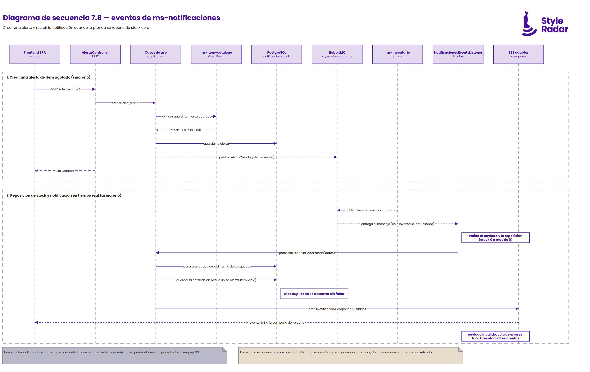

# DOCUMENTACIÓN ARQUITECTÓNICA Y DIAGRAMAS UML — GJ-Notification-Service (NOT-20)

- **Microservicio:** `GJ-Notification-Service` (`ms-notificaciones`, puerto `8300`)
- **Equipo:** Guatoque Jiraguas (`GJ`)
- **Bounded Context:** Notificaciones, alertas de disponibilidad y tiempo real (`SSE`)
- **Archivos fuente editables (Draw.io):** [`docs/uml/`](./uml/)
- **Imágenes exportadas:** [`docs/images/`](./images/)

> **Regla de oro de StyleRadar:** cada diagrama va acompañado de su explicación técnica (qué representa) y de su justificación arquitectónica (por qué se diseñó así). Un diagrama sin texto no se recibe.

## Plantilla de estilo

Todos los diagramas siguen la plantilla de diagramas de StyleRadar: fondo blanco, tipografía Poppins y la paleta del curso.

| Color | Uso | Valor |
| :--- | :--- | :---: |
| Acento | Bordes, títulos y relaciones | `#47119A` |
| Dominante | Notas y detalles | `#E8DDCA` |
| Secundario | Texto y nodos de despliegue | `#262626` |
| Apoyo | Broker y notas informativas | `#BAB9C9` |
| Base | Fondo | `#FFFFFF` |

Los valores se tomaron de la imagen de la propuesta de estilo. Si el curso publica los códigos oficiales, se reemplazan en los cinco archivos `.drawio`.

Los diagramas se editan en [Draw.io](https://app.diagrams.net) abriendo el archivo `.drawio`. Después de editarlos se exporta el PNG con el mismo nombre.

| Diagrama | Fuente editable | Imagen |
| :--- | :--- | :--- |
| Contexto | [`diagrama-contexto.drawio`](./uml/diagrama-contexto.drawio) | [`diagrama-contexto.png`](./images/diagrama-contexto.png) |
| Componentes específico | [`diagrama-componentes-especifico.drawio`](./uml/diagrama-componentes-especifico.drawio) | [`diagrama-componentes-especifico.png`](./images/diagrama-componentes-especifico.png) |
| Clases | [`diagrama-clases.drawio`](./uml/diagrama-clases.drawio) | [`diagrama-clases.png`](./images/diagrama-clases.png) |
| Base de datos | [`diagrama-base-datos.drawio`](./uml/diagrama-base-datos.drawio) | [`diagrama-base-datos.png`](./images/diagrama-base-datos.png) |
| Despliegue | [`diagrama-despliegue.drawio`](./uml/diagrama-despliegue.drawio) | [`diagrama-despliegue.png`](./images/diagrama-despliegue.png) |
| Secuencia 7.8 | [`diagrama-secuencia.drawio`](./uml/diagrama-secuencia.drawio) | [`diagrama-secuencia.png`](./images/diagrama-secuencia.png) |

---

## 1. Diagrama de contexto

  

### 1.1. Explicación técnica

El diagrama muestra la frontera de `ms-notificaciones` (puerto `8300`) y los sistemas con los que se comunica.

1. **Frontend y API Gateway (`api-gateway`, `:8080`):** el usuario llega por HTTPS a través del gateway. Las rutas REST de `/api/v1/usuarios/me` y la suscripción SSE de la campana exigen un JWT Bearer.
2. **Broker de eventos (RabbitMQ, `:5672`):** el servicio consume 8 colas durables sobre el exchange `styleradar.exchange`:
   - `ms-inventario` (`:8200`) publica `InventarioActualizado`.
   - `ms-usuarios` (`:8120`) publica el estado de cuenta y las búsquedas guardadas.
   - `ms-chat` (`:8320`) publica `MensajeEnviado`.
   - `ms-segunda-vida-donaciones` (`:8520`) publica `DonacionEstadoCambiado`.
   - `ms-item-catalogo` (`:8220`) publica prenda publicada, prenda retirada y cambios de moderación.
3. **Publicación de `AlertaCreada`:** cada alerta nueva se publica en el broker y la consume `ms-estadisticas` (`:8420`).
4. **Catálogo por OpenFeign:** al crear una alerta sobre una prenda, el servicio consulta la disponibilidad en `ms-item-catalogo`. Si Catálogo no responde, el cliente recibe `503` y no se crea la alerta.
5. **Autenticación (`ms-auth`, `:8100`):** emite el JWT. `ms-notificaciones` no lo consulta: valida la firma HS256 con la clave compartida.
6. **Base de datos propia:** `notificaciones_db` (PostgreSQL 16, `:5432`), sin tablas compartidas con otros servicios.
7. **Redis:** está en `docker-compose`, pero el servicio todavía no lo usa.

### 1.2. Justificación arquitectónica

- **Eventos en vez de consultas a otras bases de datos:** el monolito original detectaba reposiciones consultando tablas de inventario. En microservicios eso viola *Database-per-Service*. Consumir eventos elimina ese acoplamiento y reacciona al cambio en cuanto ocurre.
- **Una sola llamada síncrona:** solo la creación de una alerta necesita una respuesta inmediata sobre el stock, por eso es la única comunicación HTTP hacia otro servicio.
- **Validación local del token:** evita una llamada a `ms-auth` en cada petición y mantiene el servicio disponible aunque autenticación esté caída.

---

## 2. Diagrama de componentes específico (arquitectura hexagonal)

  

### 2.1. Explicación técnica

El servicio se organiza en puertos y adaptadores, con las dependencias apuntando hacia el dominio.

1. **Adaptadores de entrada (`infrastructure/adapter/in`):**
   - `AlertaController` implementa `AlertaApi` (documentación Swagger) y expone 9 endpoints, incluida la suscripción SSE.
   - `NotificacionesEventsListener` consume las 8 colas. Un payload inválido va directo a la cola de errores; un fallo transitorio se reintenta 3 veces antes de llegar a ella (`RabbitRetryConfig`).
   - `JwtAuthenticationFilter` y `SecurityConfig` validan el JWT sin estado. Solo `/actuator/health` y la documentación Swagger son públicos.
   - `GlobalExceptionHandler` responde con `ProblemDetail` (RFC 7807).
2. **Aplicación (`application`):** los seis puertos de entrada (`domain/port/in`) son interfaces de casos de uso. Cada una tiene su implementación `*UseCaseImpl`, que delega en `AlertaApplicationService` y `NotificacionApplicationService` (también interfaz más implementación). Los DTO son `records` y el mapeo usa MapStruct.
3. **Dominio (`domain`):** modelos, objetos de valor, reglas (`AlertaValidator`, `EvaluadorCriteriosMatcher`), evento y excepciones, sin Spring, JPA ni Lombok. Los puertos de salida son interfaces del dominio.
4. **Adaptadores de salida (`infrastructure/adapter/out`):** implementan los puertos de salida: JPA sobre PostgreSQL, cliente OpenFeign de Catálogo, publicador de `AlertaCreada` y `SseEmitter` por usuario.

### 2.2. Justificación arquitectónica

- **Dominio aislado:** las reglas críticas se prueban sin levantar Spring ni una base de datos.
- **Tecnologías intercambiables:** cambiar PostgreSQL, RabbitMQ o el cliente de Catálogo implica cambiar solo su adaptador.
- **Interfaz más implementación:** casos de uso y servicios siempre tienen interfaz, como exige la estructura votada por el curso.

### 2.3. Deuda arquitectónica (resuelta en GJ-93)

- Los mapeadores de persistencia ahora viven en `infrastructure/adapter/out/persistence/mapper`. El paquete `application` ya no importa nada de `infrastructure`.
- `AlertaController` solo conoce los casos de uso, los mapeadores de DTO, el extractor de usuario (`infrastructure/security`) y el registro SSE compartido (`infrastructure/sse`). Ya no usa ningún adaptador de salida.
- `SecurityContextUserExtractor` ya no asume el usuario 1 cuando el identificador no es numérico: responde acceso denegado.

---

## 3. Diagrama de clases

  

### 3.1. Explicación técnica

1. **Entidades:** `Notificacion`, `Alerta`, `BusquedaGuardadaCopia` y `EstadoCuentaCopia`. Los identificadores de usuario, ítem y búsqueda son `Long` y apuntan a otros servicios, por lo que no hay referencias a sus clases.
2. **Relaciones por id:** `Notificacion` referencia a `Alerta` por `alertaId`, y `Alerta` referencia a `BusquedaGuardadaCopia` por `busquedaGuardadaId`. Son relaciones lógicas, no objetos enlazados.
3. **Objetos de valor:** `CriterioBusquedaVO` (composición de la búsqueda guardada) y `DatosPrendaVO` (datos del evento de prenda).
4. **Enumeraciones:** `TipoNotificacion`, `CanalNotificacion`, `TipoAlerta`, `EstadoAlerta` y `EstadoCuenta`.
5. **Reglas:** `AlertaValidator` valida la creación, la propiedad y los duplicados de una alerta. `EvaluadorCriteriosMatcher` compara una búsqueda guardada o una alerta contra los datos de un evento, en memoria.
6. **Evento de dominio:** `AlertaCreadaDomainEvent`, que el servicio publica al registrar una alerta.

### 3.2. Justificación arquitectónica

- **Referencias por id:** importar clases de otros servicios acoplaría los modelos de dominio. Con ids y objetos de valor, el contexto de notificaciones es autónomo.
- **Evaluación en memoria:** comparar criterios contra el evento evita consultar el catálogo cada vez que llega un cambio de stock.
- **Cambios de estado en el dominio:** los cambios pasan por métodos como `desactivar()` y `marcarComoLeida()`, no por asignación directa de campos.

---

## 4. Diagrama de base de datos

  

### 4.1. Explicación técnica

El esquema relacional de `notificaciones_db` (PostgreSQL 16) lo gestionan las migraciones Flyway `V1__init_schema.sql` y `V2__add_indexes.sql`. Hibernate solo lo valida (`ddl-auto: validate`).

| Tabla | Propósito |
| :--- | :--- |
| `alertas` | Alertas por prenda agotada o por búsqueda guardada, con su estado. |
| `notificaciones` | Bandeja de cada usuario, con estado de lectura y ciclo de reposición. |
| `busquedas_guardadas_copia` | Copia local de las búsquedas guardadas, actualizada por eventos. |
| `estados_cuenta_copia` | Copia local del estado de cuenta (`ACTIVO`, `INACTIVO`, `BLOQUEADO`). |

La restricción `uk_notificacion_alerta_item_ciclo` impide más de una notificación por alerta, ítem y ciclo de reposición.

### 4.2. Justificación arquitectónica

- **Sin llaves foráneas:** usuarios e ítems pertenecen a otros servicios y no se pueden referenciar entre bases de datos. Las relaciones del diagrama son lógicas.
- **Copias locales por evento:** evitan llamadas HTTP cada vez que llega un evento y permiten evaluar en memoria.
- **Idempotencia en la base de datos:** RabbitMQ entrega al menos una vez; la restricción única impide el duplicado aunque dos entregas lleguen a la vez. La que pierde se descarta sin generar notificación.
- **Columnas tipadas:** los criterios de búsqueda se guardan en columnas propias, no en JSONB.

### 4.3. Planificado

La tabla de preferencias de canal y el envío por correo (GJ-64) aún no existen; se añadirán con una nueva migración.

---

## 5. Diagrama de despliegue

  

### 5.1. Explicación técnica

El diagrama distingue lo que existe hoy de lo planificado (borde punteado).

**Existe hoy**
1. **Equipo del desarrollador:** `docker compose` levanta `ms-notificaciones` (`:8300`), PostgreSQL 16, RabbitMQ 3.13.7 y Redis 7.
2. **GitHub:** repositorio con las ramas `main`, `develop` y `feature/scaffolding`. Los líderes aprueban los pull requests.
3. **GitHub Actions:** `ci-qa.yml` ejecuta `mvn verify` con JaCoCo de al menos 85 % y comprueba el arranque con `docker compose`. `cd-prod.yml` ejecuta `mvn verify` y construye la imagen.

**Planificado**
4. **Docker Hub (GJ-92):** publicación de la imagen `styleradar/ms-notificaciones`.
5. **Azure App Service QA (GJ-92):** el contenedor en el puerto `8300`, con PostgreSQL de Azure por JDBC sobre TLS.
6. **VM del broker (GJ-91):** RabbitMQ 3.13.7 con TLS y persistencia, administrado por Oscar. El servicio se conecta con AMQP sobre TLS.

### 5.2. Justificación arquitectónica

- **Imagen multi-etapa:** compila con Maven en una etapa y copia solo el JAR a una imagen de ejecución mínima, con usuario sin privilegios.
- **Un broker compartido en la nube:** lo definió el profesor como infraestructura compartida, sin repositorio propio.
- **Credenciales fuera del repositorio:** solo se versiona `.env.example`; cada entorno recibe sus secretos por variables.

---

## 6. Diagrama de secuencia 7.8 (eventos)

  

### 6.1. Explicación técnica

El diagrama muestra los dos recorridos principales del servicio.

**Fase 1: crear una alerta (síncrono)**
1. El frontend envía `POST /api/v1/usuarios/me/alertas` con el JWT al `AlertaController`.
2. El caso de uso consulta a `ms-item-catalogo` por OpenFeign que el ítem esté agotado. Si Catálogo no responde, la respuesta es `503` y no se crea la alerta.
3. Se guarda la alerta en PostgreSQL, se publica `AlertaCreada` en el broker (la consume `ms-estadisticas`) y el cliente recibe `201 Created`.

**Fase 2: reposición de stock y notificación (asíncrono)**
1. `ms-inventario` publica `InventarioActualizado` en RabbitMQ y el broker lo entrega a `NotificacionesEventsListener`.
2. El listener valida el payload y que sea una reposición (stock de cero a mayor que cero). Un payload inválido va a la cola de errores; un fallo transitorio se reintenta 3 veces.
3. El caso de uso busca las alertas activas, guarda la notificación y, si la restricción única detecta un duplicado, lo descarta sin fallar.
4. Por último empuja la notificación por SSE a la campana del usuario conectado.

El mismo mecanismo atiende los demás eventos: prenda publicada, estado de cuenta, búsqueda guardada, mensaje, donación, moderación y prenda retirada.

### 6.2. Justificación arquitectónica

- **Una llamada síncrona y el resto por eventos:** solo crear la alerta necesita una respuesta inmediata; la reposición se procesa sin acoplar a Inventario con Notificaciones.
- **Reintentos y cola de errores:** un fallo transitorio no pierde el evento y un mensaje inválido no bloquea la cola.
- **Idempotencia:** como el broker puede entregar un evento más de una vez, la restricción única de la base de datos evita notificaciones repetidas.
