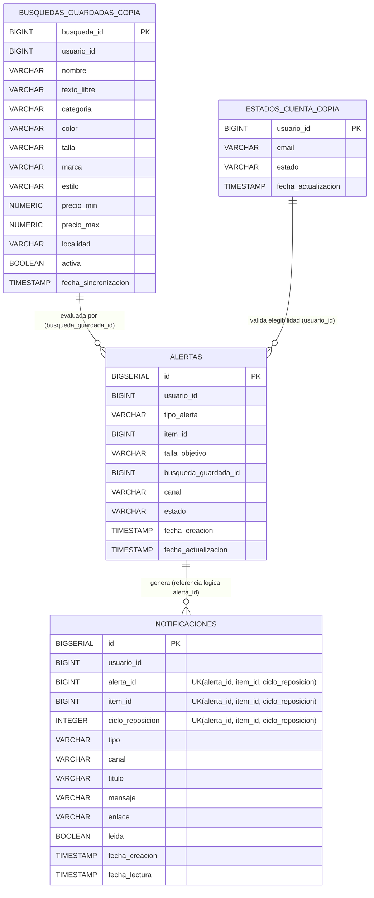
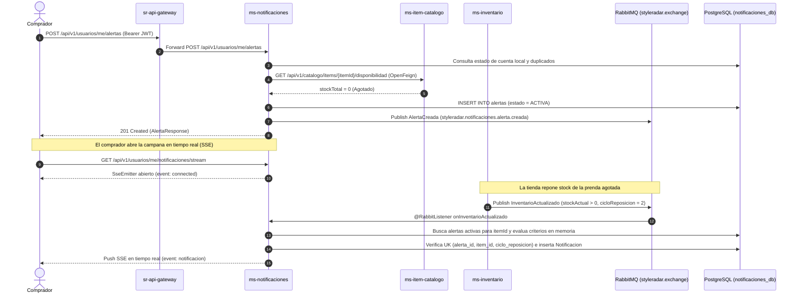

# Diagramas Técnicos — Microservicio de Notificaciones (NOT-20)

**Sistema:** StyleRadar (DOSW · 2026)  
**Servicio:** `ms-notificaciones` (`edu.dosw.styleradar.notificaciones`)

---

## 1. Diagrama de Clases (Arquitectura Hexagonal)

```mermaid
classDiagram
    direction TB

    class Alerta {
        -Long id
        -Long usuarioId
        -TipoAlerta tipoAlerta
        -Long itemId
        -String tallaObjetivo
        -Long busquedaGuardadaId
        -CanalNotificacion canal
        -EstadoAlerta estado
        -LocalDateTime fechaCreacion
        -LocalDateTime fechaActualizacion
        +estaActiva() boolean
        +desactivar() void
        +marcarDisparada() void
    }

    class Notificacion {
        -Long id
        -Long usuarioId
        -Long alertaId
        -Long itemId
        -Integer cicloReposicion
        -TipoNotificacion tipo
        -CanalNotificacion canal
        -String titulo
        -String mensaje
        -String enlace
        -boolean leida
        -LocalDateTime fechaCreacion
        -LocalDateTime fechaLectura
        +marcarComoLeida() void
    }

    class BusquedaGuardadaCopia {
        -Long busquedaId
        -Long usuarioId
        -String nombre
        -CriterioBusquedaVO criterios
        -boolean activa
        -LocalDateTime fechaSincronizacion
    }

    class EstadoCuentaCopia {
        -Long usuarioId
        -String email
        -EstadoCuenta estado
        -LocalDateTime fechaActualizacion
        +puedeRecibirNotificaciones() boolean
    }

    class AlertaValidator {
        +validarCreacionAlerta(Alerta, EstadoCuentaCopia) void
        +validarItemAgotadoEnCatalogo(boolean, Long) void
        +validarBusquedaGuardadaActiva(BusquedaGuardadaCopia, Long) void
        +validarNoDuplicada(boolean) void
        +validarPropiedadAlerta(Alerta, Long) void
    }

    class EvaluadorCriteriosMatcher {
        +coincideConBusqueda(CriterioBusquedaVO, DatosPrendaVO) boolean
        +coincideItemAgotado(Long, String, DatosPrendaVO) boolean
    }

    class CrearAlertaUseCase {
        <<interface>>
        +crearAlerta(Alerta) Alerta
    }

    class ProcesarEventosExternosUseCase {
        <<interface>>
        +procesarDisponibilidadPrenda(DatosPrendaVO) List~Notificacion~
        +sincronizarBusquedaGuardada(BusquedaGuardadaCopia, boolean) void
        +actualizarEstadoCuenta(Long, String, EstadoCuenta) void
        +generarNotificacionDirecta(...) Notificacion
    }

    class AlertaRepositoryPort {
        <<interface>>
    }

    class NotificacionRepositoryPort {
        <<interface>>
    }

    class CatalogoClientPort {
        <<interface>>
    }

    class AlertaController {
        +crearAlerta(CrearAlertaRequest) ResponseEntity
        +listarMisAlertas() ResponseEntity
        +desactivarAlerta(Long) ResponseEntity
        +listarMisNotificaciones(Boolean) ResponseEntity
        +marcarNotificacionComoLeida(Long) ResponseEntity
        +marcarTodasComoLeidas() ResponseEntity
        +contarNoLeidas() ResponseEntity
        +suscribirCampanaTiempoReal() SseEmitter
    }

    class NotificacionesEventsListener {
        +onInventarioActualizado(InventarioActualizadoEventPayload) void
        +onPrendaPublicada(PrendaPublicadaEventPayload) void
        +onUsuarioEstadoCambiado(UsuarioEstadoCambiadoEventPayload) void
        +onBusquedaGuardadaSincronizada(BusquedaGuardadaSincronizadaEventPayload) void
        +onMensajeEnviado(MensajeEnviadoEventPayload) void
        +onDonacionEstadoCambiado(DonacionEstadoCambiadoEventPayload) void
        +onModeracionPrendaCambiada(ModeracionPrendaCambiadaEventPayload) void
    }

    AlertaController --> CrearAlertaUseCase
    NotificacionesEventsListener --> ProcesarEventosExternosUseCase
    CrearAlertaUseCase ..> Alerta
    CrearAlertaUseCase --> AlertaValidator
    CrearAlertaUseCase --> AlertaRepositoryPort
    CrearAlertaUseCase --> CatalogoClientPort
    ProcesarEventosExternosUseCase --> EvaluadorCriteriosMatcher
    ProcesarEventosExternosUseCase --> NotificacionRepositoryPort
    ProcesarEventosExternosUseCase ..> Notificacion
    ProcesarEventosExternosUseCase ..> BusquedaGuardadaCopia
    ProcesarEventosExternosUseCase ..> EstadoCuentaCopia
```

---

## 2. Diagrama Entidad-Relación de Base de Datos (`notificaciones_db`)

> **Aislamiento Database-per-Service:** Sin llaves foráneas hacia tablas de otros microservicios (`usuarios`, `items`, `busquedas_guardadas`), conservando la restricción única de idempotencia `(alerta_id, item_id, ciclo_reposicion)`.

---

## 3. Diagrama de Secuencia 7.8 Actualizado con Eventos Asíncronos y SSE

