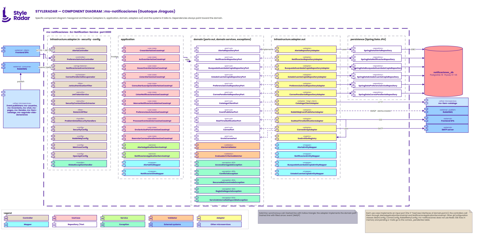
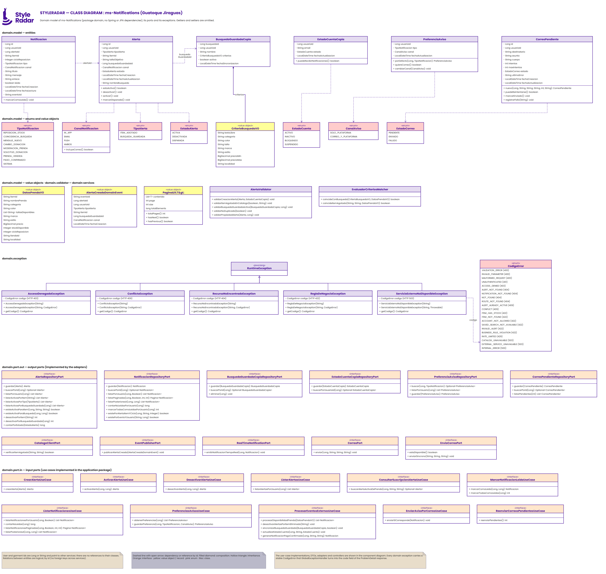
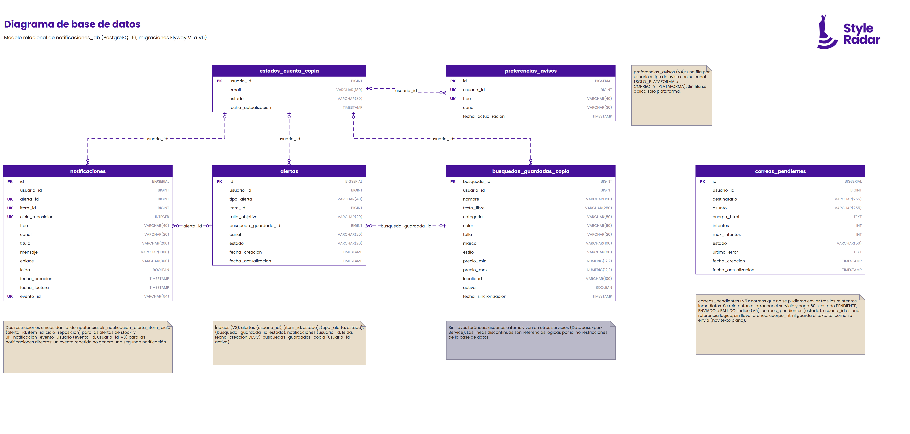
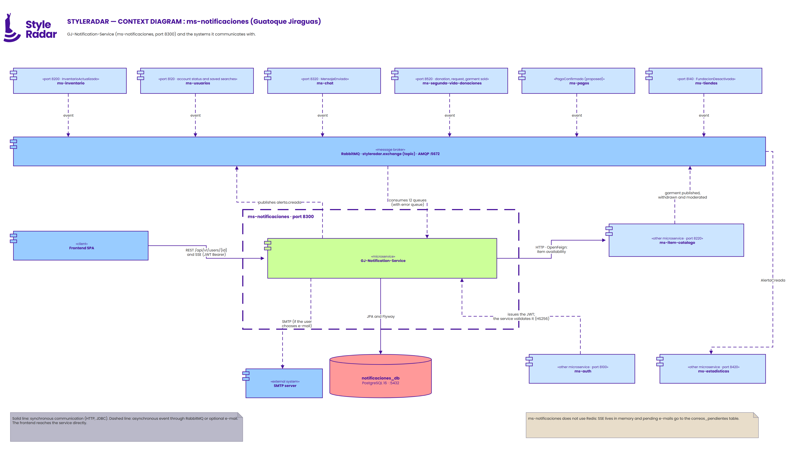
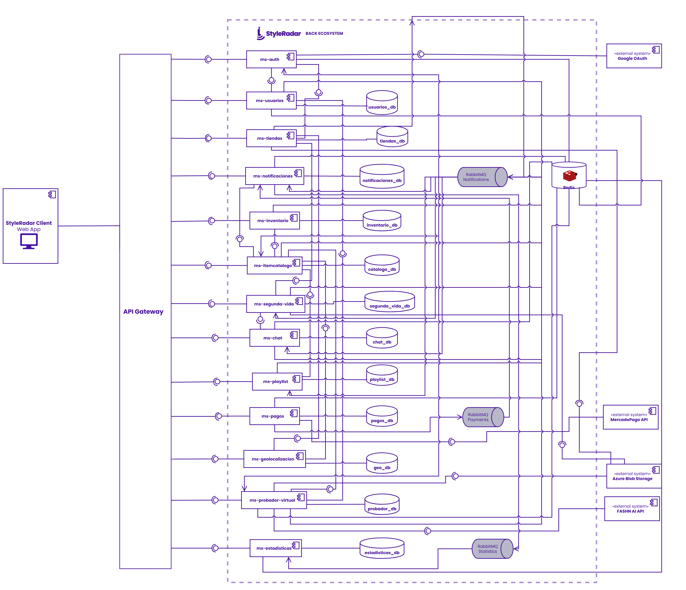
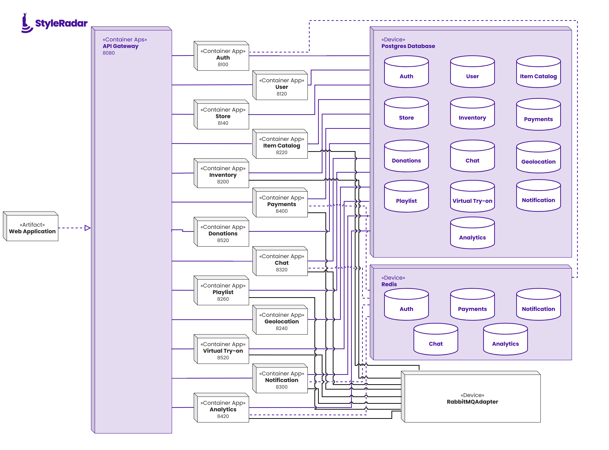

[← Volver al índice](../../README.md) · [Todos los README](./)


##  3. ARQUITECTURA HEXAGONAL CON SU DIAGRAMA

El microservicio implementa **Arquitectura Hexagonal (Puertos y Adaptadores)** combinada con **Domain-Driven Design (DDD)**. El núcleo de negocio permanece 100% puro y aislado de frameworks, bases de datos o brokers de mensajería.

### Diagrama Interactivo de Capas (Mermaid)

```mermaid
flowchart LR
    %% Clientes y Actores Externos
    subgraph EXT_IN["Entrada Externa"]
        CLIENT["Cliente / SPA<br>REST + JWT"]
        BROKER_IN["RabbitMQ Broker<br>Eventos Externos"]
    end

    %% Capa de Infraestructura - Adaptadores de Entrada
    subgraph ADAPTERS_IN["Infraestructura: Entrada"]
        REST_CTRL["AlertaController<br>& AlertaApi"]
        AMQP_LISTENER["NotificacionesEventsListener<br>(Consumer + DLQ)"]
        SCHEDULER["CorreoPendienteRecuperador<br>(al arrancar y cada 60 s)"]
    end

    %% Capa de Aplicacion
    subgraph APPLICATION["Capa de Aplicación"]
        USE_CASES["Casos de Uso (Puertos In)<br>• CrearAlertaUseCase<br>• ListarAlertasUseCase<br>• DesactivarAlertaUseCase<br>• ListarNotificacionesUseCase<br>• MarcarNotificacionLeidaUseCase<br>• ProcesarEventosExternosUseCase<br>• PreferenciasAvisosUseCase<br>• EnviarAvisoPorCorreoUseCase<br>• ReenviarCorreosPendientesUseCase"]
        APP_SERVICES["Servicios de Aplicación<br>• AlertaApplicationService<br>• NotificacionApplicationService"]
    end

    %% Núcleo de Dominio Puro
    subgraph DOMAIN["Núcleo de Dominio (Puro)"]
        ENTITIES["Entidades de Dominio<br>• Alerta<br>• Notificacion<br>• PreferenciaAviso<br>• BusquedaGuardadaCopia<br>• EstadoCuentaCopia<br>• CorreoPendiente"]
        RULES["Reglas y Matcher en Memoria<br>• AlertaValidator<br>• EvaluadorCriteriosMatcher<br>• AlertaCreadaDomainEvent"]
    end

    %% Puertos de Salida
    subgraph PORTS_OUT["Puertos de Salida (SPI)"]
        P_REPOS["Repository Ports<br>• AlertaRepositoryPort<br>• NotificacionRepositoryPort<br>• BusquedaGuardadaPort<br>• EstadoCuentaPort<br>• PreferenciaAvisoRepositoryPort<br>• CorreoPendienteRepositoryPort"]
        P_EXT["Integration Ports<br>• CatalogoClientPort<br>• EventPublisherPort<br>• RealTimeNotificationPort<br>• CorreoPort<br>• EnvioCorreoPort"]
    end

    %% Adaptadores de Salida
    subgraph ADAPTERS_OUT["Infraestructura: Salida"]
        JPA_ADAPTER["Adaptadores JPA<br>PostgreSQL 16 (Flyway)"]
        FEIGN_ADAPTER["CatalogoClientAdapter<br>OpenFeign (:8220)"]
        AMQP_ADAPTER["RabbitMqEventPublisher<br>(Exchange Topic)"]
        SSE_ADAPTER["SseNotificationAdapter<br>(Campana Tiempo Real)"]
        SMTP_ADAPTER["CorreoSmtpAdapter<br>(JavaMailSender)"]
    end

    %% Destinos Externos
    subgraph EXT_OUT["Destinos Externos"]
        DB[(PostgreSQL 16<br>notificaciones_db)]
        CATALOGO["ms-item-catalogo<br>(Validación Stock)"]
        ESTADISTICAS["ms-estadisticas<br>(AlertaCreada)"]
        SSE_CLIENT["Campana Frontend<br>(text/event-stream)"]
        SMTP["Servidor SMTP<br>(opcional)"]
    end

    %% Flujo de Invocación
    CLIENT --> REST_CTRL
    BROKER_IN --> AMQP_LISTENER

    REST_CTRL --> USE_CASES
    AMQP_LISTENER --> USE_CASES
    SCHEDULER --> USE_CASES

    USE_CASES --> APP_SERVICES
    APP_SERVICES --> DOMAIN
    APP_SERVICES --> P_REPOS
    APP_SERVICES --> P_EXT

    P_REPOS -.-> JPA_ADAPTER
    P_EXT -.-> FEIGN_ADAPTER
    P_EXT -.-> AMQP_ADAPTER
    P_EXT -.-> SSE_ADAPTER
    P_EXT -.-> SMTP_ADAPTER

    JPA_ADAPTER --> DB
    FEIGN_ADAPTER --> CATALOGO
    AMQP_ADAPTER --> ESTADISTICAS
    SSE_ADAPTER --> SSE_CLIENT
    SMTP_ADAPTER --> SMTP

    %% Estilos de Alta Claridad y Contraste
    classDef ext fill:#F1F5F9,stroke:#64748B,stroke-width:1.5px,color:#0F172A;
    classDef infra fill:#E0F2FE,stroke:#0284C7,stroke-width:2px,color:#0369A1;
    classDef app fill:#F3E8FF,stroke:#7C3AED,stroke-width:2px,color:#5B21B6;
    classDef dom fill:#FEF3C7,stroke:#D97706,stroke-width:2px,color:#92400E;

    class EXT_IN,EXT_OUT,CLIENT,BROKER_IN,DB,CATALOGO,ESTADISTICAS,SSE_CLIENT,SMTP ext;
    class ADAPTERS_IN,ADAPTERS_OUT,REST_CTRL,AMQP_LISTENER,SCHEDULER,JPA_ADAPTER,FEIGN_ADAPTER,AMQP_ADAPTER,SSE_ADAPTER,SMTP_ADAPTER infra;
    class APPLICATION,PORTS_OUT,USE_CASES,APP_SERVICES,P_REPOS,P_EXT app;
    class DOMAIN,ENTITIES,RULES dom;
```



### Diagramas Oficiales del Microservicio (Draw.io & UML)

> **Regla de Oro de Ingenieria StyleRadar:** Todo diagrama arquitectonico esta respaldado por su archivo fuente editable `.drawio`, su imagen y su justificacion tecnica documentada en [docs/DIAGRAMAS_NOT20.md](../DIAGRAMAS_NOT20.md).
>
> **Idioma:** los ocho diagramas (`.drawio` e imagenes) estan en ingles. Los nombres de clases, metodos, tablas, columnas y colas se dejan tal como estan en el codigo.
>
> **Actualizacion del 17/11/2026:** los diagramas reflejan el codigo de `develop`: `itemId` como texto (UUID), migracion V6, `Alerta.activar()`, `ActivarAlertaUseCaseImpl`, `RateLimitFilter` y `MetricasConfig`.

#### 1. Diagrama de Componentes con Arquitectura Hexagonal (Especifico)
* **Archivo Editable Draw.io:** [`docs/uml/diagrama-componentes-especifico.drawio`](../uml/diagrama-componentes-especifico.drawio)
* **Documentacion y Justificacion Tecnica:** [docs/DIAGRAMAS_NOT20.md (Seccion 2)](../DIAGRAMAS_NOT20.md#2-diagrama-de-componentes-específico-arquitectura-hexagonal)
* **Descripcion:** Modela adaptadores de entrada (Driving: REST Controller, RabbitMQ Listener), la capa de aplicacion (Input Ports, Use Cases, Application Services, DTOs, Mappers), el nucleo de dominio puro (Modelos, Value Objects, Domain Events, Validadores) y adaptadores de salida (Driven: JPA Repositories, Feign Client, Event Publisher, SSE Adapter, SMTP Adapter). Incluye los controladores de alertas y de preferencias de avisos, los 12 consumidores de eventos, el recuperador de correos pendientes (GJ-119), el caso de uso para reactivar alertas (`ActivarAlertaUseCaseImpl`), el filtro de limite de solicitudes (`RateLimitFilter`) y las metricas (`MetricasConfig`). Cada caja muestra solo su estereotipo y su nombre real.

<p align="center">
  <a href="../images/diagrama-componentes-especifico.png" target="_blank">
    
  </a>
</p>

---

#### 2. Diagrama de Clases (Modelo de Dominio y Patrones de Diseno)
* **Archivo Editable Draw.io:** [`docs/uml/diagrama-clases.drawio`](../uml/diagrama-clases.drawio)
* **Documentacion y Justificacion Tecnica:** [docs/DIAGRAMAS_NOT20.md (Seccion 3)](../DIAGRAMAS_NOT20.md#3-diagrama-de-clases-modelo-de-dominio)
* **Descripcion:** Modela las entidades de dominio (`Alerta`, `Notificacion`, `PreferenciaAviso`, `BusquedaGuardadaCopia`, `EstadoCuentaCopia`), Value Objects (`CriterioBusquedaVO`, `DatosPrendaVO`), Enumeraciones (`TipoAlerta`, `TipoNotificacion`, `CanalNotificacion`, `CanalAviso`, `EstadoAlerta`, `EstadoCuenta`) y las reglas del dominio (`AlertaValidator` para las validaciones y `EvaluadorCriteriosMatcher` para el matching en memoria) y la pagina de resultados (`Pagina`), el correo pendiente de reintento (`CorreoPendiente` y `EstadoCorreo`) y las cinco excepciones de dominio (`AccesoDenegadoException`, `ConflictoException`, `RecursoNoEncontradoException`, `ReglaDeNegocioException` y `ServicioExternoNoDisponibleException`, todas hijas de `RuntimeException`), cada una con el codigo HTTP al que se traduce. El dominio no depende de Spring ni de JPA.

<p align="center">
  <a href="../images/diagrama-clases.png" target="_blank">
    
  </a>
</p>

---

#### 3. Diagrama de Base de Datos (Modelo Relacional / ER - PostgreSQL 16)
* **Archivo Editable Draw.io:** [`docs/uml/diagrama-base-datos.drawio`](../uml/diagrama-base-datos.drawio)
* **Documentacion y Justificacion Tecnica:** [docs/DIAGRAMAS_NOT20.md (Seccion 4)](../DIAGRAMAS_NOT20.md#4-diagrama-de-base-de-datos-metamodelo-conceptual-y-físico)
* **Descripcion:** Modela el esquema relacional fisico de PostgreSQL 16 gestionado por Flyway (migraciones V1 a V6; en V6 `item_id` pasa a `VARCHAR(100)` para aceptar UUID): `alertas`, `notificaciones`, `preferencias_avisos`, `busquedas_guardadas_copia`, `estados_cuenta_copia` y `correos_pendientes`, con sus indices y las restricciones unicas que dan la idempotencia. No hay llaves foraneas: los usuarios e items viven en otros servicios (Database-per-Service).

<p align="center">
  <a href="../images/diagrama-base-datos.png" target="_blank">
    
  </a>
</p>

---

#### 4. Diagrama de Contexto del Sistema (C4 L1)
* **Archivo Editable Draw.io:** [`docs/uml/diagrama-contexto.drawio`](../uml/diagrama-contexto.drawio)
* **Documentacion y Justificacion Tecnica:** [docs/DIAGRAMAS_NOT20.md (Seccion 1)](../DIAGRAMAS_NOT20.md#1-diagrama-de-contexto-del-sistema-nivel-c4---l1)
* **Descripcion:** Delimita la frontera del microservicio y sus interacciones con el frontend SPA, broker RabbitMQ (exchange `styleradar.exchange`), microservicio de catalogo (via OpenFeign), identidad, donaciones, chat, pagos, tiendas, estadisticas y el servidor SMTP de los avisos por correo.

<p align="center">
  <a href="../images/diagrama-contexto.png" target="_blank">
    
  </a>
</p>

---

#### 5. Diagrama de Despliegue (Topologia Azure & Docker Hub)
* **Archivo Editable Draw.io:** [`docs/uml/diagrama-despliegue.drawio`](../uml/diagrama-despliegue.drawio)
* **Documentacion y Justificacion Tecnica:** [docs/DIAGRAMAS_NOT20.md (Seccion 5)](../DIAGRAMAS_NOT20.md#5-diagrama-de-despliegue)
* **Descripcion:** Modela la topologia de ejecucion y despliegue continuo: estacion de desarrollo, pipeline de CI/CD en GitHub Actions, repositorio de imagenes en Azure Container Registry, y los ambientes de QA y PROD en Azure App Service (cada uno con su base de datos y su vhost del broker).

---

#### 6. Diagrama de Componentes General (Ecosistema StyleRadar)
* **Archivo Editable Draw.io:** [`docs/uml/diagrama-componentes-general.drawio`](../uml/diagrama-componentes-general.drawio)
* **Documentacion y Justificacion Tecnica:** [docs/DIAGRAMAS_NOT20.md (Seccion 7)](../DIAGRAMAS_NOT20.md#7-diagrama-de-componentes-general-ecosistema-styleradar)
* **Descripcion:** Vista de todo el backend de StyleRadar, compartida por los equipos: el cliente web, el API Gateway, los 13 microservicios con su base de datos propia, las colas de RabbitMQ (Notificaciones, Pagos y Estadisticas), Redis y los sistemas externos (Google OAuth, MercadoPago, Azure Blob Storage y FASHN AI). `ms-notificaciones` aparece con su base `notificaciones_db` y su cola de RabbitMQ. El diagrama lo elaboro el equipo de arquitectura; este servicio solo lo conserva como referencia.

<p align="center">
  <a href="../images/diagrama-componentes-general.png" target="_blank">
    
  </a>
</p>

---

#### 7. Diagrama de Despliegue General (Ecosistema StyleRadar)
* **Archivo Editable Draw.io:** [`docs/uml/diagrama-despliegue-general.drawio`](../uml/diagrama-despliegue-general.drawio)
* **Documentacion y Justificacion Tecnica:** [docs/DIAGRAMAS_NOT20.md (Seccion 8)](../DIAGRAMAS_NOT20.md#8-diagrama-de-despliegue-general-ecosistema-styleradar)
* **Descripcion:** Topologia de ejecucion de todo el ecosistema: la aplicacion web entra por el API Gateway (`8080`) y cada microservicio corre como contenedor en su puerto, con su base en el servidor de PostgreSQL, su espacio en Redis cuando lo usa y su conexion al broker RabbitMQ. `ms-notificaciones` corre en el puerto `8300`. El de este servicio en detalle es el diagrama 5.

<p align="center">
  <a href="../images/diagrama-despliegue-general.png" target="_blank">
    
  </a>
</p>

### Estructura Oficial de Paquetes en `src/main/java/`

```text
src/main/java/edu/dosw/styleradar/notificaciones/
├── NotificacionesApplication.java           <-- Punto de entrada Spring Boot + @EnableFeignClients
├── domain/                                  <-- NÚCLEO DE DOMINIO (Cero dependencias de Spring/JPA)
│   ├── model/                               <-- Alerta, Notificacion, PreferenciaAviso, BusquedaGuardadaCopia, EstadoCuentaCopia, VO y Enums
│   ├── validator/                           <-- AlertaValidator y EvaluadorCriteriosMatcher (matching en memoria)
│   ├── event/                               <-- AlertaCreadaDomainEvent
│   ├── exception/                           <-- Excepciones semánticas de negocio
│   └── port/
│       ├── in/                              <-- Interfaces de Casos de Uso (CrearAlerta, Listar, Desactivar, MarcarLeida, ProcesarEventos, PreferenciasAvisos, EnviarAvisoPorCorreo)
│       └── out/                             <-- Interfaces SPI (Repositorios, CatalogoClientPort, EventPublisherPort, RealTimeNotificationPort, CorreoPort)
├── application/                             <-- CAPA DE APLICACIÓN (Casos de Uso y Mappers)
│   ├── usecase/                             <-- Implementaciones puras de casos de uso (*UseCaseImpl)
│   ├── dto/
│   │   ├── request/                         <-- CrearAlertaRequest y PreferenciaAvisoRequest (Java Record)
│   │   ├── response/                        <-- AlertaResponse, NotificacionResponse, ContadorNoLeidasResponse, PreferenciaAvisoResponse
│   │   └── event/                           <-- Payloads de eventos RabbitMQ (Inventario, Prenda, Usuario, Chat, Donación, Pago)
│   └── mapper/
│       └── in/                              <-- MapStruct DTO <-> Domain (AlertaDtoMapper, NotificacionDtoMapper)
└── infrastructure/                          <-- CAPA DE INFRAESTRUCTURA (Adaptadores y Configuración)
    ├── adapter/
    │   ├── in/
    │   │   ├── rest/                        <-- AlertaController, PreferenciaAvisoController y contratos OpenAPI segregados en doc/
    │   │   └── amqp/                        <-- NotificacionesEventsListener (@RabbitListener + manejo hacia DLQ)
    │   └── out/
    │       ├── persistence/                 <-- Entidades JPA, SpringDataRepositories, Adapters transaccionales y mapper/ (MapStruct dominio-entidad)
    │       ├── external/                    <-- CatalogoFeignClient y CatalogoClientAdapter
    │       ├── messaging/                   <-- RabbitMqEventPublisherAdapter
│       ├── mail/                        <-- CorreoSmtpAdapter (JavaMailSender, hilo aparte, 3 intentos con espera creciente)
    │       └── sse/                         <-- SseRealTimeNotificationAdapter (empuja cada notificación por SSE)
    ├── security/                            <-- JwtTokenService, JwtAuthenticationFilter y SecurityContextUserExtractor
    ├── sse/                                 <-- SseEmitterRegistry (conexiones SSE abiertas por usuario)
    └── config/                              <-- BeanConfig, SecurityConfig, RabbitMqConfig, RabbitRetryConfig, CorreoConfig, OpenApiConfig, GlobalExceptionHandler
```
