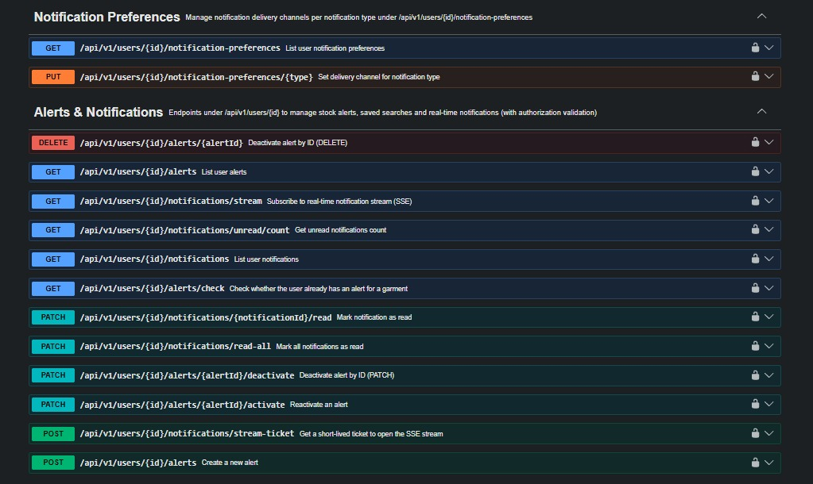

[← Volver al índice](../../README.md) · [Todos los README](./)


##  4. ENDPOINTS Y ENLACE A SWAGGER

La documentación interactiva OpenAPI 3.0 y los contratos de ejecución se encuentran desplegados y clasificados por entorno:

> [!IMPORTANT]
> **Alcance Exclusivo del Microservicio:** Esta documentación Swagger y especificación OpenAPI 3.0 pertenece **única y exclusivamente al Microservicio de Notificaciones y Alertas (`ms-notificaciones` / Puerto 8300)** del equipo **Guatoque Jiraguas (GJ)**. No contiene ni mezcla endpoints de otros microservicios del ecosistema (como autenticación, usuarios, tiendas o catálogo), garantizando el desacoplamiento estricto por servicio (Database-per-Service & API Isolation).

### Matriz Oficial de Enlaces de Swagger para `ms-notificaciones`

| Entorno | Estado | Propósito | URL Base del Servicio | Swagger OpenAPI UI | Health Check |
| :--- | :---: | :--- | :--- | :--- | :--- |
| **Desarrollo Local / Docker (DEV)** | Local | Entorno de desarrollo local en máquina | `http://localhost:8300` | [Swagger UI Local](http://localhost:8300/swagger-ui/index.html) | [`/actuator/health`](http://localhost:8300/actuator/health) |
| **Producción (PROD)** | Desplegado | Despliegue productivo de StyleRadar (Azure App Service `styleradar-notificaciones-prod`) | `https://styleradar-notificaciones-prod.azurewebsites.net` | Apagado en PROD (`SWAGGER_ENABLED=true` lo enciende) | [`/actuator/health`](https://styleradar-notificaciones-prod.azurewebsites.net/actuator/health) |
| **Calidad / Pruebas (QA)** | Desplegado | Pruebas integradas de Sprint y QA (Azure App Service `styleradar-notificaciones-qa`) | `https://styleradar-notificaciones-qa.azurewebsites.net` | [Swagger UI QA](https://styleradar-notificaciones-qa.azurewebsites.net/swagger-ui/index.html) | [`/actuator/health`](https://styleradar-notificaciones-qa.azurewebsites.net/actuator/health) |

* **Especificación OpenAPI (Contrato JSON Schema):** `http://localhost:8300/v3/api-docs` (o `/v3/api-docs` en el dominio de QA).


### Captura de Swagger UI

<p align="center">
  
</p>

<p align="center">
  <sub>Swagger UI de <code>ms-notificaciones</code>: grupos <b>Notification Preferences</b> (2 endpoints) y <b>Alerts &amp; Notifications</b> (12 endpoints), 14 en total bajo <code>/api/v1/users/{id}</code>.</sub>
</p>

### Tabla de Endpoints Expuestos

> **Nota de Arquitectura REST y Estandarización de Endpoints en Inglés (/api/v1/users/{id}):**  
> Siguiendo la directriz oficial del proyecto StyleRadar para el API Gateway y consistencia entre microservicios, todos los endpoints canónicos comienzan con **`/api/v1`** y están completamente definidos en inglés bajo la convención REST: **`/api/v1/users/{id}/...`**.
>
> **Seguridad y Validación de Autorización:**  
> La seguridad del backend extrae el usuario autenticado del token JWT (`sub` o `userId`) y valida que coincida exactamente con el `{id}` de la ruta (o que cuente con privilegios de administrador). Si un usuario intenta consultar o manipular los recursos de otro usuario (por ejemplo un token de usuario 101 solicitando `/api/v1/users/202/...`), el backend rechaza la petición inmediatamente retornando **`HTTP 403 Forbidden`** bajo el estándar RFC 7807 (Problem Details).
>
> **Formato de errores:** todos los errores son `application/problem+json` con `type: "about:blank"`, `title`, `status`, `detail`, `instance`, `mensaje`, `timestamp` y un `code` estable (por ejemplo `ALERT_NOT_FOUND`, `ALERT_ALREADY_ACTIVE`, `ITEM_HAS_STOCK`, `SAVED_SEARCH_NOT_AVAILABLE`, `ACCOUNT_NOT_ALLOWED`, `RATE_LIMITED`). El front elige su mensaje a partir de `code`, no del texto de `detail`. En los 400 de validación, `errors` trae un mensaje por campo. La lista completa de códigos está en el Swagger (esquema `ProblemDetail`).
>
> *Nota de compatibilidad:* Por interoperabilidad con las pruebas existentes y clientes previos, el servicio también responde de forma transparente a las rutas alias en español (`/alertas`, `/notificaciones`, `/preferencias-avisos`), sin prefijo `/users/{id}/...` y `/api/v1/usuarios/{id}/...`, y con el alias `/me`.

|  Método  | Endpoint Canónico (Inglés) | Descripción | Rol Requerido | Códigos HTTP |
| :--------: | :---------------------------- | :----------------------------------------- | :-------------------- | :-----------------------: |
|  `GET`  | `/actuator/health` | Health Check y estado del microservicio | Público | `200` |
|  `POST`  | `/api/v1/users/{id}/alerts` | Crea una alerta sobre prenda agotada o búsqueda guardada con canal `IN_APP`, `EMAIL`, `PUSH` o `AMBOS` (SR-RF-29 / NOT-05 / NOT-10) | Autenticado (`JWT`) | `201`, `400`, `401`, `403`, `409`, `422`, `429`, `503` |
|  `GET`  | `/api/v1/users/{id}/alerts/check` | Estado inicial del botón «Avisarme cuando llegue»: con `?itemId=` y `?tallaObjetivo=` responde `suscrita` y el `alertaId` si ya hay una alerta activa para esa prenda y talla (SR-RF-29) | Autenticado (`JWT`) | `200`, `400`, `401`, `403`, `429` |
|  `GET`  | `/api/v1/users/{id}/alerts` | Lista todas las alertas del usuario autenticado, incluyendo `nombreBusqueda` en las de búsqueda guardada (SR-RF-32 / NOT-05) | Autenticado (`JWT`) | `200`, `401`, `403`, `429` |
| `DELETE` | `/api/v1/users/{id}/alerts/{alertId}` | Desactiva una alerta perteneciente al usuario autenticado (SR-RF-32 / NOT-05) | Propietario (`JWT`) | `200`, `401`, `403`, `404`, `429` |
| `PATCH` | `/api/v1/users/{id}/alerts/{alertId}/deactivate` | Ruta alternativa PATCH para desactivar alerta (SR-RF-32 / NOT-05) | Propietario (`JWT`) | `200`, `401`, `403`, `404`, `429` |
| `PATCH` | `/api/v1/users/{id}/alerts/{alertId}/activate` | Reactiva una alerta desactivada con las mismas reglas que al crearla: sin otra alerta activa igual (409), prenda aún agotada o búsqueda activa (422) y catálogo disponible (503). Si ya está activa la devuelve sin cambios (SR-RF-32) | Propietario (`JWT`) | `200`, `401`, `403`, `404`, `409`, `422`, `429`, `503` |
|  `GET`  | `/api/v1/users/{id}/notifications` | Lista las notificaciones del usuario. Sin parámetros devuelve un arreglo; con `?page=0&size=20` o `?read=true/false` (único filtro de lectura: `true` leídas, `false` no leídas) devuelve una página (NOT-05 / NOT-12 / GJ-118) | Autenticado (`JWT`) | `200`, `400`, `401`, `403`, `429` |
| `PATCH` | `/api/v1/users/{id}/notifications/{notificationId}/read` | Marca una notificación específica como leída (NOT-13) | Propietario (`JWT`) | `200`, `401`, `403`, `404`, `429` |
| `PATCH` | `/api/v1/users/{id}/notifications/read-all` | Marca todas las notificaciones del usuario como leídas (NOT-13) | Autenticado (`JWT`) | `200`, `401`, `403`, `429` |
|  `GET`  | `/api/v1/users/{id}/notifications/unread/count` | Obtiene el contador de notificaciones sin leer para la campana (NOT-13) | Autenticado (`JWT`) | `200`, `401`, `403`, `429` |
|  `GET`  | `/api/v1/users/{id}/notifications/stream` | Suscripción Server-Sent Events (`text/event-stream`) para campana en tiempo real con soporte `Last-Event-ID` (NOT-15, GJ-62). El navegador no puede enviar la cabecera con `EventSource`: se abre con `?ticket=<ticket>` (ver la fila siguiente) | Autenticado (`JWT` en la cabecera o ticket en `?ticket=`) | `200`, `401`, `403`, `429` |
|  `POST`  | `/api/v1/users/{id}/notifications/stream-ticket` | Entrega un ticket de vida corta (60 s) que solo sirve para abrir el stream. El JWT de sesión nunca viaja en la URL: un JWT en `?ticket=` o `?access_token=` se rechaza y el ticket no abre ningún otro endpoint | Autenticado (`JWT`) | `200`, `401`, `403`, `429` |
|  `GET`  | `/api/v1/users/{id}/notification-preferences` | Lista los canales configurados por tipo de notificación (GJ-64) | Autenticado (`JWT`) | `200`, `401`, `403`, `429` |
|  `PUT`  | `/api/v1/users/{id}/notification-preferences/{type}` | Configura `SOLO_PLATAFORMA` o `CORREO_Y_PLATAFORMA` por tipo de aviso (GJ-64) | Autenticado (`JWT`) | `200`, `400`, `401`, `403`, `429` |

<details>
<summary><b>Click para ver Ejemplos Interactivos de Request y Response JSON (Payloads)</b></summary>

<br>

#### Ejemplo Request (`POST /api/v1/users/{id}/alerts`)

```bash
curl -X POST "http://localhost:8300/api/v1/users/101/alerts" \
  -H "Content-Type: application/json" \
  -H "Authorization: Bearer <JWT_TOKEN>" \
  -d '{
    "tipoAlerta": "ITEM_AGOTADO",
    "itemId": "3fa85f64-5717-4562-b3fc-2c963f66afa6",
    "tallaObjetivo": "M",
    "canal": "IN_APP"
  }'
```

#### Ejemplo Response Exitoso (`201 Created`)

```json
{
  "id": 1,
  "usuarioId": 501,
  "tipoAlerta": "ITEM_AGOTADO",
  "itemId": "3fa85f64-5717-4562-b3fc-2c963f66afa6",
  "tallaObjetivo": "M",
  "busquedaGuardadaId": null,
  "nombreBusqueda": null,
  "canal": "IN_APP",
  "estado": "ACTIVA",
  "fechaCreacion": "2026-11-02T12:00:00",
  "fechaActualizacion": "2026-11-02T12:00:00"
}
```

</details>
