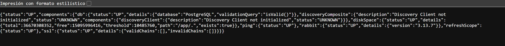

[← Volver al índice](../../README.md) · [Todos los README](./)


##  7. CÓMO EJECUTAR LOCAL Y CON DOCKER

### Prerrequisitos de Entorno

* **Java Development Kit (JDK):** Versión 21 LTS instalada (`java -version`).
* **Apache Maven:** Versión 3.9+ instalada (`mvn -version`).
* **Docker Engine & Docker Compose:** Versión 24+ en ejecución (`docker --version`).

### Ejecución Local con Maven (Perfil Dev)

```bash
# 1. Clonar el repositorio
git clone https://github.com/StyleRadar1/GJ-Notification-Service.git
cd GJ-Notification-Service

# 2. Levantar la infraestructura en Docker (PostgreSQL, Redis y RabbitMQ).
#    El servicio no usa Redis; el perfil dev lo conserva solo para su indicador de salud.
docker compose up -d notificaciones-db notificaciones-redis event-broker

# 3. Ejecutar el microservicio localmente en el puerto 8300
mvn clean spring-boot:run -Dspring-boot.run.profiles=dev
```

### Ejecución Contenerizada Completa con Docker

<details>
<summary><b>Ver comandos de Docker y docker-compose</b></summary>

<br>

```bash
# Compilar y empaquetar el JAR ejecutable omitiendo tests
mvn clean package -DskipTests

# Construir la imagen OCI local
docker build -t styleradar/ms-notificaciones:v1.0 .

# Levantar toda la pila (base de datos + redis + rabbitmq + microservicio)
docker compose up --build -d

# Ver el estado de los contenedores y detener la pila
docker compose ps
docker compose down
```

</details>

### Comprobación de Salud (Health Check)

```bash
curl -s http://localhost:8300/actuator/health
# Esperado: {"status":"UP"}
```

Una vez arriba, Swagger UI queda en `http://localhost:8300/swagger-ui/index.html` y las pruebas se corren como se explica en la [sección 9](09-pruebas-y-cobertura.md).

### Comprobación de salud en QA

Así responde `/actuator/health` del servicio desplegado en Azure App Service (QA): base de datos PostgreSQL, broker RabbitMQ, espacio en disco, `ping` y certificados en `UP`. El bloque `discoveryComposite` aparece `UNKNOWN` porque el servicio no usa un servidor de descubrimiento.

<p align="center">
  
</p>
