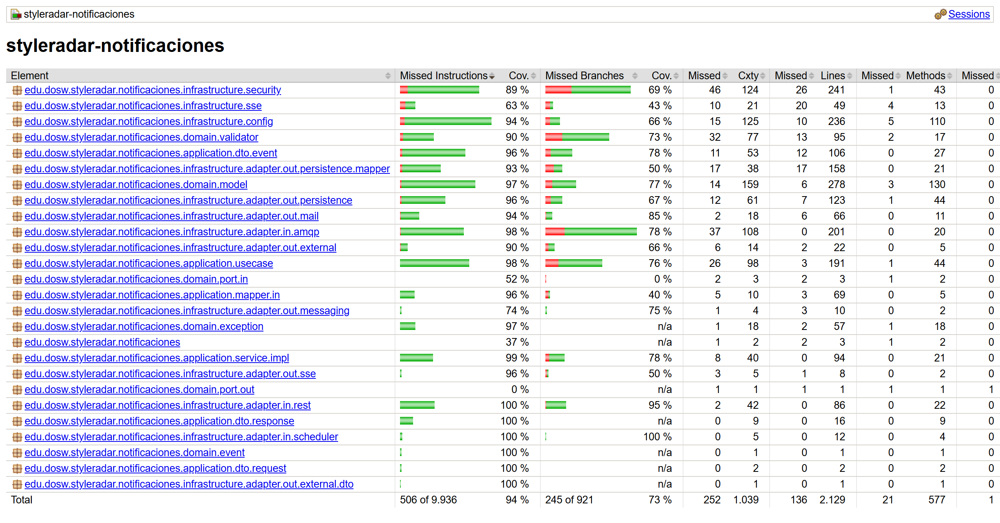

[← Volver al índice](../../README.md) · [Todos los README](./)


##  9. PRUEBAS Y COBERTURA (≥ 85%)

El proyecto exige una cobertura de código mínima del **85%** verificada automáticamente mediante el plugin de **JaCoCo** durante la fase de compilación.

### Comandos de Ejecución de Pruebas

```bash
# Ejecutar todas las pruebas unitarias y de integración con verificación JaCoCo >= 85%
mvn clean verify

# Generar únicamente el reporte HTML de JaCoCo
mvn jacoco:report
```

* **Ruta del Reporte HTML:** `target/site/jacoco/index.html`

<div align="center">
  <table width="100%" style="margin: 18px 0; border: 2px dashed #5600EF; border-radius: 8px; background-color: #FBFBFE;">
    <tr>
      <td align="center" style="padding: 22px;">
        <p>
          <br />
          <strong><font color="#5600EF" size="3">REPORTE CONSOLIDADO DE COBERTURA JACOCO (≥ 85%)</font></strong>
        </p>
        <p>
          <sub>Pega aquí la captura del reporte HTML (<code>target/site/jacoco/index.html</code>) evidenciando el cumplimiento de la cobertura mínima obligatoria (≥ 85%).</sub>
        </p>
        <p>
          <br />
        </p>
      </td>
    </tr>
  </table>
</div>


### Pirámide de Pruebas Implementada

| Nivel de Prueba | Alcance | Tecnologías Utilizadas | Ubicación en el Código | Cobertura Meta |
| :--- | :--- | :--- | :--- | :---: |
| **Pruebas Unitarias de Dominio** | `AlertaValidator`, `EvaluadorCriteriosMatcher` y modelos puros | JUnit 5, AssertJ | `src/test/java/.../unit/domain/` | ≥ 90% |
| **Pruebas Unitarias de Aplicación** | Casos de uso aislados (`CrearAlerta`, `Listar`, `Desactivar`, `ProcesarEventos`, `PreferenciasAvisos`, `EnviarAvisoPorCorreo`) y adaptador de correo con reintentos | JUnit 5, Mockito, AssertJ | `src/test/java/.../unit/application/` | ≥ 90% |
| **Pruebas de Integración y Contrato** | Controladores REST, Seguridad JWT, Flyway, Repositorios JPA, Consumidores AMQP, SSE y correo | Spring Boot Test, MockMvc, H2 PostgreSQL Mode, GreenMail | `src/test/java/.../integration/` | ≥ 85% |
| **Pruebas con RabbitMQ real** | Publicación de `AlertaCreada` y consumo de eventos contra un broker real | Testcontainers (requieren Docker; en un equipo sin Docker se omiten y las corre el CI) | `src/test/java/.../integration/messaging/` | — |

Estado actual: **169 pruebas, 0 fallos, cobertura de líneas 94,0 %** (11 pruebas con Docker omitidas en un equipo sin Docker).

> [!IMPORTANT]
> **Criterio de Fallo en CI:** El archivo `pom.xml` contiene la regla `<limit><minimum>0.85</minimum></limit>`. Si la cobertura total consolidada es inferior al 85%, el comando `mvn verify` fallará con error y el pipeline bloqueará el Pull Request.
