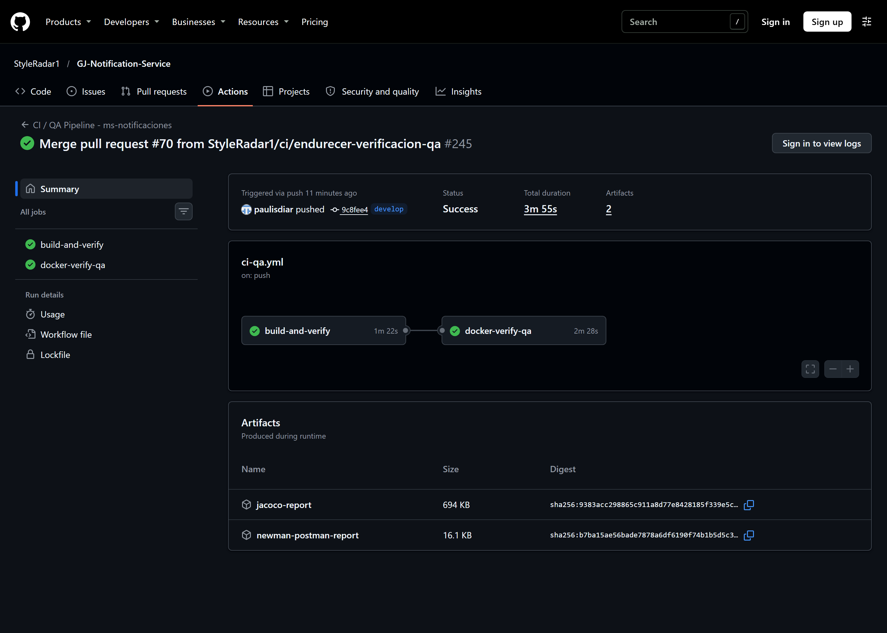
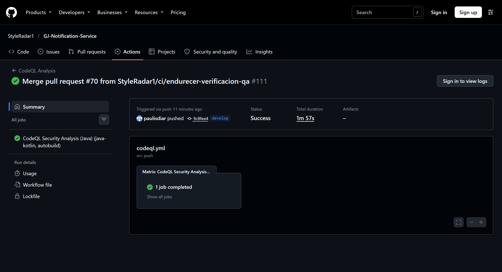

[← Volver al índice](../../README.md) · [Todos los README](./)

##  10. CI/CD CON EL BADGE DEL PIPELINE

El ciclo de vida del software implementa integración continua y entrega continua automatizada mediante **GitHub Actions**. Los flujos viven en [`.github/workflows/`](../../.github/workflows/) y las actualizaciones de dependencias las propone Dependabot ([`.github/dependabot.yml`](../../.github/dependabot.yml)).

### Matriz de Pipelines por Entorno (PROD y QA)

| Pipeline | Entorno Destino | Desencadenador (Trigger) | Quality Gate Exigido | Badge de Estado |
| :--- | :--- | :--- | :--- | :---: |
| **CI / QA** (`ci-qa.yml`) | Calidad (`QA`) | Push a `develop` o a ramas `feature/**`; Pull Requests hacia `develop` o `main`; ejecución manual | `mvn verify` + JaCoCo de líneas ≥ 85% + imagen Docker + pila `docker compose` sana + Newman local; en push además publica la imagen, despliega en QA, comprueba `/actuator/health` y corre Newman contra QA |  |
| **CD / PROD** (`cd-prod.yml`) | Producción (`PROD`) | Push (fusión) a `main`; solo se despliega desde `main` | `mvn verify` + JaCoCo ≥ 85% + imagen OCI publicada + despliegue en Azure App Service PROD + comprobación de `/actuator/health` |  |
| **Análisis estático de seguridad** (`codeql.yml`) | Transversal | Push y Pull Requests a `develop`; todos los lunes a las 06:00 UTC | CodeQL para Java sin alertas |  |

### Diagrama del Flujo Automatizado (Pipeline Stages)

```mermaid
flowchart LR
    A["Push / PR<br>(GitHub)"] --> B["Build y tests<br>(Maven, Java 21)"]
    B --> C["JaCoCo<br>(líneas ≥ 85%)"]
    C --> D["Imagen Docker<br>+ compose + Newman local"]
    D --> E["Publica imagen<br>(registro de contenedores)"]
    E --> F["Despliegue en QA<br>(App Service)"]
    F --> G["Health check<br>+ Newman en QA"]
    G --> H["Fusión a main"]
    H --> I["CD PROD<br>(verify, imagen, despliegue, health)"]

    classDef step fill:#12063A,stroke:#5600EF,stroke-width:2px,color:#FFFFFF;
    classDef pass fill:#DCFCE7,stroke:#16A34A,stroke-width:2px,color:#0C0C12;

    class A,B,D,E,F,H,I step;
    class C,G pass;
```

En los Pull Requests solo corre la parte de verificación (compilar, probar, cobertura y análisis); el despliegue a QA ocurre al fusionar en `develop`. Si la verificación en QA se encuentra con un plan de Azure lento, el calentamiento y los reintentos de Newman (3 intentos por carpeta) evitan falsos rojos.

### Evidencia de ejecución

Ejecución real del pipeline de CI/CD sobre `develop` (en verde: `build-and-verify` y `docker-verify-qa`):

  

Ejecución real del análisis CodeQL sobre `develop`:

  

  Capturas de las páginas públicas de GitHub Actions del 20/11/2026; el historial completo está en la pestaña <b>Actions</b> del repositorio.

