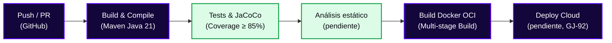

[← Volver al índice](../../README.md) · [Todos los README](./)

##  10. CI/CD CON EL BADGE DEL PIPELINE

El ciclo de vida del software implementa integración continua y entrega continua automatizada mediante **GitHub Actions**:

### Matriz de Pipelines por Entorno (PROD y QA)

| Pipeline | Entorno Destino | Desencadenador (Trigger) | Quality Gate Exigido | Badge de Estado |
| :--- | :--- | :--- | :--- | :---: |
| **CI - Staging / QA** | Calidad (`QA`) | Push a `develop` o a ramas `feature/**` | Build OK + Tests Unitarios/Integración + JaCoCo ≥ 85% + Docker Build |  |
| **CD - Producción (PROD)** | Producción (`PROD`) | Merge a rama `main` tras validación QA | Verificación completa + Imagen OCI lista para despliegue |  |
| **Análisis estático (SonarQube)** | Transversal | Pendiente de configurar en el CI | Meta: 0 Vulnerabilidades, 0 Bugs, Deuda Técnica &lt; 5% | Pendiente |

### Diagrama del Flujo Automatizado (Pipeline Stages)

### Metas de calidad en SonarQube (pendiente de configurar)

* **Bugs:** 0
* **Vulnerabilidades:** 0
* **Hotspots de Seguridad:** 0 revisados al 100%
* **Code Smells Críticos:** 0
* **Deuda Técnica:** < 5%

  <table width="100%" style="margin: 18px 0; border: 2px dashed #5600EF; border-radius: 8px; background-color: #FBFBFE;">
    <tr>
      <td align="center" style="padding: 22px;">
        

           
          <strong>EJECUCIÓN DEL PIPELINE CI/CD EN VERDE (BUILD & QUALITY GATE PASSED)</strong>
        

        

          Pega aquí la captura del pipeline de integración continua (Azure DevOps / GitHub Actions) finalizado con éxito en todas sus fases.
        

        

           
        

      </td>
    </tr>
  </table>

