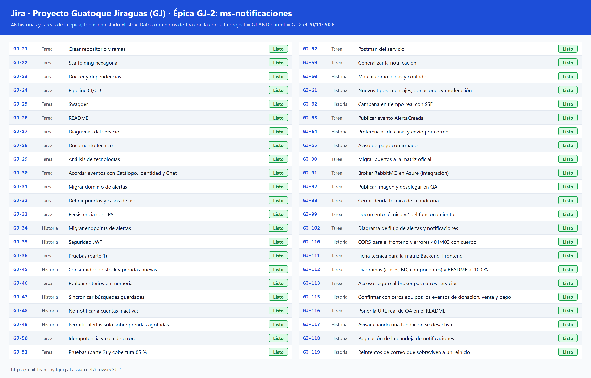

[← Volver al índice](../../README.md) · [Todos los README](./)

##  12. ENLACE A LA ÉPICA EN JIRA

El seguimiento de requerimientos, evidencias y artefactos de entrega se centraliza en los siguientes enlaces oficiales:

### Enlaces de Gestión, Repositorios y Evidencias

* **Épica Oficial del Microservicio (Jira):** [GJ-2 · ms-notificaciones](https://mail-team-nyjtgqcj.atlassian.net/browse/GJ-2)
* **Proyecto en Jira (GJ):** [https://mail-team-nyjtgqcj.atlassian.net/browse/GJ](https://mail-team-nyjtgqcj.atlassian.net/browse/GJ)
* **API Swagger en Producción (PROD):** apagado por seguridad (`SWAGGER_ENABLED=false`); la especificación se consulta en QA o en local. Se enciende con `SWAGGER_ENABLED=true` en el App Service.
* **API Swagger en Calidad (QA):** [https://styleradar-notificaciones-qa.azurewebsites.net/swagger-ui/index.html](https://styleradar-notificaciones-qa.azurewebsites.net/swagger-ui/index.html)
* **Swagger UI local (:8300):** [http://localhost:8300/swagger-ui/index.html](http://localhost:8300/swagger-ui/index.html)
* **Especificación OpenAPI 3.0 JSON Schema:** [http://localhost:8300/v3/api-docs](http://localhost:8300/v3/api-docs)
* **Documento de Análisis y Justificación de Decisiones Tecnológicas:** [docs/ANALISIS_DECISIONES_TECNOLOGICAS.md](../ANALISIS_DECISIONES_TECNOLOGICAS.md)
* **Contratos y Especificación de Eventos Asíncronos (NOT-21):** [docs/CONTRATOS_EVENTOS_NOT21.md](../CONTRATOS_EVENTOS_NOT21.md)
* **Contrato de autenticación JWT (GJ-35):** [docs/CONTRATO_JWT_AUTENTICACION.md](../CONTRATO_JWT_AUTENTICACION.md)
* **Colección de Pruebas Postman:** [postman/styleradar-notificaciones.postman_collection.json](../../postman/styleradar-notificaciones.postman_collection.json)
* **Documento de requerimientos de notificaciones (v5):** [docs/requerimientos](../requerimientos/)
* **Diagramas UML Oficiales en Draw.io:** [docs/uml/](../uml/)
* **Documentación Arquitectónica y Justificaciones (NOT-20):** [docs/DIAGRAMAS_NOT20.md](../DIAGRAMAS_NOT20.md)

### Seguimiento en Jira

La épica **GJ-2** reúne 46 historias y tareas de `ms-notificaciones`, todas en estado **Listo**. La imagen se generó con los datos que devuelve Jira para la consulta `project = GJ AND parent = GJ-2` el 20/11/2026.

  

### Requerimientos Funcionales y No Funcionales Asignados (Numeración Unificada)

Los actores son los cuatro oficiales y se muestran en el [diagrama de casos de uso](../DIAGRAMAS_NOT20.md#9-diagrama-de-casos-de-uso).

| Código RF / RNF | Nombre del Requerimiento | Actor Principal | Criterio de Aceptación Clave |
| :---: | :--- | :--- | :--- |
| `SR-RF-29` | Configurar alerta de disponibilidad | Usuario comprador | Crea alertas sobre prenda agotada (`ITEM_AGOTADO`, `itemId` UUID/texto) o búsqueda guardada (`BUSQUEDA_GUARDADA`) con canal `IN_APP`, `EMAIL`, `PUSH` o `AMBOS`; valida que la prenda esté sin stock en `ms-item-catalogo` (NOT-10), comprueba estado inicial con `GET /alerts/check`, devuelve `nombreBusqueda` y publica `AlertaCreada`. |
| `SR-RF-30` | Detectar prendas que coinciden con una alerta | Administrador de almacén (secundario: usuario comprador) | Evalúa criterios en memoria al recibir `InventarioActualizado` (tolerante a `stockAnterior` opcional) y `PrendaPublicada`, y desactiva alertas ante `PrendaRetirada` o búsqueda eliminada (NOT-06, NOT-07, NOT-08). |
| `SR-RF-31` | Notificar coincidencia o reposición de una prenda | Usuario comprador (secundario: administrador de almacén) | Genera una sola notificación por `(alerta_id, item_id, ciclo_reposicion)`, la empuja en tiempo real por SSE y envía correo si la preferencia del tipo es `CORREO_Y_PLATAFORMA` o si el canal de la alerta es `EMAIL` o `AMBOS`, con reintentos persistentes en `correos_pendientes` (NOT-11, GJ-119). |
| `SR-RF-32` | Consultar, desactivar y reactivar alertas | Usuario comprador | Permite listar sus alertas (con `nombreBusqueda`), desactivarlas (`DELETE` o `PATCH /deactivate`) sin borrar la búsqueda guardada y reactivarlas (`PATCH /activate`) validando disponibilidad y ausencia de duplicados (NOT-05). |
| `SR-RF-104` | Consultar la bandeja de notificaciones | Usuario comprador, administrador de almacén y representante de fundación aliada | Permite listar con paginación (`page`, `size`) y filtro único `read` (`true` leídas, `false` no leídas), contar no leídas, marcar como leída (individual/todas) y abrir el stream SSE mediante ticket de 60 s (`POST /stream-ticket`) con reconexión `Last-Event-ID` (NOT-12, NOT-13, NOT-15, GJ-62, GJ-118). |
| `SR-RF-105` | Elegir el canal de cada tipo de aviso | Usuario comprador, administrador de almacén y representante de fundación aliada | Permite consultar y elegir por cada uno de los 9 valores de `TipoNotificacion` entre `SOLO_PLATAFORMA` (por defecto) y `CORREO_Y_PLATAFORMA` (GJ-64). |
| `SR-RF-106` | Avisar la actividad de otros módulos | Usuario comprador, administrador de almacén y representante de fundación aliada (lo origina también el administrador StyleRadar) | Genera notificaciones idempotentes por `(evento_id, usuario_id)` al recibir eventos de `ms-chat`, `ms-segunda-vida-donaciones`, `ms-item-catalogo`, `ms-pagos` y `ms-tiendas` (fundación desactivada), excluyendo cuentas en estado `INACTIVO`, `BLOQUEADO` o `SUSPENDIDO` (NOT-09, NOT-14, GJ-61, GJ-65, GJ-117). |
| `SR-RNF-15` | Resiliencia e idempotencia en consumidores de eventos | No aplica (requerimiento no funcional) | 3 entregas totales con backoff ante fallos transitorios, rechazo inmediato sin reencolar hacia `styleradar.notificaciones.dlq` ante payloads inválidos, restricciones únicas en PostgreSQL 16 y errores HTTP con campo `code` estable (`CodigoError`). |
